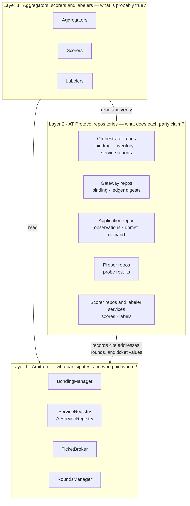
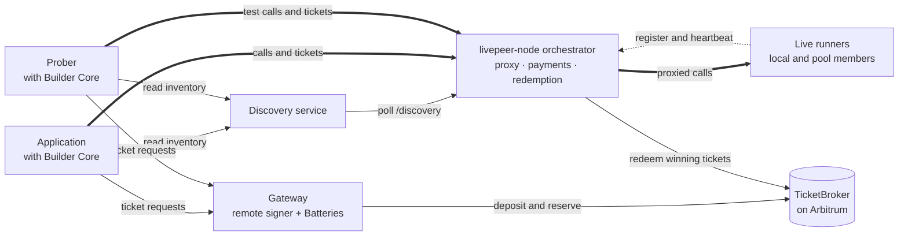
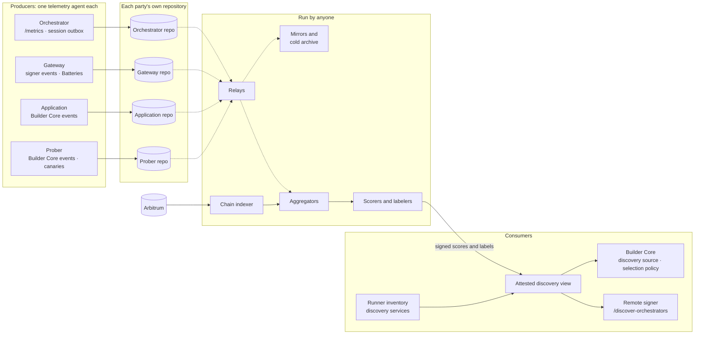

# Operator-Owned Telemetry for the Livepeer Network

*A design proposal for collecting Livepeer job data without a central collector, using AT Protocol for publication and Livepeer's on-chain state for trust.*

**Status:** Draft for design feedback · **Revised:** 2026-11-04 (first draft 2026-09-28) · **Scope:** Live Runner work on livepeer-node, used by applications built on Livepeer Builder Core

**What changed in this revision.** The first draft was written for go-livepeer, which is now deprecated. This revision targets the software that replaces it:
- livepeer-node: the orchestrator, the remote signer and the discovery service;
- Clearinghouse Batteries;
- the Python gateway SDK;
- Livepeer Builder Core, the engine that enterprise applications build on.

It also adopts the main corrections from the [implementation plan](implementation-plan.md):
- `did:plc` as the default identity;
- one record per publisher per window;
- a single telemetry agent for every role;
- a publication policy that protects participants' business data.

The go-livepeer version remains in git history.

An update on 2026-11-04 follows two upstream changes: livepeer-node now lets one runner serve several apps, and Builder Core's events feed moved to its M4.

**New to AT Protocol?** Start with the [AT Protocol primer for Livepeer operators](at-protocol-primer.md).

**Appendices:**
[A. Record schemas](appendix-a-record-schemas.md) ·
[B. Change list](appendix-b-change-list.md) ·
[C. Decisions and open questions](appendix-c-decisions-and-open-questions.md) ·
[D. Sequence diagrams](appendix-d-sequence-diagrams.md)

---

## Summary

Applications built on Livepeer Builder Core need to know which orchestrators serve their workloads well. The Network Engineering SPE plans to onboard more of these applications. Today each one finds out alone:
- ChatLPT keeps a hand-picked list of five orchestrators.
- inference-gateway keeps its own list, plus TLS trust pins and test reports committed to its repository.

Neither application can share what it learns. Neither can check what an orchestrator claims about itself.

The data needed to do better already exists, but each party keeps its share privately:
- orchestrators export detailed metrics per application and runner to their own monitoring;
- remote signers record every payment they sign into their operators' Batteries ledgers;
- Builder Core records the outcome and cost of every call an application makes.

We propose that each party publish what only it can see, so that anyone can collect it:

1. **Every party publishes signed records about its own part of the work** into a data repository it controls. The parties are orchestrators, gateways, applications that choose to, and test-traffic probers. A gateway here means a remote signer together with the Ethereum address that holds its deposit. The repository format, identity system and sync protocol come from [AT Protocol](https://atproto.com), the open protocol behind Bluesky.
2. **Livepeer's on-chain state decides who counts.**
   - An orchestrator counts if it is bonded and registered on Arbitrum.
   - A gateway counts if it holds a ticket deposit and reserve.
   - Applications and probers have no on-chain role. Their records earn weight by matching payments that gateways and orchestrators report.
   - Nobody grants access to the data network.
3. **Records are claims, not facts.** A record proves who said something, not that it is true. Truth comes from corroboration:
   - application, gateway and orchestrator reports about the same payment sessions, matched on a value in the ticket parameters;
   - payments redeemed on-chain;
   - independent test traffic.

   Anyone may compute scores from the public records, and every score must be recomputable from them. Labelers publish judgments, such as approval of an orchestrator for a workload. Applications choose which labelers to trust.
4. **Scores reach orchestrator selection gradually, through places that already exist.** These places are Builder Core's discovery source and selection policy, and the remote signer's discovery list. Scores begin in a shadow phase that measures whether they predict real outcomes. They then become a filter, and only then a weight in selection.

We are asking for feedback on the design before anything is built. The questions we most want answered are in [§14](#14-questions-for-reviewers).

---

## 1. The problem

### 1.1 How data is collected today

Every component in the new stack records something useful. None of it leaves the party that recorded it.

| Component | What it records | Where it goes |
|---|---|---|
| livepeer-node orchestrator | Calls, response latency, bytes, session ends and their causes, tickets credited, charges and redemptions, per app registration and runner | Its operator's Prometheus. The metrics were merged upstream in October 2026, and will ship in the first release after v1.0.6. |
| Remote signer | One `create_signed_ticket` event per signing. It names the orchestrator, runner app, billable seconds and fee. | Its operator's Kafka topic, consumed by Batteries |
| Batteries | Every authorization and charge, in an append-only ledger. It also matches on-chain redemptions to its own signing sessions. | Its operator's database and management API |
| Discovery services | Each orchestrator's runner inventory | Memory only; not kept |
| Builder Core | The outcome of every attempt, the charges for paid calls that failed, and the cost of each job | The application's own database |
| Python SDK, used directly | Nothing exported | — |

Four consequences follow.

- **Nobody sees the network.** No one can compare an orchestrator's account of a session with the account of the gateway that paid for it, or of the application that used it.
- **Nothing is verifiable.** Metrics and events carry no signatures. A reader must trust whoever reports them.
- **Every application repeats the same work.**
  - ChatLPT found by hand that three of its five chosen orchestrators were unusable. Their certificates are self-signed, and Builder Core requires TLS that verifies.
  - inference-gateway ran 34 test operations on 26 October to establish which orchestrators and features work for its models, and committed the results to its own repository.
  - The next application starts from nothing.
- **The previous pipeline does not apply.** The NaaP analytics pipeline was built on Kafka events from go-livepeer gateways. The new stack does not produce those events.

### 1.2 How the data is used today

Selection uses none of this data.

- The remote signer's `/discover-orchestrators` filters cached runner lists by runner app and GPU.
- Builder Core orders candidates by free capacity, then fails over when a runner refuses or cannot be reached.
- Applications narrow the candidates with allowlists they maintain by hand.

go-livepeer read a performance score from a single unsigned URL (`-orchPerfStatsUrl`). The new stack has no equivalent, so it starts without a central scoring authority. The goal is to keep it that way while giving selection the evidence it lacks.

### 1.3 What the design must achieve

We judge every design choice below against eight requirements:

| # | Requirement | What it rules out |
|---|---|---|
| R1 | Any legitimate participant can contribute data without anyone's approval. | Credential-based onboarding |
| R2 | Participants hold their own data and signing keys. | A shared store that participants write into |
| R3 | Every record is attributable to its author, and every payment claim to an on-chain address. | Anonymous or pipeline-assigned sources |
| R4 | Every claim can be checked against something its author does not control. | Scores built on self-reports alone |
| R5 | Anyone can aggregate the data and publish scores, and no aggregator is privileged. | A single canonical dashboard or score |
| R6 | End users and application customers are never exposed. | Publishing prompts, request content, API-key identities or per-customer volume |
| R7 | Participation costs a participant close to nothing. | Designs that only large operators can afford to join |
| R8 | Publishing never forces a participant to disclose more about its own business than corroboration needs. | All-or-nothing publication |

R7 deserves emphasis. If publishing is difficult, only large operators will do it. A selection rule that favors operators with published data would then quietly favor large operators.

R8 matters most for applications and gateways. An application's volume with each orchestrator is commercial information, and some applications will not publish it at all. The design must work without them, and must let those that do publish choose how precisely they publish ([§10](#10-privacy-and-commercial-confidentiality)).

---

## 2. Architecture

### 2.1 Three layers

The design has three layers. Each answers a different question, and each has a different source of authority.



- **Layer 1, the chain,** is the authority on who participates and who paid whom. Nothing in this proposal changes it.
- **Layer 2, the repositories,** holds what each participant claims. Every record is signed by its author and can be collected by anyone.
- **Layer 3, the aggregators, scorers and labelers,** decides what is probably true by checking layer 2 claims against each other and against layer 1. Its outputs are also signed and attributable.

On-chain data is never copied into AT Protocol as a source of truth. Records in layer 2 refer to on-chain facts, such as addresses, rounds and ticket values, and layer 3 joins the two.

### 2.2 How work and payments flow

The first diagram shows how jobs and payments flow. All of it exists today; the proposal adds measurement to it, not new traffic.



- **Live runners** do the work on GPU servers. Each one registers with an orchestrator, either dynamically with a heartbeat or from the orchestrator's static configuration. It advertises a runner app, such as `blueclaw/chat/qwen3.8-27b`, along with a mode, its capacity and a price.
- **The orchestrator** does several jobs:
  - it advertises its runners at `/discovery`;
  - it sits in front of them as a reverse proxy;
  - it issues a payment challenge to each new client session;
  - it credits tickets and charges for the work, per second or per call;
  - it redeems winning tickets on-chain.

  It no longer does GPU work itself.
- **Discovery services** poll orchestrators' `/discovery` endpoints and serve the merged inventory. Builder Core's discovery service can also find orchestrators from chain state.
- **The gateway** is a remote signer together with the Ethereum address that holds its ticket deposit and reserve. It signs tickets for applications after Batteries authorizes each application's API key. Applications hold no Ethereum key.
- **The application**, through Builder Core, does the following:
  1. finds runners through a discovery service;
  2. answers the orchestrator's payment challenge with tickets from its gateway;
  3. calls the runner through the orchestrator;
  4. records the outcome and the cost.

An application may run its own gateway, as ChatLPT does, or pay through someone else's.

### 2.3 How data is published and read

The second diagram shows how data is published and read. Each party runs one telemetry agent, which writes to that party's repository. Everything in the "run by anyone" group can be run by anyone, in any number of copies.



| Component | Run by | New or existing | Needed from |
|---|---|---|---|
| Orchestrator metrics per app registration and runner | Orchestrator operator | Merged in upstream livepeer-node; in the first release after v1.0.6 | Phase A0 |
| Orchestrator session outbox: one durable record per payment session | Orchestrator operator | New; an upstream livepeer-node change | Phase A1 |
| Remote signer events | Gateway operator | Existing; two new fields | A0, new fields A1 |
| Batteries ledger and settlement matching | Gateway operator | Existing; one new field, the rand hash on usage rows | A0, new field A1 |
| Builder Core events feed | Application | Arrives in Builder Core's M4, which ends in December 2026; a few new fields | Phase A0, from January 2027 |
| Telemetry agent and repository | Every publisher | New ([§2.4](#24-the-telemetry-agent)) | Phase A0 |
| Chain indexer | Anyone | New; extracted from Batteries' TicketBroker listener | Phase A0 |
| Relays | Anyone; Cloud SPE first | Existing AT Protocol software, scoped to Livepeer participants | Phase A0 |
| Mirrors and cold archive | Anyone; cold archive treasury-funded | Existing AT Protocol software plus an export job | Phases A and B |
| Aggregators | Anyone; Cloud SPE first | New; reuses NaaP's rules and code | Phase A0 |
| Scorers and labelers | Anyone; Cloud SPE first | New | Phase A0 |
| Attested discovery view | Each consumer | New ([§2.5](#25-the-attested-discovery-view)) | Phase B; shadow logging in A |
| Builder Core selection policy plugin | Application | New plugin; no change to Builder Core itself | Phase A in shadow, B |

Every component in the "run by anyone" group can have several independent operators. None of them is required for another participant to publish or read data.

### 2.4 The telemetry agent

Each publishing role installs the same artifact: one Go binary with one configuration file. It reads its party's existing data over the local network, builds summaries, and publishes them. It needs no change to the software it reads from beyond the additions listed in [Appendix B](appendix-b-change-list.md).

| Part | What it does |
|---|---|
| Inputs, by role | **Orchestrator:** scrapes `/metrics`, reads `/discovery`, and from Phase A1 reads the session outbox. **Gateway:** consumes the signer's `create_signed_ticket` events alongside Batteries, and reads Batteries' settlement and ledger APIs. **Application:** reads Builder Core's events feed. **Prober:** reads its own Builder Core events plus its canary commitments. |
| Redaction | Applies an allowlist per input. Every field the summaries do not need is dropped before anything is stored. |
| Windows | Builds five-minute windows by default, or one window per round. Late events are folded into a republish of the same record. |
| Publication policy | Applies the participant's chosen mode per record type: `full`, `delayed` or `coarse`. The policy is itself a signed record, so readers know what they are reading ([§10](#10-privacy-and-commercial-confidentiality)). |
| Audit store | Keeps the redacted raw events and their Merkle roots for the published retention period. |
| Identity | Holds the repository signing key, and prepares the binding for the participant's Ethereum key to sign ([§4.2](#42-binding-a-did-to-an-ethereum-address)). |
| Repository | Hosts the repository itself with a minimal sync-only server. Alternatively it writes to a community-hosted PDS or the participant's own PDS. |

The agent is a separate component on purpose. It adds nothing to the request path of any job. It reads Builder Core, which is written in Python, over HTTP, so neither needs the other's language. An application or orchestrator that stops the agent loses publication and nothing else.

The agent is also the only component that knows each source's own data model. Metric names, event fields and Builder Core's job format stay inside its input adapters, and everything downstream sees only the published schemas. When livepeer-node renames a metric, only an adapter changes. Each record names the source version it was built from.

### 2.5 The attested discovery view

Consumers need scores and labels at selection time. They should not need an AT Protocol client in their request path to get them.

The attested discovery view is a mode of the telemetry agent that each consumer runs next to its own engine. It works in four steps:
1. It reads runner inventory from discovery services or orchestrators.
2. It reads the scores and labels its operator trusts, and verifies their signatures and the identities behind them ([§3.3](#33-where-at-protocol-falls-short)).
3. It drops runners that fail its operator's policy.
4. It serves the result in livepeer-node's `/discovery` format.

Builder Core, the remote signer and livepeer-node's discovery service all accept a source in that format:
- Builder Core through `LPB_DISCOVERY_URL`;
- the remote signer through its `Orchestrators` list;
- livepeer-node's discovery service through its `Nodes` list.

Filtering therefore needs no change to any of them. The signer and livepeer-node's discovery service read at most 1 MiB from one source, about 2,000 runner records, so a view that feeds them serves only what its consumer needs.

Ranking and weighting need one addition: a Builder Core `SelectionPolicy` plugin. Builder Core reorders candidates by free capacity, which would undo any order the view imposed. The plugin is an extension point Builder Core already provides, so Builder Core itself does not change.

The view fails open. If no trusted score is fresh, it serves the inventory unfiltered and raises an alert.

### 2.6 How the pieces interact

[Appendix D](appendix-d-sequence-diagrams.md) traces the main flows step by step:

1. [An operator joins](appendix-d-sequence-diagrams.md#d1-an-operator-joins): publishing an identity binding and runner inventory, and being found by aggregators.
2. [A paid call](appendix-d-sequence-diagrams.md#d2-a-paid-call): from discovery through the payment challenge to the records that the application, the gateway and the orchestrator each publish.
3. [A persistent session](appendix-d-sequence-diagrams.md#d3-a-persistent-session): a metered session paid by the second, and how its end is recorded.
4. [Corroboration and scoring](appendix-d-sequence-diagrams.md#d4-corroboration-and-scoring): how an aggregator matches three accounts of the same sessions and anchors them in on-chain redemptions.
5. [Scores in selection](appendix-d-sequence-diagrams.md#d5-scores-in-selection): the attested discovery view and Builder Core's selection policy in each phase.
6. [Preserving history](appendix-d-sequence-diagrams.md#d6-preserving-history): mirrors, cold exports and pruning.
7. [Auditing a summary](appendix-d-sequence-diagrams.md#d7-auditing-a-summary): checking a summary against its raw events.
8. [A leaked canary](appendix-d-sequence-diagrams.md#d8-a-leaked-canary): from a probe's committed test secret to an orchestrator's exclusion.

### 2.7 Terms

Several words mean different things in different parts of the Livepeer stack. This proposal uses them as follows.

| Term | Meaning in this proposal | Not to be confused with |
|---|---|---|
| Gateway | The protocol role that pays orchestrators: a remote signer together with the Ethereum address that holds its ticket deposit and reserve | The Python gateway SDK, which applications use to call runners; inference-gateway, which is an application |
| Application | Software built on Builder Core that calls runners for its own users | A runner app |
| Runner app | The workload a Live Runner serves, such as `blueclaw/chat/qwen3.8-27b` | An application |
| Work key | A runner app, with its model and version | — |
| Payment session | The payments made under one payment challenge, identified by one rand hash. livepeer-node calls the identifier `pm_session_id`. | A Batteries payment session, Batteries' record of a client's signing session, which can cover several rand hashes; a persistent runner session, which can span several payment sessions |
| Rand hash | The hash of the orchestrator's secret for one payment challenge, carried in every ticket of the payment session | — |
| Window | The period one summary record covers: five minutes, or one round | — |
| Binding | A record, signed by an on-chain address, that names a DID and its repository's signing key | — |

---

## 3. Why AT Protocol, and what it does not do

### 3.1 The parts we use

AT Protocol was built for social media, but its core is a general mechanism for publishing signed data that anyone can collect. We use five of its parts and none of its social features. The [primer](at-protocol-primer.md) explains each part in more depth.

- **Decentralized identifiers (DIDs).** Each account is identified by a DID, whose document names the account's current signing key and the server hosting its data.
  - We propose `did:plc` by default. An Ethereum-signed binding is the root of trust, so the PLC directory only locates data and cannot vouch for it ([§4.2](#42-binding-a-did-to-an-ethereum-address)).
  - `did:web` remains an option for any participant with a domain served on port 443. Applications usually have one.
- **Repositories.** Each account owns one repository: a collection of JSON records organized as a Merkle tree, whose root is signed on every change. Anyone holding a copy can prove that a record was published by the account and has not been altered.
- **Personal Data Servers (PDSs).** A PDS hosts repositories and serves them to anyone who asks. Under this proposal, a participant's repository can be hosted by its telemetry agent, by a community PDS, or by its own PDS. The participant keeps its keys in every case.
- **The sync protocol.**
  - Every repository host exposes a stream of changes, with cursors for resuming, and full exports for catching up. Any consumer can subscribe without permission.
  - A *relay* combines many such streams into one. A relay that keeps only recent data costs about $30 per month to run.
  - Tap, Bluesky's verified-sync tool, provides backfill and filtered sync off the shelf. It is still in beta.
- **Lexicons.** A Lexicon is a schema for a record type, named in reverse-domain form. We would define a `network.livepeer.*` family of schemas. Once published, a Lexicon cannot change incompatibly; a breaking change requires a new name.

AT Protocol also defines *labelers*: accounts that publish signed judgments about other accounts or records, which consumers choose to subscribe to. Our labelers use that mechanism directly, and our scorers follow the same model.

### 3.2 Why not something else

| Alternative | Why we prefer AT Protocol |
|---|---|
| Federate the existing Kafka streams | Kafka has no notion of per-producer identity or signed records. Someone must still issue credentials, which violates R1. |
| Publish telemetry on-chain | Even on Arbitrum, telemetry at five-minute granularity for hundreds of participants would cost far more than it is worth, and the data would be permanent and unredactable. |
| Build a custom signed log per participant | This would work, and it is essentially what AT Protocol already is. Building it ourselves would mean designing and maintaining a sync protocol, key rotation, backfill and client libraries that AT Protocol already provides in Go, TypeScript and Rust. |

Using AT Protocol is a choice of tooling, not a claim that the problem requires it. The deciding advantage is that the hard parts already exist and are in production use.

### 3.3 Where AT Protocol falls short

Four limitations shape the design.

- **Its default identity directory is centralized.** `did:plc` depends on a single directory, operated by Bluesky and moving to an independent Swiss association. Every change to a `did:plc` identity is an operation signed by one of the account's rotation keys, so the directory cannot forge a key change. It can withhold changes, or show different readers different histories.
  - For orchestrators and gateways, the Ethereum binding contains this: readers reject records signed by keys the binding does not name.
  - Applications, probers, scorers and labelers have no binding. A reader that trusts one of them should verify its signed operation history, not only its current DID document, and alert on any key change.
- **Repositories have a size ceiling.** They are designed for up to single-digit millions of records, so participants publish one summary record per window, not individual events ([§5.3](#53-summaries-not-events)).
- **Records can be deleted.** A participant can remove a record from its own repository. Accountability therefore depends on independent archives ([§9](#9-keeping-history)).
- **Published data is public.** Permissioned data ("Spaces") shipped as an alpha in August 2026. It is not production-ready, so this design assumes that anything published, anyone can read. Spaces also provides access control rather than encryption: anyone admitted to a space can read it. Once it is stable, it could let an application share observations with chosen scorers only, or let auditors read raw batches. Neither is part of this design until then.

---

## 4. Identity: from on-chain address to published records

### 4.1 Who is a participant

| Role | Participant test | Identity anchor |
|---|---|---|
| **Orchestrator** | Active in `BondingManager` in the round, with a service URI in either service registry | Its registered address, which is also its ticket recipient |
| **Gateway** | A deposit and reserve in `TicketBroker` | Its sender address, held by its remote signer |
| **Application** | None on-chain | Its DID. Its payment claims count through the gateway that paid, matched by rand hash ([§6.1](#61-three-sided-reports)). |
| **Prober, scorer, labeler, aggregator** | None | DID only. Consumers decide whom to trust. |

Aggregators must read both service registries, because the new tools disagree on which to use. livepeer-node's chain tool writes the protocol `ServiceRegistry`. Builder Core's on-chain directory reads the `AIServiceRegistry` by default.

A party that plays two roles publishes under one identity. An application that runs its own gateway publishes its observations and its ledger digests from the same repository, with a binding for the gateway's address. When the gateway belongs to someone else, each party publishes under its own identity.

### 4.2 Binding a DID to an Ethereum address

The participant's Ethereum key proves that a repository belongs to an on-chain participant. The DID only says where to find the repository.

The **binding record** is an EIP-712 message signed by the participant's on-chain address. It names:
- the DID;
- a hash of the repository's current signing key;
- any operating addresses;
- the role;
- a validity window of at most a year;
- a nonce that increases with each new binding, so the newest binding for an address wins even if older ones remain in other repositories.

AT Protocol signs commits, not individual records. A reader receives each record inside some commit: the commit that wrote it, if the reader follows the change stream, or the repository's latest commit, if it fetches the whole repository. An aggregator therefore verifies each commit, then each record in it. It accepts a record only if all three of these hold:
1. The commit is signed by a key that a binding names.
2. That binding was valid when the commit was made.
3. The binding's address was a participant in the round of the record's window.

The second check keeps history verifiable after a key rotation. The first commit under a new key covers every record in the repository, and the binding for the new key covers that commit. A commit's time is taken from when an independent relay or mirror first saw it, because the commit's own timestamp is chosen by its signer.

No transaction and no governance action is required.

- **Orchestrators.** On livepeer-node, the registered address is the ticket recipient. A separate account in the node's keystore redeems tickets and pays gas. The binding lists that node account as an operating address, which does two things:
  - the aggregator never mistakes it for a second orchestrator;
  - the node can sign its runner records and payment challenges ([§6.2](#62-signed-offers)) while the registered key stays offline.

  The registered key signs the binding once a year, with a hardware wallet if the operator prefers.
- **Gateways.** The sender key is always online, because the signer uses it to sign every ticket. It can therefore sign the binding directly.
- **Applications** have no on-chain address and need no binding. Their records name the gateway that paid for each session. Corroboration through rand hashes needs nothing from the gateway beyond its own digests, so a gateway never has to name the applications it serves.

`did:web` is not the default because most orchestrators cannot use it. AT Protocol allows `did:web` only on port 443 with a valid certificate. Orchestrators commonly serve on ports such as 8935, and in samples of registered service URIs, about half used bare IP addresses.

### 4.3 Describing an orchestrator's runners

livepeer-node already describes an orchestrator's runners. A runner registers one or more apps with its orchestrator, and each app registration gets its own ID, route, version, capacity and price. The `/discovery` response lists one runner record for each ready app registration:
- its URL, which carries the app ID, and its runner app and version;
- its GPU;
- its capacity and the capacity still free;
- its price;
- when it was last observed.

It does not say which apps share a runner.

What the response lacks is any proof of origin. It is unsigned, discovery services index it by URL rather than by address, and nobody keeps it after the next poll.

We propose two changes:

- **Sign each runner record.** The orchestrator adds its registered address to each runner record in its discovery response, and signs the record with an operating key that its binding authorizes. A consumer can then attribute every price, capacity and hardware claim to an on-chain identity. Signing each record, rather than the whole response, lets the signatures survive discovery services, which merge runners from many sources.
- **Publish an inventory record.** The agent writes an `orch.inventory` record hourly, and whenever the inventory changes. The record lists the operator's orchestrator endpoints and their runners. This keeps the history that discovery caches discard. It also lets one operator describe several orchestrator endpoints under one address, which the on-chain registry, holding one URI per address, cannot do.

Records identify an app registration by its app ID. The ID appears in the app's URL, so the orchestrator's metrics and Builder Core's attempts both carry it, and their records match on it. Runner IDs stay out of published records, which only group the apps that share a runner.

Labels and approvals should attach to the orchestrator, runner app and model version instead. The agent therefore also writes one small `orch.offering` record for each work key the orchestrator offers, so that a label has a subject to attach to. livepeer-node generates app IDs unless a runner keeps them, and holds runner credentials only in memory, so an app's ID can change when its runner restarts.

---

## 5. What each role publishes

### 5.1 Who can see what

Each role in a job sees something the others cannot. The design asks each role to publish what only it can observe.

| Role | What only it can see | What it publishes |
|---|---|---|
| **Orchestrator** | Work done and payments received, across every gateway, application and runner in its pool | Binding, runner inventory and offerings, service reports |
| **Gateway** | Every payment it signed: orchestrator, runner app, billable seconds, expected value and rand hash | Binding, ledger digests |
| **Application** | The client's experience: which runners it tried, its failovers, refusals and timeouts, paid calls that failed, latency, and work that no runner could take | Observations and unmet demand, if it chooses to publish |
| **Prober** | Controlled tests that are nobody's self-report, including canary secrets and capability checks | Probe results, canary commitments and reveals |

Applications see the network as its users do, so their observations are the most useful input to selection. They are also the most sensitive.
- Publishing is optional for each application, and those that publish choose a publication mode ([§10](#10-privacy-and-commercial-confidentiality)).
- Probers provide a baseline record of every orchestrator that does not depend on any application publishing.

When an application runs its own gateway, its observations and its ledger digests come from the same party, so they cannot corroborate each other. In that case the independent checks are the orchestrator's reports, the chain and probe results.

Builder Core already records most of what an application observation needs. It keeps the outcome of each attempt, using a fixed set of outcomes, and classifies every charge:
- `delivered`;
- `failed_after_payment`, paid for but failed;
- `uncertain`;
- `pending`.

The share of paid calls that failed, per orchestrator, is a quality signal that nothing else in the stack measures. Jobs that failed because no runner offered the work, or because every runner was busy, are unmet demand. Published per runner app and model, they tell orchestrators which runners to deploy.

### 5.2 One payment path for every runner app

Every runner app on livepeer-node pays through the same two orchestrator functions:
- `PaymentEngine.Receive` validates tickets and credits their expected value to the session;
- `PaymentEngine.Charge` debits the session for the work done.

Only the billing unit differs:

| Runner app mode | Billing unit |
|---|---|
| Persistent session priced per hour | Seconds, charged as they elapse |
| Single-shot call | A fixed price per call |

Since October 2026, livepeer-node counts both functions' work per app registration and runner. It counts tickets accepted and winning, expected value credited, charges, billed seconds and fixed charges. It also counts calls by outcome, response-header latency, bytes and session ends by cause.

Two things are still missing: the payer of each session, and the session itself. Prometheus counters cannot carry per-session values, and livepeer-node's metrics deliberately keep session identifiers and payer strings out of their labels. A small durable outbox closes the gap: one record per payment session, carrying its rand hash, payer, runner app, app registration, credit, charges, tickets, winners and end cause ([Appendix B](appendix-b-change-list.md)).

### 5.3 Summaries, not events

Repositories cannot hold every event, and they should not: raw events contain session identifiers and timing detail that serve no public purpose. Participants publish **summaries** instead: counts, sums and histograms.

- **One record per publisher per window.** Each record carries an array of rows, grouped by orchestrator, runner app and model. Its key is derived from the window, so a republish replaces the record rather than duplicating it. That is 288 records per day for a five-minute window. A repository keeps only the latest version of each record. The change stream carries every version, so mirrors keep them all. Once a window's record is final, a further change is an amendment that every reader can see.
- **Windows.** Five minutes by default. A participant that publishes in the `coarse` or `delayed` mode may use one window per round instead. Each source places an event in the window in which it recorded it: a call when it completed, a ticket when it was signed, a session when it ended.
- **Additive quantities only.** An aggregator can merge twelve five-minute rows into an hour, or combine rows from many publishers, without error. NaaP's canonical rules already require this; they forbid averaging averages.
- **Payment references.** Rows that describe paid sessions carry the first eight bytes of each session's rand hash ([§6.1](#61-three-sided-reports)). The list is capped per row, with a Bloom filter for any overflow. From A1, application rows also carry each session's client tag, and gateway rows a hash of it.
- **Commitments.** Each record carries a Merkle root over the redacted raw events it summarizes. The raw events stay with the publisher for a published retention period. An auditor who doubts a summary can request the raw batch and check it against the root.

### 5.4 One job family, many runner apps

The new stack has one job family, the Live Runner. Records describe work with a **work key**: the runner app, the model and the version. Runners differ in mode (single-shot or persistent) and transport (HTTP, server-sent events, WebSocket or trickle). The core measurements are the same for all of them.

| Measured by | Measurements |
|---|---|
| Orchestrator, as reverse proxy | Calls and sessions by outcome, time to the response header, bytes, session length, cause of each session's end, capacity refusals |
| Application, through Builder Core | Attempts by outcome, failovers, paid calls that failed, time to the runner's response headers and, for streams, to the first byte, the payment refusals it met, and jobs that found no runner |
| Gateway | Sessions signed, expected value, billable seconds, fees |

Neither the orchestrator nor Builder Core interprets request or response bodies. That keeps application content out of every record (R6). It also means quality measures specific to an application need extensions, published by the application or by a prober. Examples are tokens per second for a language model, frame rate for video, or whether a model honors structured output. livepeer-node's own metrics contract makes the same point: payload failures, inference latency, frame rate and GPU use require runner telemetry. Each extension is named for its runner app, so no consumer breaks when one is added.

Draft schemas for every record type are in [Appendix A](appendix-a-record-schemas.md).

---

## 6. Trust: from attributable claims to probable truth

A signed record proves who made a claim. It does not prove the claim. An orchestrator can overstate its work, and an application can understate a competitor's quality. The design therefore gives self-reports no weight on their own.

Two kinds of misbehavior need different treatment.

- **Misrepresentation** is lying about the work: overstating sessions, advertising hardware that is not there, or reporting a competitor unfairly. Sections 6.1 to 6.6 address it, because each such lie can be checked against evidence the liar does not control.
- **Host abuse** is misusing the machine the work runs on: reading an application's secrets, intercepting its TLS traffic with a custom root certificate, or answering its DNS queries from a resolver the operator controls. No record can disprove it. Section 6.7 describes how test traffic can detect some host abuse, and what it cannot detect.

Against misrepresentation, four kinds of evidence give self-reports weight.

### 6.1 Three-sided reports

An application's observation, its gateway's ledger digest and the orchestrator's service report describe the same payment sessions from three positions. When they agree, they corroborate one another. When they disagree, the disagreement is itself a signal worth publishing.

They are matched on the **recipient rand hash**, a value from the ticket parameters.
- For each payment challenge, the orchestrator picks a secret random number and sends only its hash to the client.
- The client passes the challenge to its gateway's signer, which puts the hash into every ticket it signs for that session.
- Whether a ticket wins depends on the signer's signature and the orchestrator's secret together. The signer cannot predict wins, and the orchestrator cannot change its secret afterward.

livepeer-node draws a new secret for every challenge, so one rand hash identifies one payment session between one gateway and one orchestrator. For single-shot runner apps, one session is one call.

The rand hash makes a good join key for four reasons:

- **No single party chooses it.** It is generated with a fresh random seed and committed before any ticket is signed. A fabricated value matches no orchestrator's record and no redemption. By contrast, a client can forge the manifest ID, which is why Builder Core no longer uses it as its cost key.
- **All three parties already hold it.** The orchestrator created it. The signer reports it as `pm_session_id` in every event. Builder Core can learn it from Batteries once Batteries includes it on usage rows.
- **It reveals no content.** It says nothing about the application, the customer or the request.
- **It is safe to publish.** A hash does not reveal the secret behind it, so publishing it lets no one predict or claim a win.

What a published list does reveal is how many payment sessions a gateway opened with an orchestrator, and when. On-chain redemptions already show which gateway pays which orchestrator, and roughly how much. The list adds precision and timing, not new relationships. An application behind a shared gateway is never revealed by the gateway's digest. It appears only if it publishes its own observations.

**Proving which application made a session.** A rand hash proves that a session happened. It does not prove which application made it. The prefixes in a gateway's digest are public, so anyone could copy them into an observation and claim that those sessions went badly. We therefore propose a client tag for each session:
- Batteries holds a secret for each API key. For each session that key pays for, it derives a tag from the secret and the rand hash, and returns the tag to the key's holder on its usage rows.
- The application publishes the tag beside the session's prefix.
- The gateway's digest publishes only a hash of each tag.

An aggregator checks that each tag an application publishes hashes to the gateway's value. Nobody without the key's secret can compute a tag, so an application can claim only sessions it paid for. The gateway's operator could compute tags for its own clients, but it already handles their payments. Tags from different sessions cannot be linked to each other, so the published hashes reveal nothing about who the clients are.

### 6.2 Signed offers

An orchestrator makes two kinds of offer:
- **Its runner records in discovery,** each with the runner's price, capacity and GPU.
- **Its payment challenge,** with a price and ticket parameters.

Neither is signed today, so neither can be attributed later.

We propose that the orchestrator sign both with an operating key that its binding authorizes. Each party then checks or records the signature:
- The gateway's signer already receives the challenge before it signs any ticket. It verifies the signature and records a hash of the signed offer in its event.
- Builder Core answers the challenge itself, so it can verify the signature too.

Signed offers do not make hardware claims true. They make them attributable: an orchestrator that advertises an H100 and performs like a T4 can be shown to have done so.

### 6.3 Payments on-chain

An application that reports many sessions with an orchestrator should have paid that orchestrator accordingly, through its gateway. Each ticket's expected value is its face value multiplied by its win probability. Winning tickets are redeemed on-chain in public. Payment is the one signal that costs real money to fake.

Redemptions give two kinds of evidence:

- **Volume.** Redemptions are a random sample of all tickets sent. An aggregator can estimate, with a confidence interval, how much business a gateway and an orchestrator really did.
- **Anchors.** Redeeming a winning ticket reveals the orchestrator's secret on-chain. Its hash matches exactly one session in the published records. Each redemption is therefore an unforgeable proof that this gateway paid this orchestrator for that session, as both reported it. Batteries already performs this match for its own gateway's sessions. The chain indexer extends it to every published session.

### 6.4 Test traffic

Probers send test jobs and publish the results. Their reports are the only data in the system that is nobody's self-report.
- Cloud SPE, funded by the treasury, is the first prober.
- Its prober is built as an ordinary Builder Core application, so it uses the same discovery, payment and failover code as the applications it stands in for. What it measures is what an application would get.

Probes have a weakness: an orchestrator that recognizes probe traffic can serve it specially. The orchestrator sees which gateway address signed each ticket, so a prober with its own gateway is easy to recognize. Three countermeasures help:
- **Pay through a gateway that real applications also use,** so that the sender address does not single out probes.
- **Rotate addresses** across funded deposits.
- **Send traffic that looks like real use.**

Over time, corroborated observations of real traffic should carry more weight than probe results. Probes are best at confirming that an orchestrator is alive, and that it really offers what it advertises.

### 6.5 Scores must be recomputable

A scorer publishes each score together with:
- the name and version of its formula;
- a reference to the exact records it used.

Anyone can then recompute the score. This removes a conflict of interest that would otherwise be hard to avoid. An organization such as Cloud SPE may run probes, an aggregator and a scorer at once. With recomputable scores, it does not need to be trusted, only checked.

### 6.6 Self-dealing

Payment evidence has a blind spot. An operator that runs both a gateway and an orchestrator can pay itself, recover the payment minus redemption costs, and publish favorable reports from both sides. An application that also runs orchestrators can do the same through its own gateway. Any of them can also publish unfavorable reports about competitors.

Nothing in this design eliminates self-dealing. We propose to detect it as well as possible and to reduce its effect. Detection belongs to labelers, not to the protocol. Candidate signals, from cheapest to most involved:

1. **Declared affiliation.** Participants declare their affiliations in a signed record. Declared affiliations are excluded from independent corroboration but not penalized, which rewards honesty.
2. **Concentrated revenue.** Most of an orchestrator's payments come from one or two gateways.
3. **Traced funding.** A gateway's ticket deposit was funded from wallets that received the orchestrator's fees or rewards. This needs only on-chain data and is the strongest signal.
4. **Shared infrastructure.** A gateway, an application and an orchestrator share an IP address, network operator, TLS certificate or repository host. Signed inventory records make this visible.
5. **Irrational prices.** A gateway consistently pays more than the market.
6. **Uncorroborated quality.** An orchestrator's good results come only from applications whose reports probes and independent applications do not corroborate.

Flagged relationships have their observations down-weighted, not discarded. Diverse applications and probers mitigate the problem; they do not solve it.

### 6.7 Host abuse

Runner apps run on hardware that the orchestrator, or a member of its pool, controls, and every request passes through the orchestrator's proxy. Stopping the orchestrator from reading or tampering with them requires sandboxing, hardware attestation or confidential computing, and this design provides none of those. What it can do is three things:
- detect some abuse;
- tie each detection to an on-chain identity;
- keep the evidence where the operator cannot delete it.

**Checks made by probes.** Probes can check for some of the abuse a real application would suffer:

- **Canary secrets.** Probe requests carry credentials that look real, such as API keys and database passwords, where a real application's requests would carry them. Each one is sent to one orchestrator only and monitored for use. If one is ever used, the leak traces to the orchestrator that received it.
- **TLS interception.** A probe runner app connects to endpoints its operator controls and compares the certificate it receives with the one it expects. Interception through a custom root certificate shows up as a mismatch.
- **DNS tampering.** A probe runner app resolves names whose correct answers it knows in advance.

Canaries work against any orchestrator, because they travel in ordinary requests. TLS and DNS checks must run where runner apps run, so they need a probe runner app on the orchestrator's hosts. Only orchestrators that agree to host one can be checked this way. Such an orchestrator knows which runner app is the probe, so these checks are weaker than canaries. They protect the outbound traffic of runner apps, not the requests applications send.

**Evidence anyone can check.** An accusation should not rest on the prober's word.
1. When a prober issues a canary, it publishes a commitment in its `probe.result`: a hash of the canary, the orchestrator's address and a random nonce.
2. If the canary is later used, the prober publishes the three values in a `probe.canaryReveal` record. Anyone can then confirm that this canary went to this orchestrator, and that the prober recorded it before the leak rather than after.
3. The commitment proves where the canary went. The evidence that it was used still comes from whoever monitors it, who must publish that evidence under its own identity.
4. A labeler then publishes a `secret-misuse` label citing both.

TLS and DNS results go in the same `probe.result`. Labelers flag repeated failures as `tls-interception` or `dns-tampering`.

**What these checks cannot catch.**

- A canary reveals a theft only when the stolen secret is used. An operator who copies secrets and never uses them, or uses only real applications' secrets, goes undetected.
- An operator who recognizes probe traffic can behave honestly toward probes alone. The countermeasures in [§6.4](#64-test-traffic) apply.
- Host-level scanning, such as intrusion detection software on the orchestrator's machine, would report through the operator, who controls the machine being scanned. We do not propose it.

**Until attestation is affordable,** applications that handle sensitive data should use only orchestrators they have vetted. Today that vetting lives in private allowlists. In this design it becomes an `approved` label:
- An application, or a party it trusts, publishes the label on the orchestrator, runner app and model version it has vetted.
- The label carries an expiry, and is withdrawn when the vetting no longer holds.

When hardware attestation becomes affordable, inventory records can carry attestation reports, and verifiers can publish `attested` labels. Attestation then strengthens the same selection path, and nothing else in the design changes.

---

## 7. From scores to orchestrator selection

### 7.1 Three phases

Scores must earn their influence on selection. We propose three phases, each entered only when the previous phase's criteria are met.

| Phase | What changes | Criteria for moving on |
|---|---|---|
| **A. Shadow** | Scorers publish scores. Builder Core's selection policy plugin records the score available at selection time next to the outcome that followed. Selection does not change. | Scores predict outcomes: rank correlation between an orchestrator's score and its next hour's success and latency; calibration by vantage and runner app; coverage of orchestrators and sessions |
| **B. Filter** | The attested discovery view drops candidates below a minimum score, or without the labels its operator requires. | No regression in applications' own success rates; no sudden concentration of traffic; stable scores |
| **C. Weight** | The selection policy plugin adds score as a weighted term, alongside free capacity, price and randomness. | Default weights agreed through governance |

Five safeguards apply from Phase B onward:

1. **Fail open.** Without a fresh trusted score, selection behaves as it does today.
2. **Candidate floor.** A filter may never leave fewer than a minimum number of candidates.
3. **Exploration share.** A random share of selections ignores scores, so new orchestrators still receive traffic and can build a record. The share is configurable but never zero.
4. **Rate-of-change cap.** An orchestrator's effective score moves only so far per hour.
5. **Scorer quorum.** A score applies only when several independent scorers publish one. Weighting waits until enough independent scorers exist network-wide that no single scorer controls selection.

Concentration is a particular risk here. If every onboarded application follows the same labels, traffic could pile onto a few orchestrators. The exploration share and the candidate floor exist to prevent that.

### 7.2 Where scores enter selection

Selection happens in three places in the new stack, and scores reach each one without changing its code.

- **Builder Core applications.** The attested discovery view filters what Builder Core discovers. A `SelectionPolicy` plugin ranks and, in Phase C, weights what remains.
- **The remote signer's discovery list.** The signer serves `/discover-orchestrators` from the sources in its `Orchestrators` list, which may be discovery services. Pointing that list at an attested discovery view filters what the signer serves to every client it supports.
- **Applications that use the Python SDK directly.** They can read the same view. The SDK tries runners in the order discovery returns them, so the view's order is their ranking.

Each application, signer and allocator chooses its own scorers and labelers. There is no network-wide ranking.

Labelers matter as much as scorers here, because much of what applications need is a judgment rather than a number:
- that an orchestrator was vetted for a runner app;
- that a model supports a feature;
- that a certificate fails verification.

An application's policy is a subscription: the labelers it trusts and the labels it acts on. One application might exclude any orchestrator that a trusted labeler marks `secret-misuse`. Another might admit only orchestrators it has marked `approved`.

One question remains open. An SPE that onboards applications could run a shared labeler, so that each new application starts from vetted approvals instead of building its own list. The alternative is for each application to publish only its own approvals. A shared labeler saves duplicated work. It also makes the SPE a likely default gatekeeper, although consumers can still choose other labelers.

### 7.3 Proving the new pipeline counts correctly

Before any score influences selection, we need evidence that the new pipeline measures correctly. Phase A provides that evidence by computing each measurement two ways from the same activity:
- **The existing way.** The record that each participant already keeps locally: the Batteries ledger, Builder Core's attempts and cost classification, the orchestrator's metrics, and the chain.
- **The new way.** An aggregator's computation from published records alone.

```
                  ┌─► Batteries · Builder Core · node metrics · chain ──────────► measurements  (existing)
Pilot participant ┤
                  └─► summaries in its repository ─► aggregator ────────────────► measurements  (new)
```

If the new path is built correctly, the two agree. The table below shows what a comparison for one day, one gateway, one application and one orchestrator might look like. The numbers are invented for illustration.

| Measurement | Existing record | New path | Tolerance | Result |
|---|---|---|---|---|
| Payment sessions signed | Batteries: 4,812 | Gateway ledger digest: 4,812 | Exact | Pass |
| Expected value signed | Batteries: 0.4120 ETH | Gateway ledger digest: 0.4120 ETH | Exact | Pass |
| Attempts succeeded, refused, timed out | Builder Core: 1,206 / 14 / 3 | Application observation: 1,206 / 14 / 3 | Exact | Pass |
| Paid calls that failed | Builder Core: 9 | Application observation: 9 | Exact | Pass |
| Calls served for the runner app | Orchestrator metrics: 1,230 | Orchestrator service report: 1,229 | ±0.5% | Pass |
| Time to response header, 90th percentile | Orchestrator metrics: 2.1 s | Orchestrator service report: 2.6 s | ±5% | **Fail** |
| Winning tickets redeemed | Chain: 7 | Matched by rand hash in published records: 7 | Exact | Pass |

The payment rows come from durable ledgers and from the chain, and must agree exactly. The signer writes each event to disk before it returns payment, and Batteries removes duplicates, so nothing is lost or counted twice. Any disagreement is a defect. Quality rows get tolerances, because Prometheus counters reset when a process restarts and histograms round values into buckets.

A result outside tolerance, such as the failing row above, points to a real defect. In that example, the summary's histogram bounds may be too coarse to recover the slowest responses. Either the bounds or the summary must be fixed before anything is built on them.

**Phase A compares measurements, not scores.**
- **A measurement is a fact** about what happened, counted or timed. Any two honest pipelines should agree on it, so agreement is a fair test of the new pipeline.
- **A score is a judgment** about what those facts mean. Requiring every scorer to reproduce one formula would make that formula official, reintroducing a central authority by another route.

Cloud SPE's first formula, `lr-v1`, will therefore be one published option without special standing. It is built from reservation success, the share of paid calls that failed, response latency against other runners of the same runner app, and the causes of session ends. Anyone may recompute it, adopt it, or publish a competing formula.

---

## 8. Regions

The network has no authoritative definition of a region. Orchestrators are not assigned to regions by any authority, and one operator's endpoints may span several continents.

We propose to define region relative to the application or prober doing the observing. Selection needs to know how well an orchestrator serves *this* application, not which continent it sits on. Every observation and probe result records the measured latency and the observer's coarse location. Scorers then publish scores for each pair of orchestrator and observer cluster, rather than for named regions.

Orchestrators may still declare a location for each endpoint in their inventory record. The declaration cannot be verified, but it can be compared with measured latency, and a mismatch is attributable.

---

## 9. Keeping history

Preserved history matters for two reasons. Scores need past data, and disputes need evidence. Because a participant can delete records from its own repository, preservation cannot depend on the participant. We propose three tiers:

| Tier | Contents | Operated by | Retention |
|---|---|---|---|
| **Live** | Each participant's repository | The participant | Detailed records until archived, then compacted |
| **Mirror** | Complete copies kept current from each repository's change stream | Anyone: SPEs, the Foundation, scorers | Indefinite |
| **Cold** | One export of every repository per round, stored by content hash; optionally the export's hash anchored on-chain | Treasury-funded | Indefinite |

Mirrors need not be trusted. Every repository change is signed, so a copy held by anyone can be verified against the participant's key. Several independent mirrors mean no single party holds the history.

These mirrors depart from a norm of the wider AT Protocol network. Hubble, the network-wide public mirror run by microcosm, deletes records when their authors do. A mirror for this design must keep them, because accountability is its purpose. The LIP should state plainly that records published under these schemas are kept after deletion. The rule that records hold no personal data is what makes that acceptable.

Retention differs by kind of data. Summaries and Merkle roots are kept indefinitely. Raw events stay with participants for a period the specification must fix, and audits must happen within it.

Size is not urgent. One record per publisher per five-minute window is about 105,000 records a year, far below the repository ceiling. Participants may still compact old windows into hourly and daily records for tidiness, and may prune the detail once mirrors hold it. Pruning is safe only because the mirrors exist.

---

## 10. Privacy and commercial confidentiality

Operators are public by design. Their addresses, endpoints, prices and performance are exactly what this proposal exists to publish. Three other kinds of data must stay out of every record, or be published only as their owner chooses.

- **Content.** Request bodies, prompts, paths and headers pass through the orchestrator's proxy. They are never recorded. livepeer-node's metrics already exclude them, and Builder Core does not keep request bodies in its job records.
- **Customer identity.** Batteries knows which API key, allocation and beneficiary each payment belongs to. Builder Core knows which of an application's users ran each job. None of this is published. The schemas have no fields that could hold these values, and identifiers that must link records over time are salted hashes.
- **Business volume.** An application's traffic with each orchestrator, and a gateway's traffic with each application, are commercial information. Runner app names can also identify customers.

Business volume is covered by R8. Each publisher declares a publication policy in a signed record:

| Mode | Volume fields | Quality fields | Delay |
|---|---|---|---|
| `full` | Exact | Exact | None |
| `delayed` | Exact | Exact | Published after a delay, 24 hours by default |
| `coarse` | Rounded to logarithmic buckets | Exact histograms over sampled sessions | None or delayed |

Corroboration works in every mode, because matching uses rand hashes and quality uses rates. Scorers report which modes underlie each score.

Applications may also publish nothing. Their sessions still appear, unnamed, in their gateway's digest and the orchestrator's report.

The rand hash prefixes published in payment rows reveal the number and timing of payment sessions between a gateway and an orchestrator. On-chain redemptions already reveal the pair and an estimate of its volume.

The rule is to publish at the level of the operator and never at the level of an end user or customer.

---

## 11. Incentives and adoption

Publishing is not mandated. Instead, applications and signers may treat the absence of data as a reason to prefer other orchestrators. We think this is the right incentive, with two qualifications.

- **Absence means lower confidence, not exclusion.** Applications and probers observe every orchestrator they use, whether or not it publishes. An orchestrator's own reports corroborate those observations; they are not the basis of its score. A new orchestrator with no history must still receive exploratory traffic.
- **The first beneficiary of a participant's telemetry is the participant.**
  - **Orchestrators** are accountable for every runner in their pools, including runners contributed by others. livepeer-node's metrics already give them a per-runner view for removing members that perform poorly. Publishing adds the clients' view of the same runners.
  - **Applications** get shared scores and approvals in place of the curation each one does alone today.
  - **Gateways** get corroborated accounting that both their applications and the orchestrators they pay can check.

To meet R7, every role installs the same telemetry agent, configured with one file. An orchestrator's agent reads the metrics livepeer-node already exports, so publishing needs no orchestrator change until the session outbox arrives.

Stable runner identity would help pool management even without this proposal. livepeer-node issues each runner its own credential after it registers, but keeps the credential only in memory. It generates app IDs unless the runner keeps them. A runner's identity, and its apps' IDs, therefore do not reliably survive a restart.

---

## 12. What this proposal does not do

- **It does not affect stake or slashing.** The data informs selection, explorers and delegators. Once data can cost an operator stake, the incentive to game it rises sharply. We propose to record this as an explicit non-goal in the governing LIP.
- **It does not make claims trustless.** It makes them attributable and checkable, and relies on corroboration to separate the probable from the doubtful.
- **It does not protect workload confidentiality.** It cannot stop an orchestrator from reading an application's secrets or tampering with its traffic; that requires sandboxing and attestation. It detects some such abuse through test traffic and keeps a durable record of what it finds ([§6.7](#67-host-abuse)).
- **It does not publish raw events.** Raw events stay with their publishers, committed to by Merkle roots.
- **It does not replace chain state.** The chain remains the authority on who participates and who paid whom.
- **It does not handle retail billing.** Builder Core reports the network's wholesale cost, and applications set their own prices. Neither is published at the level of a customer.
- **It does not cover go-livepeer.** Transcoding, and any other work that still runs on go-livepeer, is outside its scope.

---

## 13. Governance and rollout

**Schemas.** The `network.livepeer.*` Lexicons, their versioning rules and the non-goals in [§12](#12-what-this-proposal-does-not-do) should be adopted through a LIP. Because a published Lexicon cannot change incompatibly, the versioning process must exist before the first schema is published. Two consequences follow:
- The pilot publishes under an experimental namespace and migrates at adoption.
- Lexicon resolution runs through DNS. Each group of schemas resolves through its own TXT record: `network.livepeer.orch.*` through `_lexicon.orch.livepeer.network`, for example. The LIP must therefore name whoever controls the `livepeer.network` domain.

**Pilot scope.** Live Runner work on livepeer-node, by applications built on Builder Core. The pilot assumes that Builder Core's milestones M1 to M5 are complete, including its events feed. The feed arrives in M4, which ends on 18 December 2026, and M5 ends on 31 December, so applications start publishing in January 2027. Orchestrators need the first livepeer-node release after v1.0.6, which will include the metrics their records are built from.

**Pilot participants.**

| Participant | Role |
|---|---|
| ChatLPT and inference-gateway, the Network Engineering SPE's sample applications | Applications, each publishing under its own identity |
| The gateways that pay for them | Gateways |
| Cloud SPE | First prober, aggregator, scorer and labeler |
| Livepeer Inc's Livepeer Agent | Expected to join once the system is built |
| Volunteer orchestrators, starting with those the applications already use | Orchestrators |

**Two steps for Phase A.**
- **A0 needs no upstream change.** It covers:
  - the telemetry agent;
  - gateway ledger digests from signer events and Batteries;
  - application observations from Builder Core's events feed;
  - orchestrator quality rows scraped from livepeer-node's existing metrics;
  - probes, the chain indexer, a relay and the aggregator;
  - a shadow scorer.
- **A1 adds the upstream changes:**
  - the orchestrator's session outbox, which gives orchestrator records a payer dimension and rand hashes;
  - two new signer event fields, face value and win probability;
  - the rand hash on Batteries usage rows, which lets application records be matched session by session;
  - signed runner records and payment challenges.

**Upstream changes.** [Appendix B](appendix-b-change-list.md) lists every change to livepeer-node, Batteries, Builder Core and the Python SDK.
- Each change is small and useful on its own. We suggest proposing them in order of size, starting with the signer event fields.
- livepeer-node's maintainers have just added the operational metrics this design builds on. The session outbox follows the same conventions: fixed fields, nothing taken from requests, and a durable store the signer already uses.

---

## 14. Questions for reviewers

We would value feedback on any part of the design, and especially on these questions:

1. **Identity.** Is `did:plc` with an Ethereum-signed binding acceptable as the default? Will orchestrator operators sign a binding with their registered key once a year?
2. **Signed offers.** Will orchestrators sign their runner records and payment challenges, knowing that the signatures make misrepresentation attributable?
3. **The session outbox.** Is one durable record per payment session acceptable to livepeer-node's maintainers, given that it duplicates part of what the signer already records?
4. **Applications.** What would persuade an application to publish its observations, and in which publication mode?
5. **Gateways.** Will gateway operators publish ledger digests per orchestrator, including rand hash prefixes?
6. **Summaries.** Is a five-minute window right? Which histogram boundaries would make the summaries useful to you?
7. **Self-dealing.** Which detection signals would you trust? Which would produce too many false positives among legitimate operators who run several roles?
8. **Phase criteria.** What evidence would persuade you that scores are ready to filter, and later to weight, orchestrator selection?
9. **History.** Who should operate mirrors and cold storage, and should cold exports be anchored on-chain?
10. **Shared approvals.** Should an SPE publish approval labels for the applications it onboards, or should each application publish its own?
11. **Host abuse.** Which probe checks would you accept as evidence of host abuse? Would you host a probe runner app so that TLS and DNS checks can run on your hosts?

Decisions already taken, and the questions still open, are listed in [Appendix C](appendix-c-decisions-and-open-questions.md).
