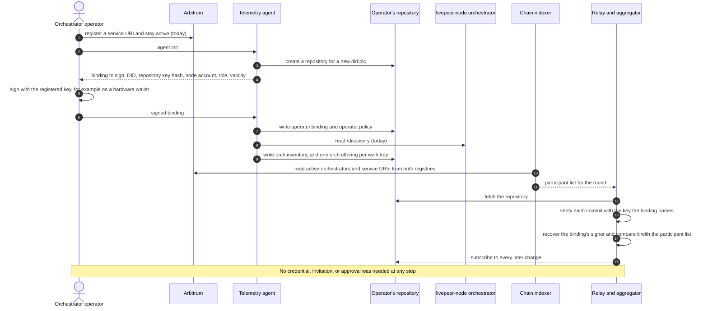
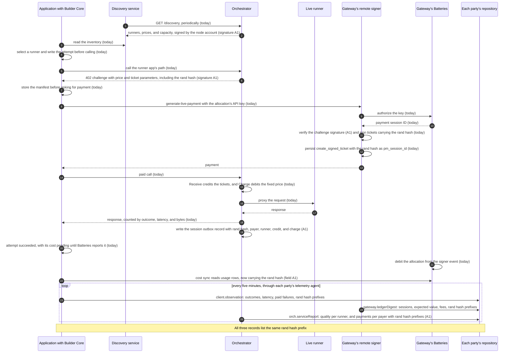
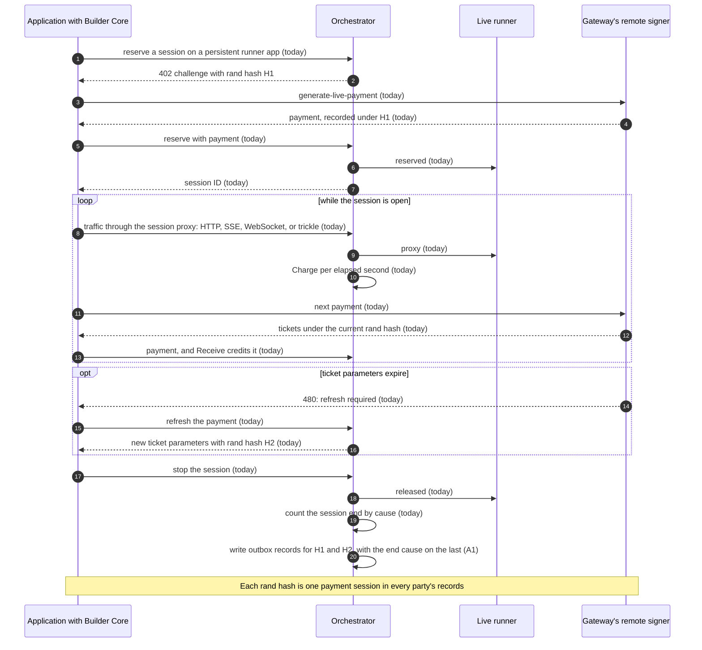
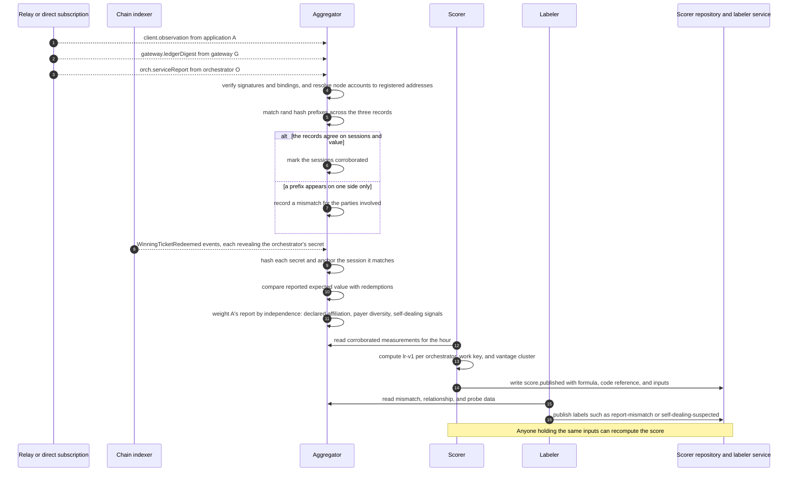
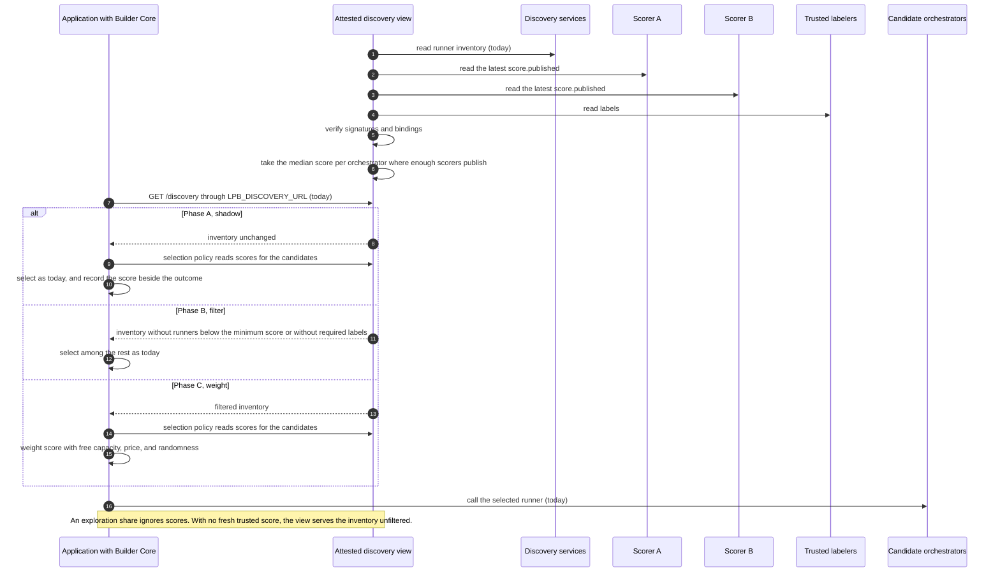
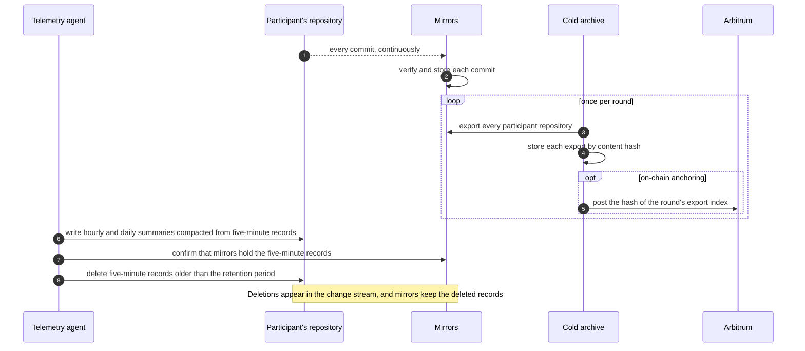
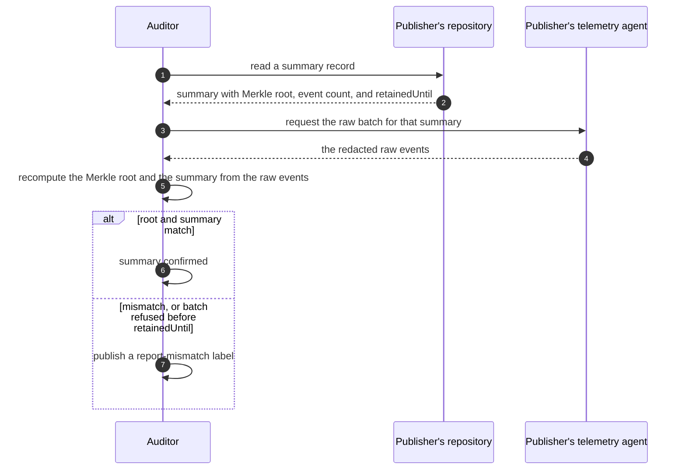
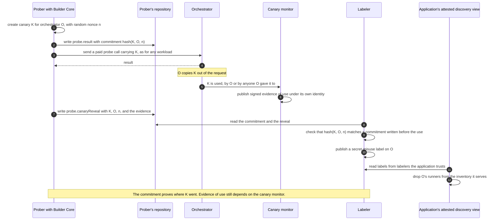

# Appendix D: Sequence diagrams

*Companion to [Operator-Owned Telemetry for the Livepeer Network](README.md). Each diagram traces one flow from the proposal step by step.*

Each step carries one of three markings:
- **"today"** marks a step that already happens in livepeer-node, Clearinghouse Batteries or Builder Core. Builder Core features from its milestones M1 to M5 count as today, because the pilot assumes they are complete.
- **"A1"** marks a proposed upstream change.
- An unmarked step belongs to the proposed telemetry system: the telemetry agent, the aggregator, scorers and labelers.

Record type names refer to the schemas in [Appendix A](appendix-a-record-schemas.md). Code changes refer to [Appendix B](appendix-b-change-list.md).

## D.1 An operator joins

An orchestrator becomes visible to every aggregator without asking anyone. The chain already lists it. Its binding proves that the repository and the on-chain address belong to the same operator.

**A gateway** joins the same way, with two differences:
- Its participant status comes from its deposit and reserve in TicketBroker, not from bonding.
- Its sender key is always online, because its remote signer uses it for every ticket. The agent can therefore have the binding signed from the signer's own keystore.

**An application** joins without a binding, because it has no on-chain address.
1. It creates its DID. `did:web` on its own domain suits most applications.
2. It writes its publication policy.
3. It asks the relay to crawl its repository. Such requests are rate-limited, because the relay's normal crawl list comes from chain state.

Its records carry weight only as far as their rand hashes match published gateway digests.

## D.2 A paid call

An application makes a single-shot call through Builder Core and pays through a gateway. Three parties end up publishing a five-minute summary that includes the same session, and all three carry the same rand hash prefix. That shared prefix is what lets an aggregator match them later.

**What exists today.**
- Builder Core records the attempt, its outcome and its cost class.
- The signer records the payment, and Batteries records the charge.
- The orchestrator's metrics count the call.

**What is missing:**
- the agents that publish these records;
- the rand hash on Batteries' usage rows, which lets the application's record join the others;
- the orchestrator's per-payer session record (A1).

Without A1, the orchestrator's report still carries quality per runner. It cannot yet be matched session by session.

**Failure on a paid call.** Suppose the runner is gone, or out of capacity, after the payment went out. Builder Core then moves the job to a runner on another orchestrator. The first attempt's charge is classified `failed_after_payment`. The application's observation counts that charge against the first orchestrator, under the same rand hash that appears in the gateway's digest.

## D.3 A persistent session

An application holds a persistent session with a runner app priced per hour and charged by the second. The session outlives its first ticket parameters, so it spans more than one rand hash.

A session can also end for other reasons:
- an idle timeout or the maximum duration in Builder Core;
- the runner stopping;
- payment failing;
- the engine stopping.

livepeer-node already counts session ends by cause. Builder Core records how each session ended as part of its job record. Both causes appear in the published summaries. `lr-v1` counts causes that lie with the orchestrator or its runner against the orchestrator, such as a runner stopping, expiring or failing its health checks. It does not count a stop the client requested, a normal completion, or a balance the payer let run out.

## D.4 Corroboration and scoring

An aggregator receives up to three accounts of the same sessions, matches them, anchors them on-chain, and weighs each reporter. A scorer then turns corroborated measurements into a published score that anyone can recompute.

**Three variations change how much evidence an aggregator has:**
- **The application does not publish.** The match is two-sided, between gateway and orchestrator. The application's sessions are still counted, unnamed, in the gateway's digest.
- **The application runs its own gateway.** Its observation and its ledger digest come from one party, so they are not independent. The orchestrator's report and the chain are the independent checks.
- **Before A1.** Only the gateway's digest carries rand hashes. Its sessions are anchored by redemptions. The application and the gateway can be compared only in aggregate, per orchestrator and window. The orchestrator contributes quality per runner only. An application that runs its own gateway can publish rand hashes from its own signer events, but its records are then not independent of its digest.

## D.5 Scores in selection

Each application chooses which scorers and labelers to trust. It reads them through an attested discovery view running next to its engine. How it uses them depends on the phase.

**The remote signer** uses scores without any change to its code. Its `Orchestrators` list points at an attested discovery view. Every client that discovers through the signer's `/discover-orchestrators` then receives the filtered inventory.

**Applications that use the Python SDK directly** can read the same view. Ranking needs the SDK's runner selector to keep the order it is given.

## D.6 Preserving history

Participants may compact or prune detailed records once independent mirrors hold them. Mirrors keep deleted records, so pruning cannot erase history.

## D.7 Auditing a summary

Any summary can be checked against the raw events it was computed from, for as long as the publisher's stated retention period lasts.

The Merkle root is computed over events that are already redacted. The agent applies its allowlist before it stores anything, so the batch it serves is exactly the batch it committed to, and it never has to reveal a private field to prove a summary.

## D.8 A leaked canary

A probe carries a test credential issued to one orchestrator only. The prober commits to it publicly before the job runs. If the credential is ever used, anyone can confirm which orchestrator received it. Where the orchestrator hosts a probe runner app, the prober also checks TLS certificates and DNS answers from it, and those results go into the same `probe.result`.

A canary catches only secrets that are used. It does not catch two kinds of operator ([§6.7](README.md#67-host-abuse)):
- one who copies secrets and never uses them;
- one who recognizes probe traffic and leaves it alone.

Paying for probes through a gateway that real applications also use makes the second harder ([§6.4](README.md#64-test-traffic)).
