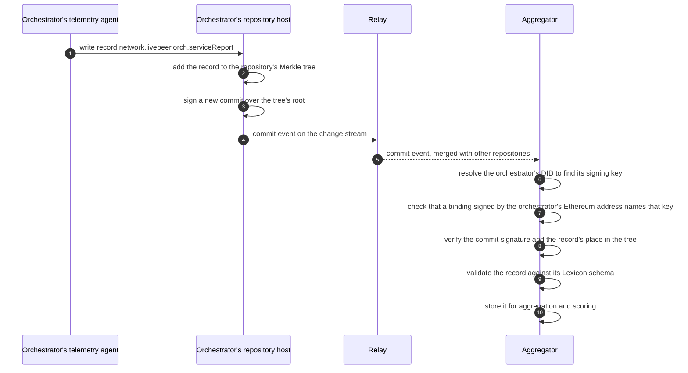

# AT Protocol Primer for Livepeer Operators

*Companion to [Operator-Owned Telemetry for the Livepeer Network](README.md). This primer explains the parts of AT Protocol the proposal relies on, for readers who know Livepeer but not AT Protocol. It does not cover the social features of Bluesky, which the proposal does not use.*

*Revised 2026-11-03, to match the proposal's revision for livepeer-node, Clearinghouse Batteries and Livepeer Builder Core.*

---

## 1. The idea in one paragraph

AT Protocol lets each account publish signed records into a repository it controls, and lets anyone collect those records without asking permission. The protocol's own summary is: *"Users publish JSON records into repositories. The changestreams of those records then sync across the network to drive applications."* Bluesky uses it for social posts. Nothing in the core protocol is specific to social media, and a growing number of applications use it for other kinds of data.

For Livepeer:
- an "account" is a participant: an orchestrator, a gateway, an application, a prober, a scorer or a labeler;
- a "record" is a signed claim, such as an orchestrator's five-minute service report;
- an "application", in AT Protocol's sense, is anything that reads those claims, such as an analytics dashboard, a scorer, or a Livepeer application choosing an orchestrator.

## 2. Following one record

The easiest way to see how the parts fit is to follow one record from creation to use. Suppose an orchestrator publishes its service report for 14:00–14:05.



Five things happened that matter for Livepeer:

1. **A host the orchestrator chose stored the record.** It may be the orchestrator's own agent or a community host, but the orchestrator holds the keys in either case.
2. **The record was signed as part of a commit.** Any later reader, including one who received it second-hand from a mirror, can verify that the orchestrator published exactly this record.
3. **The Ethereum binding decided which key counts.** The DID says where to find the repository; the orchestrator's on-chain address, through its binding, says which signing key to trust.
4. **The aggregator did not need permission.** The change stream is public by design; the protocol calls unauthenticated access to it "a core feature."
5. **The relay was a convenience.** The aggregator could have subscribed to the orchestrator's repository host directly. At Livepeer's scale, which is hundreds of participants rather than millions of accounts, some readers will.

The sections below explain each part in turn.

## 3. The parts

### 3.1 Identity: DIDs

Every account is identified by a **decentralized identifier (DID)**. A DID resolves to a small JSON document that names three things:
- the account's current signing key;
- the server hosting its repository;
- optionally, a human-readable name.

Changing the signing key means updating the DID document; the DID itself stays the same.

AT Protocol supports two DID methods:

| Method | How it resolves | Strength | Weakness |
|---|---|---|---|
| `did:plc` | Through a directory service, `plc.directory` | Supports key rotation and account recovery, and needs no domain | The directory is a single service operated by Bluesky, currently being moved to an independent Swiss association |
| `did:web` | From `https://<hostname>/.well-known/did.json` | Depends on nothing but DNS and the account's own web server | Allowed only on port 443 with a valid certificate. Losing the domain means losing the identity, with no recovery mechanism. |

**The proposal uses `did:plc` by default.** `did:web` would suit an orchestrator with a domain and a public certificate on port 443. Many orchestrators have neither: they serve on ports such as 8935, often on a bare IP address, with self-signed certificates.

The directory's weakness is contained by the **binding**: a record, signed by the participant's Ethereum address, that names its DID and its repository's signing key. Readers trust only keys a binding names. A misbehaving directory could therefore send readers to the wrong place, but could not make them accept forged records. Applications, which usually have a domain, may choose `did:web` instead.

Bluesky accounts also have **handles**, human-readable names such as `alice.example.com`. The proposal does not need them.

### 3.2 Repositories and records

Each account owns exactly one **repository**. A repository holds **records**, which are JSON documents grouped into **collections** named after their schema. Each record has a key within its collection, so every record has a global address of the form:

```
at://did:plc:ab12cd34ef56gh78ij90kl12/network.livepeer.orch.serviceReport/20261104T1400Z.300
```

The record key here is derived from the window the record covers: five minutes from 14:00. A republish of the same window replaces the record instead of adding a second one.

The repository is organized as a **Merkle search tree**: a tree in which every node is identified by the hash of its contents, so the hash at the root summarizes every record. Each change produces a new root, and the account signs a **commit** over it. Two properties follow.

- **Records are self-certifying.** Anyone holding a record, the tree nodes above it, and the signed commit can prove the account published it, without trusting whoever handed them the data.
- **Copies can be compared cheaply.** Two copies of the same repository have the same root hash, regardless of the order in which records were written.

A repository can be exported as a single file, called a **CAR file**, containing every record, every tree node, and the signed commit. This is how mirrors and archives take complete, verifiable copies.

Accounts can delete records from their own repositories. Deletion appears in the change stream like any other change, so anyone who was watching keeps the earlier record. This is why the proposal depends on independent mirrors.

### 3.3 Repository hosts and Personal Data Servers

A **Personal Data Server (PDS)** hosts repositories and serves them to anyone who asks. It accepts writes only from the account that owns the repository, signs commits with the account's key, and publishes a change stream. By design it contains no application logic.

The proposal offers three ways to host a participant's repository:

| Mode | Who runs the server | For whom |
|---|---|---|
| **Agent-hosted** | The participant. The telemetry agent includes a minimal repository host that serves only what readers need. | Participants who run the agent anyway |
| **Community-hosted** | Cloud SPE first, later others, running a standard PDS with one account per participant | Participants who want nothing extra running |
| **Own PDS** | The participant, running the reference PDS | Participants who already run AT Protocol infrastructure |

A participant holds its rotation key and its Ethereum binding in every mode, so it can move between them at any time.

The reference PDS runs in Docker with SQLite storage. Its stated minimum is 1 GB of RAM, one CPU core, and 20 GB of disk, sized for up to 20 accounts. Independent implementations exist in Go, which describes itself as experimental, and in Rust, which supports only `did:plc`.

### 3.4 Sync: the change stream and backfill

Every repository host offers two ways to read its data:

- **The change stream** (`com.atproto.sync.subscribeRepos`) is a WebSocket feed of every commit, each with a sequence number. A reader that disconnects can resume from its last sequence number, within a replay window the server keeps.
- **Full export** (`com.atproto.sync.getRepo`) returns the whole repository as a CAR file. A new reader uses it to catch up, then switches to the change stream.

A reader verifies each commit against the previous state of the repository. A missing commit shows up as a break in that chain, and the reader re-fetches the full repository to repair it.

Two limits affect Livepeer's record design:
- a single commit's changes may not exceed 2 MB;
- a single record may not exceed 1 MB.

The proposal's summary records stay well below the record limit, and split into pages if they approach it. Scores are published in shards for the same reason.

### 3.5 Relays and Tap

A **relay** subscribes to many repository hosts and re-publishes their change streams as one combined stream. It does not interpret records; it forwards them. A relay saves readers from opening one connection per host.

Running a relay used to be expensive, because early relays kept the full history of every repository. A protocol revision known as Sync 1.1 allowed relays to keep only recent events. A relay for the entire Bluesky network now runs on a virtual server costing about $30 per month. A relay restricted to Livepeer's repositories costs less. Anyone may run one, and several can run at once. The proposal runs Livepeer-scoped relays from the start, and readers can still subscribe to hosts directly.

**Tap** is Bluesky's verified-sync tool. It reads from a relay, verifies every commit, and provides backfill and sync filtered by account and collection. An aggregator can use it instead of building its own sync code.

### 3.6 Lexicons: schemas

A **Lexicon** is a schema for a record type or an API method, named in reverse-domain form, such as `network.livepeer.orch.serviceReport`. Readers validate records against the Lexicon before using them.

Four Lexicon rules shape the proposal:

- **Published Lexicons cannot change incompatibly.** A new version may add optional fields. It may not remove required fields, rename fields, or change a field's type. Any breaking change needs a new name. This is why the proposal asks for a versioning process, through a LIP, before the first schema is published, and why the pilot uses an experimental namespace.
- **Lexicons are found through DNS.** The authority for `network.livepeer.*` is a DNS record under `livepeer.network`, which names the account that publishes the schemas. Whoever controls that domain controls schema publication.
- **The data model forbids floating-point numbers,** because floats do not re-encode identically on every machine, which would break signatures. Ratios and latencies are therefore stored as integers in fixed units.
- **Unknown fields are ignored.** A reader built for one version of a record can still read records written by newer software.

### 3.7 AppViews: aggregators

An **AppView** reads records from many repositories and builds views over them: counts, rankings, search, timelines. In Bluesky, the AppView is what assembles your feed. AppViews are the most expensive part of AT Protocol to run at Bluesky's scale, which is why few independent ones exist there.

The proposal calls its AppViews **aggregators**. At Livepeer's scale the cost concern largely disappears: the whole network's telemetry is a few hundred repositories, each writing about one record per five-minute window. Cloud SPE's aggregator, built on NaaP's code and rules, would be one among any number.

### 3.8 Labelers: published judgments

A **labeler** is an account that publishes signed **labels** about other accounts or records. A label carries:
- a short value, such as `!warn` or a custom term;
- a subject: an account's DID, or a record's address, optionally pinned to one version of the record;
- an optional expiry;
- the labeler's signature.

A labeler can withdraw a label by publishing its negation. Consumers choose which labelers to subscribe to, and a label has no effect on anyone who does not subscribe.

Bluesky uses labelers for moderation. The proposal uses the same mechanism for judgments, and the same principle for scores: anyone may publish them, and each application, signer and allocator chooses whose to trust.

- **Flags.** `self-dealing-suspected` and `report-mismatch`, on an orchestrator's or gateway's DID.
- **Approvals and capabilities.** These concern one orchestrator and one runner app together, so they attach to the orchestrator's `orch.offering` record for that runner app and version. An application can publish `approved` on the offerings it has vetted, with an expiry. A prober can publish `cap-structured-output` where tests show the feature works.
- **Host abuse.** If a test credential sent to one orchestrator is later used, a labeler can publish `secret-misuse` against that orchestrator, citing the evidence.

An application subscribed to both kinds of labeler can exclude the first orchestrator and prefer the others. One that does not subscribe is unaffected.

## 4. How much to trust it

AT Protocol's designers describe its trust model as **"lazy trust"** or **"credible exit."** Readers do not re-verify everything on every read, but the data is always signed and exportable, so anyone can verify it or move away from a service they no longer trust.

For Livepeer the important distinction is between what is cryptographically guaranteed and what is not:

| Guaranteed by the protocol | Not guaranteed by the protocol |
|---|---|
| A record was published by the account whose key signed the commit. | The record is true. |
| A copy of a repository is complete and unaltered, as of a given commit. | A record will stay in the participant's repository. |
| The order of changes within one repository. | Identity changes: the protocol states that identity and account events are "not self-certifying," so readers must resolve DIDs themselves. |

The proposal fills the right-hand column with Livepeer's own evidence:
- Ethereum-signed bindings, for identity;
- on-chain payments and redemptions;
- reports from all three parties to a payment session: the application, the gateway and the orchestrator;
- test traffic;
- independent mirrors.

## 5. How AT Protocol concepts map to the proposal

| AT Protocol concept | In this proposal |
|---|---|
| Account | A participant: an orchestrator, gateway, application, prober, scorer or labeler |
| DID | `did:plc` by default. Orchestrators and gateways bind it to their Ethereum address with a signed record. |
| Repository | The participant's published claims |
| Record | A binding, publication policy, inventory, offering, service report, observation, ledger digest, unmet demand, probe result or score |
| PDS | Agent-hosted, community-hosted or the participant's own |
| Lexicon | The `network.livepeer.*` schemas in Appendix A, governed through a LIP |
| Relay | Livepeer-scoped relays, run from the start by Cloud SPE and at least one other operator |
| AppView | An aggregator, such as Cloud SPE's |
| Labeler | A publisher of flags, approvals and capability labels |
| CAR export | Mirror and cold-archive copies |

## 6. What the proposal does not use

Several parts of the Bluesky deployment would reintroduce central dependencies, so the proposal avoids them:

- **Trust in the PLC directory.** The proposal uses `did:plc` to locate repositories, but trusts only signing keys that an Ethereum binding names.
- **Bluesky's relay network.** Bluesky's relays limit new hosts until they establish a track record, and the default relay is operated by Bluesky. Livepeer aggregators read from Livepeer-scoped relays or from repository hosts directly.
- **Bluesky's hosted Jetstream,** a simplified JSON feed that most small Bluesky applications depend on. Livepeer readers use the change stream, with Tap for verified sync.
- **Bluesky's AppView and the `app.bsky.*` schemas.** None of the social features are needed.
- **Handles, blobs and OAuth.** Participants write to their own repositories through their telemetry agents, and records hold no media.

One practical point needs testing early: the agent's minimal repository host must sync correctly with the indigo relay and with Tap before any participant depends on it.

## 7. Limitations that matter here

- **All published data is public.** AT Protocol's permissioned data, called Spaces, shipped as an alpha in August 2026. It is not production-ready and carries no security review, so the proposal assumes that anything published, anyone can read. It publishes only operator-level summaries, in the mode each publisher chooses.
- **Repositories have a size ceiling** of roughly single-digit millions of records. The proposal publishes one record per publisher per window, about 105,000 a year, far below the ceiling.
- **Records can be deleted** by their authors. Independent mirrors keep history.
- **Standardization is in progress.** The core protocol has been submitted to the IETF, but is not yet a formal standard.
- **Schema interoperability is voluntary.** Nothing stops a second, incompatible set of Livepeer schemas from appearing. Governance through a LIP is the remedy.

## 8. Glossary

| Term | Meaning |
|---|---|
| **AppView** | A service that aggregates records from many repositories into views. Called an aggregator in the proposal. |
| **AT-URI** | The global address of a record: `at://<did>/<collection>/<record key>`. |
| **Binding** | In this proposal, a record signed by a participant's Ethereum address that names its DID and its repository's signing key. |
| **CAR file** | A single-file export of a repository, including all records, tree nodes, and the signed commit. |
| **Commit** | A signed statement of a repository's current Merkle root. |
| **DID** | Decentralized identifier; resolves to a document naming the account's signing key and repository host. |
| **Label** | A signed judgment about an account or record, published by a labeler. |
| **Labeler** | An account that publishes signed labels about other accounts or records. |
| **Lexicon** | A schema for a record type or API method. |
| **Merkle search tree** | The hash-linked tree that organizes a repository's records. |
| **NSID** | Namespaced identifier; the reverse-domain name of a Lexicon, such as `network.livepeer.orch.inventory`. |
| **PDS** | Personal Data Server; hosts repositories and serves their change streams. |
| **Relay** | A service that combines many hosts' change streams into one. |
| **Repository** | One account's complete, signed collection of records. |
| **Tap** | Bluesky's verified-sync tool: backfill and filtered sync from a relay. |

## 9. Further reading

- AT Protocol documentation and specifications: <https://atproto.com>
- "AT Protocol for distributed systems engineers": <https://atproto.com/articles/atproto-for-distsys-engineers>
- AT Protocol DID specification: <https://atproto.com/specs/did>
- AT Protocol labels: <https://atproto.com/specs/label>
- Introducing Tap: <https://docs.bsky.app/blog/introducing-tap>
- AT Protocol Spaces alpha: <https://atproto.com/blog/atproto-spaces-alpha>
- Reference PDS: <https://github.com/bluesky-social/pds>
- Kleppmann et al., "Bluesky and the AT Protocol: Usable Decentralized Social Media," arXiv:2402.03239
- Christine Lemmer-Webber, "How decentralized is Bluesky really?" — the most cited critique of AT Protocol's centralization points
