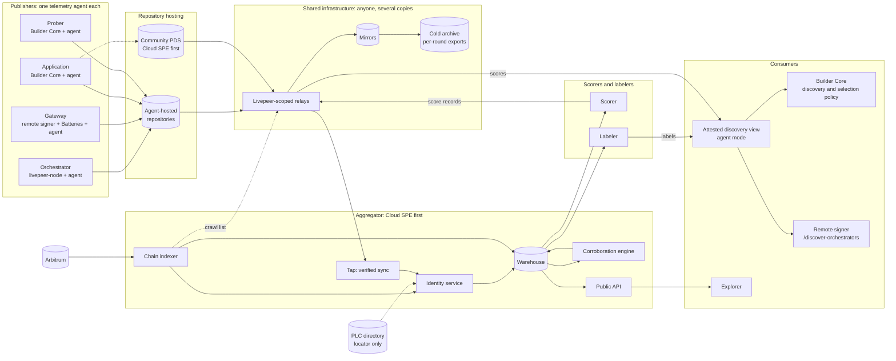
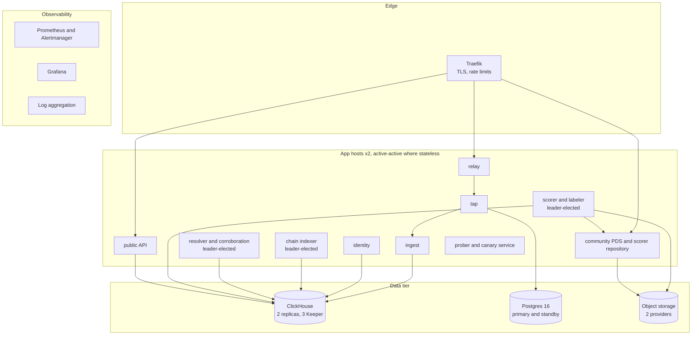
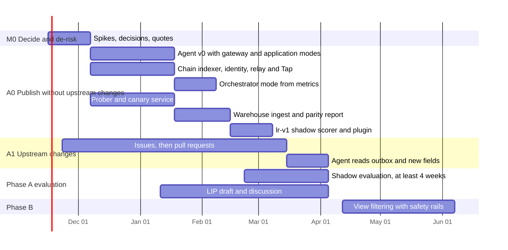

# Building the Livepeer Operator-Owned Telemetry Platform: Implementation Plan

*An implementation plan for the [Operator-Owned Telemetry proposal](README.md): what to build, who runs it, in what order, and how we will know it works.*

**Status:** Draft for discussion · **Revised:** 2026-11-03 (first draft 2026-10-04) · **First aggregator operator:** Cloud SPE

**Companion documents:** [Proposal](README.md) · [AT Protocol primer](at-protocol-primer.md) · [A. Record schemas](appendix-a-record-schemas.md) · [B. Change list](appendix-b-change-list.md) · [C. Decisions and open questions](appendix-c-decisions-and-open-questions.md) · [D. Sequence diagrams](appendix-d-sequence-diagrams.md)

**What changed in this revision.** The first draft planned the work for go-livepeer, which is now deprecated. Its review of the proposal produced fourteen corrections, and the proposal has since adopted them. This revision plans the work for the stack that replaces go-livepeer:
- livepeer-node;
- Clearinghouse Batteries;
- Livepeer Builder Core;
- the Python gateway SDK.

[§2](#2-what-changed-since-the-first-draft) lists where each earlier correction now lives, and what the new stack changed.

---

## Summary

**What we build.**
- **The telemetry agent.** One Go binary that every publisher runs: orchestrators, gateways, applications and probers. It reads data its party already has, builds window summaries, and publishes them to the party's repository. In a second mode it serves an *attested discovery view*: runner inventory filtered and ordered by the scores and labels its operator trusts, in livepeer-node's `/discovery` format.
- **An aggregation stack.** A chain indexer extracted from Batteries, a Livepeer-scoped relay, verified sync with Tap, an identity service, a warehouse, a corroboration engine and a public API. It reuses NaaP's rules and code.
- **A scorer and a labeler.** The scorer publishes `lr-v1`, with a daily recompute check. The labeler publishes capability, certificate, mismatch and host-abuse labels.
- **A prober.** An ordinary Builder Core application, so it measures what an application would get.
- **History.** Mirrors and a cold archive.

**What already exists.** Most of the data:
- livepeer-node's metrics per runner app and runner, added upstream in October 2026;
- the remote signer's event for every signing, which already carries the rand hash;
- Batteries' ledger and its matching of on-chain redemptions;
- Builder Core's attempt outcomes, cost classes and events feed.

The SDK already tries runners in the order discovery returns them. Builder Core, the signer and the discovery service all accept a `/discovery` source. Scores can therefore reach selection without changing any of them.

**What needs upstream changes.** Five changes to livepeer-node and Batteries, each useful on its own ([Appendix B §B.11](appendix-b-change-list.md#b11-proposing-the-upstream-changes)). Phase A0 needs none of them. Phase A1 adds them as they land.

**Where the risk is.** Not throughput: at ten times today's network, the whole system writes about two records per second. The risks are:
- identity: binding every record to an on-chain participant;
- correctness, shown by parity with each participant's own records;
- adoption by applications, which may choose not to publish;
- upstream review, which nobody in the pilot controls;
- concentration: of traffic, if many applications follow the same labels, and of infrastructure, while Cloud SPE runs most of it.

**Who runs infrastructure.**
- Each publisher runs one agent and owns a repository.
- Cloud SPE runs the first relay, indexer, aggregator, scorer, labeler, community repository host and mirror.
- The Network Engineering SPE runs the selection policy plugin and onboards applications.
- A second operator should run the second relay, mirror and scorer within Phase A.
- The Foundation or a contracted SPE should hold the treasury-funded cold archive.
- Whoever controls the `livepeer.network` domain must publish the Lexicons.

[§9](#9-who-runs-what) has the full table.

---

## Contents

1. [What exists today](#1-what-exists-today)
2. [What changed since the first draft](#2-what-changed-since-the-first-draft)
3. [Target architecture](#3-target-architecture)
4. [Identity](#4-identity)
5. [Records and Lexicons](#5-records-and-lexicons)
6. [Corroboration engine](#6-corroboration-engine)
7. [Scoring and selection](#7-scoring-and-selection)
8. [Privacy and commercial confidentiality](#8-privacy-and-commercial-confidentiality)
9. [Who runs what](#9-who-runs-what)
10. [The Cloud SPE aggregator deployment](#10-the-cloud-spe-aggregator-deployment)
11. [Scale](#11-scale)
12. [Delivery plan](#12-delivery-plan)
13. [Verification and quality gates](#13-verification-and-quality-gates)
14. [Risks](#14-risks)
15. [Open decisions for the plan owner](#15-open-decisions-for-the-plan-owner)
16. [Status of the proposal documents](#16-status-of-the-proposal-documents)

---

## 1. What exists today

### 1.1 livepeer-node

livepeer-node provides the orchestrator, the remote signer, a standalone discovery service and a chain tool.

| Area | What exists | Gap for this plan |
|---|---|---|
| Orchestrator metrics | Since October 2026, per runner app and runner: calls by outcome, response-header latency, call and session duration, bytes, reservations, session ends by reason, health checks, capacity, and payment counters. Served on a loopback listener. | No payer dimension and no per-session records, by design. Counters reset on restart. ETH values are approximate. |
| Payments | `PaymentEngine.MakeChallenge`, `Receive` and `Charge`. A fresh rand hash for every challenge, and again on each 480 refresh. Payment state in a SQLite store. | Nothing is kept per session once it ends. |
| Discovery | `/discovery` lists each runner's URL, app, version, mode, GPU, capacity and price. Standalone discovery merges sources, keeps complete runner records, and chooses each runner by its newest `observed_at`. | Unsigned. `address` is a URL, not an Ethereum address. The cache is not kept. |
| Remote signer | `/generate-live-payment`, `/discover-orchestrators`, and a `create_signed_ticket` event for every signing, written durably before payment is returned | Events lack runner ID, face value and win probability |
| Runner registry | Dynamic runners with heartbeat, and static runners from configuration | Runner IDs are chosen by the runner. Credentials are kept in memory only. |
| Chain tool | Writes the protocol `ServiceRegistry` | Builder Core reads the `AIServiceRegistry` by default |

### 1.2 Clearinghouse Batteries

A single Go binary with SQLite storage. It provides:
- the signer's authorization webhook;
- an embedded Kafka broker (`minikafka`) that the signer publishes to;
- an append-only ledger of authorizations and charges;
- a TicketBroker listener with reorganization handling, which matches redemptions to signing sessions by rand hash;
- a management API with usage, session and settlement reports.

**Gap.** Usage rows do not carry the rand hash, so an application cannot join its own usage to settlements or to other parties' records.

### 1.3 Livepeer Builder Core

The engine that enterprise applications build on. This plan assumes its milestones M1 to M5 are complete.

- **Jobs and attempts.** Each attempt records the runner URL, the orchestrator URL, whether payment was sent, an outcome from a fixed set, the status code and timestamps.
- **Failover.** Decision D52 fixes when a job moves to another runner. A paid failover never pays the same orchestrator twice.
- **Cost.** Every paid attempt gets a cost class: `delivered`, `failed_after_payment`, `uncertain` or `pending`.
- **Events feed.** Job and cost events, read with a cursor (decision D10).
- **Extension points.** `SelectionPolicy`, `DiscoverySource` and `OrchestratorDirectory`, chosen when the application assembles its engine.

**Gaps.** No first-byte time on attempts, and no rand hash until Batteries provides one.

### 1.4 Python gateway SDK

`call_runner`, `reserve_session` and `runner_selector` handle discovery, the 402 challenge, signer-minted payments and failover. Candidates are tried in discovery order. No telemetry is exported. Builder Core uses the SDK for every runner call.

### 1.5 The applications

- **ChatLPT** is a reference chat application. It keeps a hand-picked list of five orchestrators. Three of them use self-signed certificates, which Builder Core cannot verify. It runs its own gateway.
- **inference-gateway** serves OpenAI- and Anthropic-compatible APIs over Builder Core. It keeps an allowlist and TLS trust pins. On 26 October 2026 it ran 34 test operations to establish which orchestrators and features work for its models, and committed the results to its repository.

The Network Engineering SPE plans to onboard more applications of this kind. Each would otherwise repeat the same curation.

### 1.6 NaaP analytics

NaaP's pipeline runs ClickHouse with layered materialized views, a Go resolver and a Go read API. It was built on Kafka events from go-livepeer gateways, which the new stack does not produce.

**What carries over:**
- its 40 canonical rules, written as an architecture-independent contract;
- the additive-primitives discipline;
- the replay harness that proves byte-identical determinism per layer;
- the store contract and the API envelope.

**What does not:** its session reconstruction from Kafka events, and its live video-to-video SLA formula.

### 1.7 The AT Protocol ecosystem

- **Tap**, Bluesky's verified-sync tool, provides backfill and collection-filtered sync from any relay.
- **Spaces**, AT Protocol's permissioned data, shipped as an alpha on 2026-08-20. It is not production-ready.
- **Hosting.**
  - The reference PDS (TypeScript) needs about 1 GB of RAM.
  - The Go PDS (`cocoon`) describes itself as experimental.
  - The Rust PDS supports `did:plc` only.

  A minimal sync-only repository host, built on indigo's repository packages, is the lightest option for an agent.

---

## 2. What changed since the first draft

### 2.1 Where the first draft's corrections live now

| First-draft correction | Now |
|---|---|
| C1. `did:plc` by default, with an Ethereum binding as the root of trust | Proposal [§4](README.md#4-identity-from-on-chain-address-to-published-records); Appendix C, D1 |
| C2. One record per publisher per window | Proposal [§5.3](README.md#53-summaries-not-events); Appendix C, D22 |
| C3. Live video-to-video selection ignores scores | Withdrawn. go-livepeer is out of scope. |
| C4. Do not wait for upstream changes | Kept as the A0 and A1 split (D24), now for livepeer-node and Batteries |
| C5. Commercial confidentiality | Requirement R8 and the publication policy (D20) |
| C6. Redemption anchoring and rand hash prefixes | Proposal [§6.3](README.md#63-payments-on-chain); D23 |
| C7. One telemetry agent | D21 |
| C8. Three hosting modes | D1 |
| C9. A score adapter for go-livepeer | Replaced by the attested discovery view (D25) |
| C10. Relays from the start | D30 |
| C11. The Lexicon publisher's DNS domain | Proposal [§13](README.md#13-governance-and-rollout); Appendix C, question 21 |
| C12. Raw-batch audits | D31 |
| C13. Orchestrators appear under several addresses | The binding lists operating addresses ([Appendix A §A.5](appendix-a-record-schemas.md#a5-networklivepeeroperatorbinding)) |
| C14. Factual corrections | Made in the proposal and appendices |

### 2.2 What the new stack changed

1. **The client's view moved from the gateway to the application.** go-livepeer gateways saw every session. In the new stack, the remote signer sees payments and Builder Core sees outcomes. The application's records are therefore the client view, and they are optional.
2. **Scores can reach selection without code changes.** Builder Core, the signer and the discovery service all read `/discovery`-format sources. An attested discovery view replaces the first draft's score adapter.
3. **The orchestrator's quality side already exists.** livepeer-node's metrics cover it. What is missing is a record per payment session, with its payer.
4. **The rand hash already flows.** The signer reports it in every event, and Batteries matches redemptions with it. Only Batteries' usage rows hide it from applications.
5. **Discovery merges runners from many sources.** Signatures must therefore cover each runner record, not a whole response.
6. **Histograms should use livepeer-node's buckets.** Orchestrator rows built from its metrics are then exact.
7. **Labels need a record to attach to.** Approvals and capabilities concern an orchestrator and a work key together, which is why each work key gets an `orch.offering` record.
8. **Two service registries are in use.** livepeer-node's chain tool writes one, and Builder Core reads the other by default. The identity service reads both.
9. **In-sandbox checks need a probe runner app.** Applications no longer run their own workloads on orchestrators' hosts. Canaries still travel in requests to any orchestrator. TLS and DNS checks need a probe runner app on hosts that agree to run one.

---

## 3. Target architecture

### 3.1 Principles

1. **The chain decides who counts. Records decide what was claimed. Corroboration decides what is probably true.** These are the proposal's three layers.
2. **The root of trust is an Ethereum signature, not a DID method.** DID infrastructure locates data; the binding authenticates it.
3. **Every publisher installs one artifact:** the telemetry agent.
4. **Nothing in a job's request path depends on this system.** The agent reads data after the fact, and the attested discovery view fails open.
5. **Every derived number is reproducible.** This applies to the aggregator's measurements and to scorers' scores. NaaP's replay harness is the model.
6. **Pilot names are disposable.** Nothing is published under `network.livepeer.*` before the LIP.

### 3.2 System context



### 3.3 Components

#### 3.3.1 Livepeer telemetry agent

One Go binary, with one container image and one configuration file. It is built in a new repository in the Build Track's style. Its role is set in configuration, and the same binary serves every role.

| Subsystem | Responsibility | Built on |
|---|---|---|
| Input: metrics scraper | Scrapes livepeer-node's loopback `/metrics` every 15 seconds and turns counters into window deltas, handling restarts | Prometheus client libraries |
| Input: discovery reader | Reads the orchestrator's own `/discovery` for its inventory and offerings | — |
| Input: session outbox reader | Reads livepeer-node's session outbox with a stored cursor (A1) | — |
| Input: signer events | Reads the signer's topic from Batteries' embedded broker, with its own offsets | Kafka client |
| Input: Builder Core events | Reads `GET /v1/events` with a stored cursor and the application's `events.read` scope | — |
| Input: probes | Capability, canary and probe runner app results from the prober | — |
| Redaction | An allowlist per input. Fields are dropped at ingest, before anything is stored. | — |
| Local event store | SQLite in write-ahead-log mode, one table per input, retention per policy | — |
| Window builder | Aligned five-minute or per-round windows, a grace period (default 120 s), late events folded into a republish under the same key, histogram bound sets per schema version | — |
| Identity | Holds the repository signing key. Prints the EIP-712 binding for the operator's wallet to sign. | go-ethereum `apitypes` |
| Repository | Agent-hosted mode: a minimal sync-only host. Community mode: a client that writes to a remote PDS. | indigo `atproto/repo`, `atproto/crypto` |
| Publication policy | `full`, `delayed` or `coarse`, and the signed policy record | — |
| Audit store | Redacted raw batches and their Merkle roots; an optional authenticated batch endpoint | — |
| Attested discovery view | Reads inventory, reads and verifies trusted scores and labels, applies its operator's policy and the safety rails, and serves `/discovery`. Counts jobs its filter left without candidates. | indigo |
| Operations | `/healthz`, Prometheus `/metrics`, structured logs | — |

**Resource budget (target):** under 100 MB of RAM, under 1% of a core, and under 2 GB of disk at 30 days of raw retention for a busy gateway.

#### 3.3.2 Chain indexer

It indexes Arbitrum One:
- BondingManager: activation, deactivation, bonding, reward and reward-caller events;
- both service registries: `ServiceURIUpdate`;
- TicketBroker: deposits, reserves, withdrawals, unlocks and `WinningTicketRedeemed`;
- RoundsManager: `NewRound`.

Its outputs are:
- **participant sets per round:** active orchestrators with their service URIs from either registry, and senders with a deposit and reserve;
- **redemptions**, each with its revealed rand value and the rand hash it opens.

It is built by extracting Batteries' TicketBroker listener (`internal/chain/listener.go`), which already handles reorganizations, into a reusable module. It reads through two RPC providers and requires them to agree on block hashes. Data counts as final once its block is at or below Arbitrum's `finalized` block, which follows finality on Ethereum; before that it is provisional. Arbitrum produces a block every quarter-second or so, so a fixed confirmation count would say little about finality. The Livepeer subgraph serves as an independent daily cross-check, not as a source.

#### 3.3.3 Relay and Tap

- **Relay.** The indigo relay, run as a Livepeer-scoped instance with recent-events retention. Its crawl list holds:
  - the repository hosts of participants with a verified binding;
  - declared applications and probers;
  - the community PDS;
  - known scorer hosts.

  Unknown hosts may request a crawl, and are rate-limited.
- **Tap.** Subscribes to the relay, filtered to the Livepeer collections and the experimental namespace. It delivers to the ingest service by acknowledged WebSocket, so delivery is at least once.
  - Every publisher writes an `operator.policy` record. Tap uses that collection as its *signal collection*, so it follows every repository that publishes under these schemas, including applications and probers, which have no binding.
  - Tap describes itself as beta. The pilot pins its version, and the conformance tests in [§13](#13-verification-and-quality-gates) run against it.

#### 3.3.4 Identity service

Its jobs:
- resolve DIDs, with a cache and PLC replica support;
- verify bindings against chain state *at the time of each window*;
- keep the key history of each DID;
- map every observed address, registered or operating, to a registered address;
- map orchestrator URLs to registered addresses, from both registries and from bound inventory records;
- tell Tap which DIDs to follow.

A binding can be valid, expired, superseded, invalid or unresolved. Records from a DID without a valid binding are stored, but kept out of canonical tables. Applications and probers have no binding. Their records are accepted by DID, and earn weight only through corroboration.

#### 3.3.5 Warehouse and ingest (extending NaaP)

- **Ingest** writes each verified record operation to an append-only log keyed by DID, collection, record key and revision. Each entry holds the CID, operation, commit time, record and validation result. Deletions are logged too.
- **Normalization** flattens `rows[]` into a table per collection. The latest revision of each row wins, and the log keeps every revision.
- **The canonical layer** reuses NaaP's rules and its additive discipline, with Live Runner facts in place of its live video-to-video session reconstruction.
- **Parity tables** compare each measurement from published records with the participant's own records ([§13.3](#133-phase-a-parity)).
- **Storage engine.** ClickHouse is kept, because the team already runs it, the data volume is small, and materialized views make re-derivation cheap.

#### 3.3.6 Corroboration engine

A resolver stage, described in [§6](#6-corroboration-engine).

#### 3.3.7 Scorer

A deterministic job. For each scoring window it:
1. freezes the input set: the latest revision of each record as of the freeze time;
2. computes the formula;
3. writes an inputs manifest, the sorted CIDs, to content-addressed object storage;
4. publishes sharded `score.published` records to the scorer's repository.

The formula code is published, and a `recompute` command reproduces any shard from public data ([§7.3](#73-recomputability)).

#### 3.3.8 Labeler

A standard AT Protocol labeler service exposing `com.atproto.label.queryLabels` and `subscribeLabels`. Its DID document carries an `#atproto_label` signing key and an `#atproto_labeler` service endpoint, and every label it publishes is signed. It is a minimal Go labeler on indigo; Ozone, Bluesky's moderation stack, is heavier than needed. Each label references a method document and the evidence behind it.

Cloud SPE's labeler publishes:
- `cap-` and `nocap-` labels, and `tls-unverified`, from its probes;
- `report-mismatch` and `binding-invalid`, from the aggregator;
- `secret-misuse`, `tls-interception` and `dns-tampering`, from its integrity checks;
- `self-dealing-suspected`, `hardware-mismatch`, `location-mismatch` and `probe-special-treatment`, from Phase B.

`approved` labels are published by applications, or by parties they trust. Whether an SPE should run a shared approval labeler is open (Appendix C, question 1).

#### 3.3.9 Mirror and cold archive

- **Mirror.** A Tap instance in full-history mode for every followed DID. It writes every commit to object storage, plus a daily full export per DID. An off-the-shelf network mirror such as microcosm's Hubble will not do: it deletes records when their authors delete them, and this mirror exists to keep them.
- **Cold archive.** Once per round it writes:
  - an export of every followed repository;
  - an index mapping each DID to its revision and the export's SHA-256;
  - the index's hash.

  Storage is two independent object stores from different providers. Anchoring the index hash on-chain costs one transaction per round, and is recommended from Phase B.

#### 3.3.10 Public API

The NaaP API conventions carry over: RFC 7807 errors, `{data, pagination, meta}` envelopes and cursor pagination.

| Route | Purpose |
|---|---|
| `/v1/participants` | Participants and their binding status |
| `/v1/orchestrators/{address}/measurements` | Hourly measurements, with the publishers and corroboration behind each |
| `/v1/orchestrators/{address}/offerings` | Offerings, with the labels on each |
| `/v1/orchestrators/{address}/scores` | Scores per scorer, formula, work key and vantage cluster |
| `/v1/corroboration/{address}` | Match rates, redemption anchors and labels |
| `/v1/demand` | Unmet demand per work key, across publishing applications |
| `/v1/parity` | The Phase A parity table |
| `/v1/records/{did}/{collection}/{rkey}` | A record with its verification status and revisions |

Every response carries the CIDs it was computed from, so the Explorer can show how each number was derived.

#### 3.3.11 Prober

Cloud SPE's prober is an ordinary Builder Core application with its own agent and DID. It pays through a gateway that real applications also use, and rotates across several funded deposits ([§6.4](#64-self-dealing-and-probe-gaming)).

It runs three kinds of check:
- **Calls shaped like real use**, per published test profile. For chat runner apps, it reuses the feature checks inference-gateway ran by hand: structured output, parallel tools, reasoning, image input and sampling parameters.
- **Canaries.** A canary service issues one credential per orchestrator per probe. The prober records the commitment in `probe.result` and sends the credential in a request, where a real application would carry one. The service watches for use, and when one is used it publishes signed evidence under its own DID. The prober then publishes `probe.canaryReveal`.
- **TLS and DNS checks**, run by a probe runner app on hosts where an orchestrator agrees to run one. It compares certificates with pinned fingerprints and resolves names with known answers.

The canary service is a separate deployment from the prober, so evidence of use never comes from the process that issued the canary.

### 3.4 How the pieces interact

[Appendix D](appendix-d-sequence-diagrams.md) traces each flow for the new stack, and marks every step as existing today, needing an upstream change, or new.

---

## 4. Identity

### 4.1 Participants

The participant tests and identity anchors are in proposal [§4.1](README.md#41-who-is-a-participant), and the binding record is in [Appendix A §A.5](appendix-a-record-schemas.md#a5-networklivepeeroperatorbinding). In short:
- orchestrators and gateways bind a DID to their registered address;
- applications, probers, scorers and labelers have a DID and no binding.

### 4.2 The binding ceremony

| Role | Who signs the binding | How |
|---|---|---|
| Orchestrator | The registered address, which can stay offline | `agent init` creates a `did:plc` and prints an EIP-712 payload. The operator signs it with a hardware wallet or offline tool. The binding lists the node's keystore account as an operating address. |
| Gateway | The sender address, which is always online | A small CLI signs the payload with the signer's keystore file. The agent itself never holds the Ethereum key. |
| Application running its own gateway | The gateway's sender address | As for a gateway. The binding sits in the application's own repository, with role `gateway`. |

### 4.3 Rotation and compromise

| Event | Procedure |
|---|---|
| Planned repository key rotation | The agent creates key K2. The operator signs a new binding naming K2 with a higher nonce, and the agent updates the DID document. Commits made under K1 before the new binding's `validFrom` stay valid. The agent's next commit covers every record under K2, so a reader that fetches the whole repository verifies all of it against the new binding. |
| Repository key compromised | The operator signs a binding for K2 with `validFrom` set to the time of compromise. Aggregators distrust K1 commits that a relay or mirror first saw after that time, and labelers flag disputed windows. |
| Operating address compromised | A new binding omits the address. Records citing that address after the new `validFrom` lose attribution. |
| Registered key compromised | Out of scope for telemetry. It is a stake-level incident, and aggregators follow the chain. |
| Application's repository key compromised | The application rotates through its PLC rotation key. It has no binding, so readers rely on the PLC history. |
| PLC directory unavailable | Cached DID documents keep working. Bindings do not depend on PLC. |
| PLC directory misbehaves | Every `did:plc` change is an operation signed by a rotation key, so the directory cannot forge one. It can withhold changes or show readers different histories. Orchestrators and gateways are protected by their bindings. For applications, scorers and labelers, which have none, readers verify the signed operation history and alert on any key change. They can also choose `did:web`. |

---

## 5. Records and Lexicons

The schemas are in [Appendix A](appendix-a-record-schemas.md). This section covers how they are governed and kept.

### 5.1 Namespace and governance

| Stage | NSID authority | Who publishes the schemas |
|---|---|---|
| Pilot (A0 and A1) | An experimental authority on a domain Cloud SPE controls | Cloud SPE |
| After the LIP | `network.livepeer.*` | The controller of the `livepeer.network` domain, through one `_lexicon` TXT record per schema group, such as `_lexicon.orch.livepeer.network`, and schema records in the publishing account's repository |

The LIP fixes four things:
- the versioning rules: only optional fields may be added, and breaking changes need new names;
- the histogram bound sets of each schema version;
- the non-goals;
- the record-key conventions.

During migration, the aggregator reads both namespaces.

### 5.2 Histogram bounds

Version 1 adopts livepeer-node's buckets ([Appendix A §A.2](appendix-a-record-schemas.md#a2-conventions)), so orchestrator rows built from metrics are exact, and applications bucket their own first-byte times to match. The parity test decides whether these bounds are dense enough. If the latency row fails, version 2 can be built from the session outbox, which records each single-shot call exactly, without changing the metrics.

### 5.3 Retention, compaction and pruning

- **Compaction is optional.** Agents compact five-minute records into hourly records after 30 days, and into daily records after a year, only when the operator enables it.
- **Pruning requires evidence of mirroring.** The agent checks that at least two independent mirrors have published a mirror attestation at or after the revision being pruned. A mirror attestation is a small signed record: the DID, the revision and the export's hash.
- **Raw batches** are kept for 30 days by default. The publication policy declares the actual period, and `retainedUntil` is a commitment.

### 5.4 Clock policy

- Windows use the publisher's UTC clock. The agent refuses to publish when its NTP-reported offset exceeds 2 seconds.
- Cross-party matching uses rand hashes, not time. Each source places events by when it recorded them ([Appendix A §A.2](appendix-a-record-schemas.md#a2-conventions)), so one session can sit in different windows on each side. The aggregator matches a rand hash anywhere within the session's span, plus one window either side for clock skew.

---

## 6. Corroboration engine

### 6.1 Units of evidence

The engine works on **pair-windows**: one payer address, one orchestrator address, one work key and one hour. Five-minute rows roll up to hours for corroboration. Measurements keep five-minute resolution.

### 6.2 Signals

| # | Signal | Computation | Phase | Strength |
|---|---|---|---|---|
| S1 | Three-way match | Intersect rand hash prefixes across a gateway's digest row, an orchestrator's payer row and an application's observation row. An application's sessions count only where its client tags hash to the gateway's values. Compare sessions, value and outcomes within tolerance. | A1 | Strong when the parties are independent |
| S2 | Redemption anchor | For each redemption, hash the revealed rand value, find the published rows holding its prefix, and mark the pair-window *anchored* | A0 for gateway digests; A1 for the others | Exact proof that the business happened, in the window both sides named |
| S3 | Volume consistency | Compare expected wins, from the published tickets and expected value, with observed redemptions, using a Poisson interval over a rolling seven-round window | A0 | Statistical. Weak for small pairs, strong for whole-gateway totals. |
| S4 | Application and gateway totals | Compare an application's paid attempts with its gateway's sessions per orchestrator and window, when the application names the gateway | A0 | Medium. Becomes S1 when rand hashes arrive. |
| S5 | Client view versus orchestrator view | Compare an application's first-byte times and failures with the orchestrator's header latency and call outcomes for the same runner | A0 | Medium. Detects an orchestrator whose own view hides failures. |
| S6 | Probe agreement | Compare probe results with independent applications' results for the same orchestrator and vantage cluster | A0 | Medium. Also detects special treatment of probes. |
| S7 | Declared versus measured | Compare the declared GPU with measured performance against the work key's cohort, and the declared location with latency | A0 | Labels only |

### 6.3 Reporter weighting

Each observation row gets a weight *w* between 0 and 1 before it enters scores:

```
w = identity_ok × min(1, anchored_share / 0.5) ^ α × diversity_factor × (1 − self_dealing_penalty)
```

- **`identity_ok`** is 1 for a gateway or orchestrator with a valid binding. For an application or prober it is 1 once the DID has corroborated history, and 0.5 before.
- **`anchored_share`** is the fraction of the reporter's recent pair-windows with S2 anchors. With α = 0.5 by default, a reporter with few anchors is down-weighted but not excluded.
- **`diversity_factor`** is 1 when another, independent reporter or prober in the same cluster corroborates the reporter's view of an orchestrator within 24 hours, and 0.5 otherwise. A party's two roles, such as an application and its own gateway, do not count as independent.
- **`self_dealing_penalty`** comes from labels the scorer has chosen to trust.

Weights are scorer policy, not aggregator facts. The aggregator publishes the signals, and each formula decides how to weigh them. `lr-v1` uses the weights above so that it is reproducible.

### 6.4 Self-dealing and probe gaming

**Self-dealing signals, cheapest first:**
1. **Concentrated revenue.** More than 80% of an orchestrator's anchored value comes from one sender for three or more consecutive rounds.
2. **Traced funding.** A sender's deposit was funded within two hops from addresses receiving the orchestrator's fees or rewards.
3. **Shared infrastructure.** The same IP address or /24, TLS certificate or repository host across a gateway, an application and an orchestrator.
4. **Irrational prices.** Paying more than twice the median price for the work key over seven days.
5. **Uncorroborated quality.** Good quality reported only by reporters whose diversity factor is 0.5.

Thresholds start conservative and are published. Operators that legitimately run several roles declare it in an `operator.affiliation` record. A declared affiliation removes the penalty for undisclosed self-dealing, but keeps the affiliated observations out of independent corroboration.

**Probe gaming:**
- Probers pay through a gateway that real applications use, and rotate across at least five deposits funded through unrelated paths.
- Probers publish in `delayed` mode, so their paying address is not visible while a probe could still be recognized.
- Probe profiles match real traffic.
- S6 runs continuously.

Deposits and test traffic are a line in the prober's budget ([§12.6](#126-funding-and-team)).

---

## 7. Scoring and selection

### 7.1 `lr-v1`

`lr-v1` is Cloud SPE's first formula for Live Runner work. It is computed hourly per orchestrator, work key and vantage cluster, from corroboration-weighted rows.

| Component | Computation | Weight |
|---|---|---|
| Reliability | Attempts that succeeded, out of attempts that reached the orchestrator. Capacity refusals are excluded when the orchestrator's published capacity was exhausted at the time, so honest reporting of a full runner is not punished. | 0.5 |
| Paid failure | One minus the share of paid attempts that ended `failed_after_payment` or `uncertain` | 0.2 |
| Latency | Time to first byte, as a percentile rank against other runners of the same runner app in the same cluster | 0.2 |
| Session health | One minus the share of sessions that ended for a cause that lies with the orchestrator or its runner: runner stopped, unregistered, expired or unhealthy, shutdown, or billing error | 0.1 |

The score is `10000 × coverage × weighted sum`, in basis points, with shrinkage toward the cohort mean for sparse data. The confidence comes from the effective sample size after weighting. Scores are frozen at the hour plus 15 minutes.

**These weights are a starting proposal, not findings.** The shadow phase tests whether they predict outcomes.

### 7.2 Vantage clusters

Clusters are derived, not declared:
1. Each observer's rows carry an H3 cell at resolution 2, and first-byte histograms per orchestrator.
2. The scorer clusters observers by their latency to orchestrators they have in common, with a stable algorithm and a published seed.

An attested discovery view maps its own position to a cluster, and uses that cluster's scores.

### 7.3 Recomputability

Each score shard names:
- the formula;
- `codeRef`, a git commit of the open-source scorer;
- `freezeTime`;
- `inputsUri`, a content-addressed list of record CIDs.

`lpscore recompute --shard <at-uri>` fetches the inputs from any mirror or relay and reproduces the shard byte for byte. CI recomputes a sample of published shards every day. A mismatch pages the scorer's operator, and the scorer applies `score-irreproducible` to its own output. The scorer is visibly accountable for its own bugs.

### 7.4 How scores reach selection

| Consumer | Path | Change needed | Phase |
|---|---|---|---|
| Builder Core applications: filter | `LPB_DISCOVERY_URL` points at the attested discovery view | None | B |
| Builder Core applications: shadow and weight | A `SelectionPolicy` plugin reads scores from the view | A plugin package; no change to Builder Core | A (shadow), C (weight) |
| Remote signer | Its `Orchestrators` list points at a view, which filters and orders what it serves | None | B |
| livepeer-node discovery | Its `Nodes` list includes a view | None | B |
| Direct SDK users | Read the view; the SDK tries runners in the order given | None | B |
| Explorer | Public API | None | A |

### 7.5 Safety rails

These apply from Phase B. The attested discovery view and the selection policy plugin both enforce them.

1. **Fail open.** If no trusted score is fresher than three hours, the filter is disabled and selection behaves as it does today. A metric and an alert record the event.
2. **Candidate floor.** If the filter would leave fewer than max(3, 20% of candidates), the threshold relaxes to keep that floor.
3. **Exploration share.** At least 10% of selections ignore scores, so new orchestrators build a record. The share is configurable but never zero.
4. **Rate of change.** An orchestrator's effective score moves by no more than 2,000 basis points per hour, which damps flapping and blunts sudden manipulation.
5. **Quorum.** In Phase B, a score applies only when at least two trusted scorers publish one for that orchestrator and cluster. In Phase C, weighting requires at least three independent scorers network-wide. "Independent" means no shared operator and no shared formula code commit, as declared in the scorers' affiliation records. Governance decides the numbers.

### 7.6 Shadow-phase evaluation

The selection policy plugin, in shadow mode, logs each selection: the time, the candidate set, the runner chosen, the scores available and the outcome. The scorer then computes:

| Criterion | Threshold to propose Phase B |
|---|---|
| Spearman correlation between score and next-hour success rate, for orchestrators with at least 30 attempts | ρ ≥ 0.4 in every pilot cluster, for four consecutive weeks |
| Calibration | Orchestrators in the top score quintile succeed more often than the bottom quintile in at least 90% of weeks |
| Coverage | At least 80% of pilot attempts went to orchestrators with a score of confidence ≥ 5,000 |
| Stability | Week-over-week rank churn below 30% for orchestrators without a measured change |
| Counterfactual regression | Replaying selection with the filter on would not have removed more than 5% of successful attempts |
| Concentration | Replaying selection with the filter on would not have sent more than 50% of any work key's attempts to one orchestrator |

These are proposed numbers for the LIP discussion, not facts.

---

## 8. Privacy and commercial confidentiality

| Data | Rule | Enforced where |
|---|---|---|
| Request and response bodies, prompts, paths and headers | Never read by the agent. livepeer-node and Builder Core do not record them. | Source systems |
| Job, request and manifest IDs | Kept only in the local raw store, never in records | Window builder |
| API keys, allocations and customers | Never published. A gateway publishes only a coarsened count of paying keys. | Ingest allowlist |
| Business volume | Publication policy: `full`, `delayed` or `coarse` | Agent |
| Orchestrator, gateway and node addresses | Public by design | — |
| Runner IDs, runner app names and versions | Already public in discovery | — |
| Rand hash prefixes | Published. They reveal the number and timing of sessions between a gateway and an orchestrator, not who the application is. | — |
| Client tags | Published by the application only. The gateway publishes hashes that cannot be linked across sessions. | Batteries and agent |

**Schema-level enforcement.** The Lexicons contain no fields that can hold private data. The agent validates every outbound record against its Lexicon, and against a second "no free text" rule: strings must be known values, addresses, hashes, timestamps or identifiers that discovery already publishes. A configuration mistake cannot smuggle private data into a free-form field.

**Legal.** A public, mirrored archive cannot honor deletion requests. The rule is therefore enforced before publication, not after, and the LIP should say so in plain terms.

---

## 9. Who runs what

### 9.1 Every party and its footprint

| Party | Runs | Required? | Approximate footprint | Cost to them |
|---|---|---|---|---|
| **Orchestrator operators** | livepeer-node (existing); agent in orchestrator mode; a repository | Voluntary | One container beside livepeer-node | Close to zero; a binding signed once a year |
| **Gateway operators** | Remote signer and Batteries (existing); agent in gateway mode | Voluntary | One container | Close to zero |
| **Applications** (ChatLPT, inference-gateway, then each new application) | Builder Core (existing); agent in application mode; attested discovery view; selection policy plugin | Publishing optional; reading recommended | One container | Close to zero |
| **Livepeer Inc's Livepeer Agent** | As an application, once the system is built | Expected | One container | Close to zero |
| **Probers** (Cloud SPE first) | A Builder Core prober; agent in prober mode; a canary service; rotating deposits | Needed for coverage of every orchestrator | Small VM, plus deposits | Deposit float and test-traffic fees |
| **Relay operators** (Cloud SPE first, a second party by the end of Phase A) | Livepeer-scoped indigo relay | At least one; two for resilience | Small VM | Tens of dollars per month |
| **Aggregators** (Cloud SPE first; later others) | Tap, chain indexer, identity service, warehouse, corroboration, API | At least one | [§10](#10-the-cloud-spe-aggregator-deployment) | Moderate |
| **Scorers** (Cloud SPE with `lr-v1`, then others) | Scorer job and repository | Two for Phase B, three for Phase C | Small | Small |
| **Labelers** (Cloud SPE first; applications for their own approvals) | Labeler service | Recommended | Small | Small |
| **Community PDS host** (Cloud SPE first) | A standard PDS for participants who do not host their own | Needed for R7 | Small VM plus backups | Small, plus availability responsibility |
| **Mirror operators** (Cloud SPE, the Foundation, at least one other) | Tap in full-history mode, and object storage | At least two independent ones before any pruning | Small VM plus storage | Small |
| **Cold archive** (treasury-funded; the Foundation or a contracted SPE) | Per-round exports, two object stores, an optional anchor transaction | Recommended before Phase B | Storage, plus one transaction per round | A treasury line item |
| **Lexicon publisher** (controller of `livepeer.network`) | `_lexicon` DNS record and a repository of schema records | Required at LIP adoption | DNS and a repository | None |
| **PLC directory** (external) | DID resolution | Locator only | — | None |
| **Arbitrum RPC providers** (external) | Chain reads | Required by indexers | — | Paid plans |
| **livepeer-node and Batteries maintainers** | Review the A1 changes | Required for A1 | — | Review time |
| **Governance** (LIP authors, the Foundation, token holders) | The LIP for Lexicons, non-goals and Phase C defaults | Required | — | — |

### 9.2 What Cloud SPE runs

Cloud SPE carries most of the first-operator load. That is why the second relay, second mirror and second scorer are deliverables of Phase A rather than hopes.

| Service | Purpose |
|---|---|
| Prober, canary service and their agent | Coverage of every orchestrator |
| Livepeer-scoped relay #1 | Sync backbone |
| Community PDS | R7 for participants who do not host their own repository |
| Aggregator: chain indexer, identity, Tap, warehouse, corroboration, API | First aggregator |
| Scorer (`lr-v1`) and labeler | First scorer and labeler |
| Mirror #1 | History |
| Cold archive, until a treasury-funded operator takes over | History |

### 9.3 What the Network Engineering SPE runs

| Item | Purpose |
|---|---|
| The selection policy plugin | Shadow logging, then weighting, for every Builder Core application |
| Agents for ChatLPT and inference-gateway | The first application publishers |
| Builder Core's first-byte and rand hash additions | Inputs for application records |
| Onboarding for new applications | Agent, view and plugin set up as part of joining |
| Possibly a shared approval labeler | Open (Appendix C, question 1) |

---

## 10. The Cloud SPE aggregator deployment

### 10.1 Topology



**Rules for this deployment**
- **Leader election.** Postgres advisory locks for every job with a single writer: the indexer, the resolver, the scorer and the labeler.
- **Deployment.** Compose stacks per role, managed through Portainer as NaaP already is. Images are tagged by commit, migrations only move forward, and secrets live in stack environments, never in repositories.
- **Key custody.** The scorer's and labeler's signing keys live in a hardware- or KMS-backed signing service. The PLC rotation keys for Cloud SPE's identities are held offline.
- **Separation.** The canary service runs with its own credentials and DID, apart from the prober.

### 10.2 Sizing (initial, with headroom for ten times growth)

| Tier | Initial | Notes |
|---|---|---|
| App hosts | 2 × (8 vCPU, 32 GB RAM, 200 GB NVMe) | The relay, Tap and ingest are light; the resolver and scorer are bursty |
| ClickHouse | 2 × (8 vCPU, 32 GB RAM, 500 GB NVMe) plus 3 small Keeper nodes | Record data is under 4 GB a day even at ten times today's network ([§11](#11-scale)). No Kafka path runs alongside it. |
| Postgres | 2 × (4 vCPU, 16 GB RAM, 200 GB) | Tap state, identity cache, job locks |
| Object storage | 1 TB per provider in the first year | Mirror exports, cold exports, score input manifests |
| Arbitrum RPC | 2 paid providers | Agreement on block hashes; a self-hosted node only if provider costs exceed it |

**Order-of-magnitude cost:** low thousands of US dollars per month, dominated by ClickHouse hosts and RPC. These are estimates, to be replaced by quotes in M0.

### 10.3 Service levels

| Objective | Target |
|---|---|
| Ingest lag, from record commit to canonical table | p99 under 2 minutes |
| Score publication | Each hour's shards published by the hour plus 20 minutes, in 99% of hours |
| Public API availability | 99.9% monthly |
| Score availability | Served by the scorer's repository, the relays and the mirrors. Attested discovery views cache the last good scores. |
| Chain indexer finality lag | Under 5 minutes for provisional data, under 30 minutes for final |
| Recompute success | 100% of sampled shards each day |

### 10.4 Disaster recovery

- **ClickHouse can be rebuilt.** Everything canonical can be re-derived from the record log, the mirror and the chain indexer. Backups exist to shorten recovery, not to preserve truth. The recovery point objective is 24 hours for backups, and the recovery time objective is 8 hours to a full re-derivation.
- **Postgres**, for Tap and identity, has point-in-time recovery and a standby promoted by hand. Recovery point 5 minutes, recovery time 1 hour.
- **Scorer and labeler keys** have a documented rotation procedure.
- **The community PDS** exports every repository to object storage daily. Participants hold their rotation keys, so they can move elsewhere if it is lost.

### 10.5 Security

- **Public surfaces:** the relay and API, read-only and rate-limited; the PDS, with reads plus authenticated writes for hosted accounts. Labeler and scorer writes are internal only.
- **Abuse controls:** the relay crawls only participants, declared applications and probers, plus rate-limited crawl requests. The PDS limits account creation to verified bindings and declared applications.
- **Supply chain:** pinned images, SBOMs, reproducible builds of the agent, and signed releases. Operators run the agent next to their keys.
- **The agent never needs an Ethereum private key.** Bindings are signed by the operator's wallet or keystore CLI. The agent holds only its repository key.

### 10.6 Observability

- Prometheus metrics for every component.
- Alert rules with promtool unit tests, for:
  - ingest lag;
  - binding failures;
  - drops in match rates;
  - recompute failures;
  - relay crawl errors;
  - late score publication;
  - fail-open events reported by attested discovery views whose operators consent.
- Grafana dashboards kept in the repository.
- Log aggregation, which NaaP does not have today.

---

## 11. Scale

| Quantity | Today (approx.) | 10× | 100× |
|---|---|---|---|
| Publishing orchestrators | 50 | 500 | 5,000 |
| Publishing gateways | 5 | 50 | 500 |
| Publishing applications | 2 | 50 | 500 |
| Probers and scorers | 2 | 10 | 50 |
| Window records per day | about 19,000 | about 190,000 | about 1.9 million |
| Average write rate | about 0.2 per second | about 2 per second | about 22 per second |
| Record bytes per day, at about 20 KB each | about 0.4 GB | about 4 GB | about 40 GB |
| Rows per day after flattening | about 0.2 million | about 2 million | about 20 million |

Each publisher writes about 300 records a day: 288 five-minute summaries, plus inventory records. Applications write two summary collections.

- **ClickHouse** handles the 100× row count on a modest cluster.
- **Relays and Tap** are designed for Bluesky's network, which is several orders of magnitude larger.
- **The scorer** at 100× shards by work key and cluster, which the record keys already allow.

The parts that do not scale by adding hardware are:
- **Adoption,** by applications and orchestrators. The agent's simplicity, and the first benefit to each publisher, are the levers.
- **Upstream review.** Small, standalone changes are the lever.
- **Governance.** Proposing the LIP early is the lever.
- **Trust in scorers.** Recomputability and at least three independent scorers are the levers.

---

## 12. Delivery plan

### 12.1 Workstreams

| WS | Workstream | Main repositories | Lead skills |
|---|---|---|---|
| WS1 | Telemetry agent: inputs, windows, repository host, attested discovery view | New: `livepeer-telemetry-agent` (Go) | Go, AT Protocol |
| WS2 | Identity and Lexicons: binding, ceremony tools, experimental Lexicons, LIP draft | The agent, a Lexicon repository, the LIP | Protocol design |
| WS3 | Chain indexer, extracted from Batteries | Batteries, a new indexer module | Go, Ethereum |
| WS4 | Aggregator: relay, Tap, ingest, identity, warehouse, corroboration, API | NaaP (a new ingest path), deployment stacks | Go, ClickHouse |
| WS5 | Scorer, labeler and recompute tool | New: `livepeer-scorer` | Go or Python, statistics |
| WS6 | Upstream changes to livepeer-node and Batteries | Upstream pull requests | Go |
| WS7 | Builder Core additions and the selection policy plugin; SDK verification | Builder Core, a new plugin package, the SDK | Python |
| WS8 | Prober, probe runner app and canary service | New: a prober application | Python, security |
| WS9 | Operations: deployment, service levels, alerts, PDS, mirror, archive | Deployment repository | SRE |
| WS10 | Adoption: onboarding applications and volunteer orchestrators, operator documentation, the Explorer | Documentation, Explorer | Developer relations |

### 12.2 Phases and gates



The dates are a proposal anchored to 2026-11-03. Upstream review sets A1's real timeline, and nobody in the pilot controls it.

**Gate M0 → A0**
- The identity spike has passed: a `did:plc` and binding verified end to end, including key rotation.
- The repository host spike has passed: the indigo relay and Tap sync from the agent's minimal host. Otherwise the agent ships against the community PDS first.
- The experimental NSID authority is registered.
- Cloud SPE's hosting is approved in scope and budget, per the Build Track rule.
- Builder Core's events feed is available to the pilot applications.
- Issues for the A1 changes are open upstream.

**Gate A0 → Phase A evaluation**
- ChatLPT, inference-gateway and their gateways have published for two weeks, with at least 99% of expected windows present.
- The parity table's payment rows match exactly, and its quality rows are within tolerance, or have a known cause.
- The prober is publishing, with canaries.
- At least five volunteer orchestrators publish runner rows.
- Redemption anchoring works for gateway digests.
- At least one independent relay and one independent mirror are running.

**Gate A1 complete**
- The session outbox, the signer fields and the Batteries usage field have shipped in releases, and volunteer orchestrators run them.
- At least 30% of pilot sessions are matched three ways, or two ways where the application runs its own gateway.

**Gate A → B**
- The shadow criteria in [§7.6](#76-shadow-phase-evaluation) have been met for four weeks.
- A second, independent scorer is publishing.
- The LIP has been accepted for the Lexicons, or the experimental names are formally adopted as interim.
- The safety rails are implemented in the attested discovery view and the plugin.

**Gate B → C**
- Phase B shows no regression in applications' own success rates over eight weeks.
- At least three independent scorers.
- Weighting defaults approved through governance.

### 12.3 Milestone deliverables

| Milestone | Deliverables |
|---|---|
| **M0** (3 weeks) | Identity spike; repository host spike; service-URI census across both registries; ClickHouse and RPC quotes; experimental NSID; Lexicon v0 from Appendix A; upstream issues for the A1 changes; Cloud SPE hosting approval request |
| **A0** | Agent v0.1 (gateway and application modes, publication policy, community-PDS client), then v0.2 (minimal repository host, orchestrator mode from metrics, prober mode, attested discovery view). Chain indexer v1. Identity service v1. Relay #1. Ingest into ClickHouse. Parity report. `lr-v1` shadow scorer with recompute in CI. Labeler v1 (`cap-`, `nocap-`, `tls-unverified`, `binding-invalid`). Selection policy plugin in shadow mode. Builder Core first-byte time. Community PDS. Documentation for every role. |
| **A1** | The upstream changes as they ship ([Appendix B §B.11](appendix-b-change-list.md#b11-proposing-the-upstream-changes)). Agent support for the session outbox and the new signer fields. Rand hash on Builder Core attempts. Three-way matching. Mirror #1, plus a partner's mirror. |
| **Evaluation** | Weekly shadow reports; public API v1; Explorer integration; LIP draft; cold archive v1 |
| **B** | View filtering with safety rails; a second scorer onboarded; signed runner records and challenges verified by the SDK and the signer |

### 12.4 Upstream changes

The changes, their order and their standalone value are in [Appendix B](appendix-b-change-list.md). Two points of strategy:

- **Upstream first, with a time limit.** livepeer-node's maintainers are actively adding the operational data this plan builds on, so changes should go upstream rather than into a fork. If a change has not shipped within 12 weeks of its pull request, the plan owner decides whether volunteer orchestrators run a branch build in the meantime. That decision is open ([§15](#15-open-decisions-for-the-plan-owner)).
- **Operator value first.** Each issue describes what the change gives an operator before what it gives this proposal.

| # | Change | Owner | Phase |
|---|---|---|---|
| U-1 | Signer event fields: runner ID, face value, win probability | livepeer-node | A1 |
| U-2 | Rand hash on Batteries usage rows | Batteries | A1 |
| U-3 | Orchestrator session outbox | livepeer-node | A1 |
| U-4 | Signed runner records in discovery | livepeer-node | A1 |
| U-5 | Signed payment challenges, verified by the signer | livepeer-node | A1 |
| U-6 | Stable runner identity | livepeer-node | B |
| BC-1 | First-byte time on attempts | Builder Core | A0 |
| BC-2 | Rand hash on attempt sessions | Builder Core | A1, after U-2 |
| BC-3 | Selection policy plugin | Builder Core plugin | A0 (shadow) |
| S-1 | Verify signed runner records and challenges | SDK | A1, after U-4 and U-5 |

### 12.5 Repositories

| Repository | Status | Owner |
|---|---|---|
| `livepeer-telemetry-agent` | New | Cloud SPE |
| Chain indexer module | Extracted from Batteries | Cloud SPE, offered upstream |
| `livepeer-scorer`: scorer, labeler and recompute | New | Cloud SPE |
| `livepeer-telemetry-lexicons` | New; becomes the LIP's reference | Cloud SPE, then governance |
| Selection policy plugin | New package | Network Engineering SPE |
| Prober application and probe runner app | New | Cloud SPE |
| NaaP analytics | Extended | Cloud SPE |
| livepeer-node, Batteries, SDK | Upstream pull requests | Their maintainers |

All new repositories follow the Build Track conventions:
- Beads for work tracking;
- change requests for other repositories;
- agent-readable `AGENTS.md` and `ARCHITECTURE.md`;
- forward-only migrations;
- fakes for every external system;
- CI gates for lint, types, coverage and determinism.

### 12.6 Funding and team

**Track alignment**
- **Build:** the agent, the selection policy plugin and the Builder Core additions.
- **Validate:** recomputable scores, self-dealing detection and network data as public evidence. This is the natural home for the scorer and the labeler.
- **Operate:** per-runner and per-payer telemetry for orchestrator operators.
- **Delegate:** orchestrator comparison in the Explorer.

A single treasury proposal for the aggregator's hosting and the cold archive is cleaner than spreading costs across tracks. Cloud SPE's hosting needs explicit approval either way.

**Team for A0 and A1, about five months:**

| Role | Allocation |
|---|---|
| Go and AT Protocol engineer: agent, identity, relay and Tap | 1 FTE |
| Data engineer: ClickHouse, resolver, scorer | 1 FTE |
| Integration engineer: livepeer-node and Batteries changes, Builder Core plugin | 0.5–1 FTE |
| Security engineer: prober, canary service, probe runner app | 0.5 FTE |
| SRE: deployment, service levels, PDS, mirrors | 0.5 FTE |
| Protocol and governance lead: LIP, application and operator onboarding | 0.25 FTE |

**Running costs:**
- the aggregator ([§10.2](#102-sizing-initial-with-headroom-for-ten-times-growth));
- prober deposits and test traffic;
- a cold-archive storage line;
- bounties for volunteer orchestrators, for example a fixed bounty per orchestrator that publishes with a valid binding for four weeks.

---

## 13. Verification and quality gates

Every component is built test-first. The lists below give the behaviors each one must show, in the order we would drive them. The first item in each list is its starter test.

Two rules apply throughout:
- **Expected values come from the inputs, worked out by hand.** Small fixtures make that possible. A golden file copied from a component's own output proves only that the component is consistent with itself.
- **Invariants get property-based tests,** run over many random inputs, in addition to the examples.

### 13.1 Agent

1. **Starter test:** an empty window produces a valid record with a policy stamp, no rows and a commitment to an empty batch.
2. **Window placement:** an event recorded at 14:04:59.999 falls in the 14:00 window, and one at 14:05:00 in the 14:05 window. A call is placed by its completion time, a session by its end.
3. **Counter deltas:** deltas across consecutive windows add up to the counter's total increase. The scrape that closes one window opens the next. A restart produces a reset count and no negative values.
4. **Additivity**, property-based: merging two rows and then reading the totals gives the same result as summarizing the combined events.
5. **Republish:** rebuilding a window from the local store after a crash produces the same record, under the same key.
6. **Payment references:** prefixes are sorted and cut to the lowest 2,000. The Bloom filter contains every prefix, and client tags stay aligned with their prefixes.
7. **Redaction**, fuzzed: a field the allowlist does not name, added to any source event, never reaches the store or a record.
8. **No free text**, fuzzed: arbitrary strings injected into identifier fields are rejected, not published.
9. **Paging:** a record that would exceed 800 KB is split into pages whose rows add up to the unsplit record.
10. **Schema compatibility:** every record validates against the current schema and against the previous published version.
11. **Attested discovery view:** its output parses in Builder Core's discovery client, the signer and the SDK. Each safety rail has its own test: stale scores fail open, the candidate floor holds, the exploration share stays within bounds under a seeded random source, and the rate-of-change cap holds.

Three further suites run outside the inner loop:
- **Contract tests.** Each input adapter is tested against the real upstream at a pinned version: livepeer-node's metrics and discovery, the signer's events through Batteries' broker, and Builder Core's events feed. The same tests run against the fakes used in unit tests, so a fake that drifts from the real system fails.
- **Repository conformance.** Nightly, an indigo relay and Tap sync from the agent's repository host. The suite checks backfill, live sync, a resync after a gap, and key rotation.
- **Soak.** Seven days at ten times a busy gateway's event rate, under 100 MB of RAM.

### 13.2 Aggregator

1. **Starter test:** one valid binding and one record produce one accepted row, attributed to the binding's address.
2. **Binding verification:** a record is accepted when its commit's key is named by a binding valid at the commit's time. It is rejected when the binding names another key, or once a binding with a higher nonce for the same address appears in any repository.
3. **Rotation:** after a key rotation, a full-repository backfill still verifies every historical record.
4. **Compromise:** commits under a compromised key that were first seen after the compromise are rejected; earlier ones stay accepted.
5. **Address mapping:** node accounts and both service registries resolve to one registered address. An address with no binding stays unresolved and is never merged.
6. **Matching:** one session's rand hash matches across a gateway's several windows and the orchestrator's single window. A prefix copied from a public digest, without a valid client tag, is not counted for the copier.
7. **Redemption anchoring:** a redemption's revealed secret anchors exactly the rows that hold its prefix.
8. **Amendments:** a record changed after it became final is flagged as an amendment, and scorers use the version current at their freeze time.
9. **Determinism:** replaying the same record log produces identical checksums at every layer, using NaaP's replay harness.
10. **Corroboration under attack:** synthetic worlds with known truth, injected misreporting and injected self-dealing are detected at the published thresholds.

### 13.3 Phase A parity

Parity is the outer acceptance test for the whole pipeline. The inner tests show that each part behaves as specified; parity shows that the parts together count what the participants' own records count.

The proposal's [§7.3](README.md#73-proving-the-new-pipeline-counts-correctly) table is computed per hour and orchestrator for every pilot participant. It compares published records with:
- Batteries' ledger, for payments;
- Builder Core's attempts and cost classes, for outcomes;
- livepeer-node's metrics, for orchestrator quality;
- the chain, for redemptions.

Payment rows must match exactly. Quality rows have the tolerances the proposal gives. A failure blocks the Phase A evaluation gate until it is explained.

### 13.4 Scorer

1. **Starter test:** one orchestrator with hand-built inputs produces the score worked out by hand from the formula.
2. **Recompute:** a daily recompute of a random 5% of shards, from public mirrors, reproduces them byte for byte.
3. **Versioning:** a formula change ships as a new formula version, never in place.
4. **Reporting:** a shadow-evaluation report is generated and published weekly.

---

## 14. Risks

| # | Risk | Likelihood | Impact | Mitigation |
|---|---|---|---|---|
| K1 | Upstream changes to livepeer-node or Batteries stall | Medium | High | A0 needs none of them; each change is small and standalone; issues framed by operator value; a time-limited decision on branch builds |
| K2 | Applications decline to publish | Medium | High | Publication modes (R8); probers cover every orchestrator; applications get shared scores and labels whether or not they publish |
| K3 | Few orchestrators publish | Medium | Medium | Application and probe records score orchestrators without them; bounties; per-payer accounting as the operator's own benefit |
| K4 | Builder Core's events feed slips | Low | High | The plan assumes M1 to M5; as a fallback, the agent reads the application's attempt and cost tables read-only |
| K5 | The minimal repository host is harder than expected | Medium | Medium | Fall back to the community PDS; the agent's PDS client mode ships first |
| K6 | AT Protocol changes: sync, Lexicon resolution, PLC governance; Tap is still in beta | Medium | Medium | Pinned indigo and Tap versions; conformance CI; Ethereum-rooted trust makes PLC replaceable |
| K7 | Scores are gamed | Medium | High | Redemption anchoring, weighting, labels, quorum, rate-of-change caps, the exploration share |
| K8 | Scores harm selection | Low–medium | High | The shadow phase, counterfactual replay, fail-open, the candidate floor |
| K9 | Traffic concentrates because many applications follow the same labels | Medium | Medium | The exploration share and the candidate floor; the concentration criterion in §7.6; labeler diversity |
| K10 | Cloud SPE runs too much | High at first | Medium | The second relay, mirror and scorer are Phase A deliverables; everything is recomputable |
| K11 | A privacy incident from misconfiguration | Low | High | Allowlist redaction, the no-free-text rule, no schema fields for private data |
| K12 | Governance delays the LIP | Medium | Medium | The experimental namespace; formal interim adoption; the LIP started during A0 |
| K13 | Readers treat telemetry, or an absent `secret-misuse` label, as proof that an orchestrator protects workload confidentiality | Medium | High | The explicit non-goal (proposal §12); label documentation states that absence is not evidence; sensitive applications use `approved` orchestrators until attestation exists |
| K14 | Probes become recognizable, so integrity checks see only honest behavior | Medium | Medium | Canaries shaped like real secrets, a shared gateway, rotating deposits, `probe-special-treatment` comparisons |
| K15 | The two service registries disagree about an orchestrator | Medium | Low | The identity service reads both and records conflicts; inventory records are tied to bindings |

---

## 15. Open decisions for the plan owner

The design's decisions are recorded in [Appendix C](appendix-c-decisions-and-open-questions.md). These decisions about the work itself remain open before M0 closes:

1. **Who owns the work?** Is the agent a Build Track deliverable, a Validate Track deliverable, or a separate treasury proposal? The answer decides the approval route for Cloud SPE's hosting.
2. **Is there a contact for the `livepeer.network` domain,** so the Lexicon publication path can be confirmed early?
3. **Which publication mode will ChatLPT and inference-gateway use** for their first records: `full` or `delayed`?
4. **Upstream only, or branch builds as a fallback?** If an A1 change has not shipped within its time limit, should volunteer orchestrators run a branch build?
5. **Which gateway will the prober pay through,** so that its traffic does not stand out?
6. **Should NaaP ingest the new records,** so that its dashboards continue for Live Runner work?
7. **Is a neutral name acceptable** for the aggregator's public face, with NaaP as its codebase rather than its brand?

---

## 16. Status of the proposal documents

| Document | Status, 2026-11-03 |
|---|---|
| Proposal (README) | Revised for livepeer-node, Batteries and Builder Core |
| Appendix A: record schemas | Revised |
| Appendix B: change list | Revised |
| Appendix C: decisions and open questions | Revised; D18 to D31 added |
| Appendix D: sequence diagrams | Revised |
| AT Protocol primer | Revised: `did:plc` with the binding, hosting modes, Spaces, Tap, the Lexicon evolution rule, labels |

---

## Sources

- AT Protocol DID specification, on `did:web` restrictions and key types: <https://atproto.com/specs/did>
- AT Protocol labels: <https://atproto.com/specs/label>
- Introducing Tap: <https://docs.bsky.app/blog/introducing-tap>
- Tap command reference: <https://pkg.go.dev/github.com/bluesky-social/indigo/cmd/tap>
- AT Protocol Spaces alpha: <https://atproto.com/blog/atproto-spaces-alpha>
- Cocoon (Go PDS): <https://github.com/haileyok/cocoon>
- rsky-pds `did:plc`-only issue: <https://github.com/blacksky-algorithms/rsky/issues/296>
- Code and documents reviewed on 2026-11-03:
  - livepeer/node at `e2b3319`, including `docs/metrics.md`, `docs/discovery.md` and `docs/http-api.md`;
  - Clearinghouse Batteries at `d47d1ff`;
  - livepeer-builder (Builder Core) at `016c65d`, including its engine, payments, discovery and events contracts;
  - livepeer-python-gateway at `cd6ed5e`;
  - inference-gateway and ChatLPT, including inference-gateway's capability probe results of 2026-10-26.
