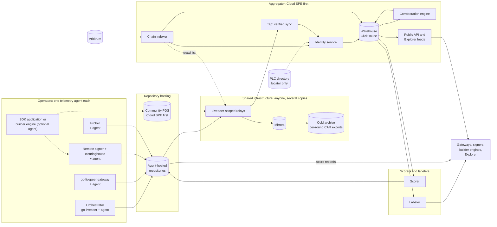
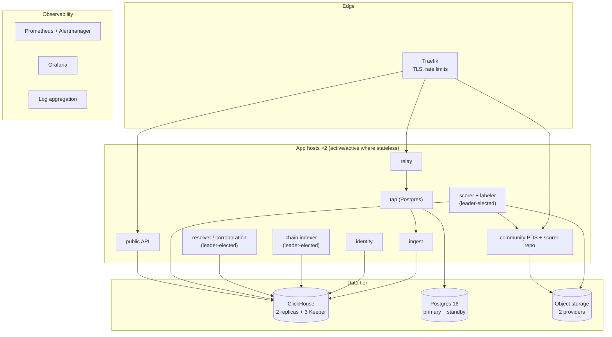
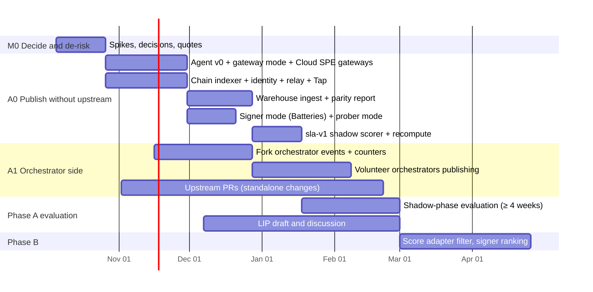

# Building the Livepeer Operator-Owned Telemetry Platform: Implementation Plan

*An implementation plan for the [Operator-Owned Telemetry proposal](README.md): what to build, who runs it, the decisions it needs, and where the proposal should change before anything is built.*

**Status:** Draft for discussion · **Date:** 2026-10-04 · **First aggregator operator:** Cloud SPE

**Companion documents:** [Proposal](README.md) · [AT Protocol primer](at-protocol-primer.md) · [A. Record schemas](appendix-a-record-schemas.md) · [B. Change list](appendix-b-change-list.md) · [C. Decisions and open questions](appendix-c-decisions-and-open-questions.md) · [D. Sequence diagrams](appendix-d-sequence-diagrams.md)

---

## Summary

The proposal's core idea holds up against the code: each operator publishes signed claims, on-chain state decides who counts, scores are earned through corroboration, and scores enter selection in stages. AT Protocol is a reasonable choice of tooling, and the ecosystem has improved since the proposal was written. Bluesky's **Tap** service now does verified backfill and filtered sync off the shelf. Permissioned data shipped as an **alpha** ("Spaces") in August 2026.

Several of the proposal's specifics do not survive contact with the code and the network. Six change the plan:

1. **`did:web` on the orchestrator's service hostname does not work for most orchestrators.** In NaaP's capability samples, 26 of 50 and 18 of 40 orchestrator hosts are bare IP addresses. Almost all serve on port 8935 or similar with a self-signed certificate. AT Protocol permits `did:web` only on port 443 with a valid HTTPS certificate, and allows no ports. **Recommendation:** `did:plc` by default, with the Ethereum binding as the root of trust. The binding should sign the repository's signing key, so the PLC directory becomes a locator and not an authority. `did:web` stays an option for operators who have a real domain.
2. **The record layout would exceed AT Protocol's repository ceiling within months, not years.** One `serviceReport` per (node, payer, work, five-minute window) gives tens of thousands of records per day for a busy orchestrator. **Recommendation:** one record per publisher per window, with rows inside it, and deterministic record keys so a republish replaces rather than duplicates.
3. **Live video-to-video ignores performance scores today.** `LiveSelectionAlgorithm` drops `perfScores` entirely, so swapping `-orchPerfStatsUrl` for scorer DIDs does nothing for the pilot's first job family. Phase B for live video-to-video needs a selection code change, not a flag.
4. **The pilot should not wait for upstream go-livepeer changes.** Every orchestrator-side record depends on new go-livepeer code. **Recommendation:** start with the parts that need no upstream change. These are gateway observations, signer ledger digests from the clearinghouse, probes, the chain indexer, the aggregator, and the scorer. Run orchestrator instrumentation in parallel through the existing fork and upstream pull requests.
5. **Publishing per-orchestrator volume exposes gateway operators' business, not only end users.** R6 protects end users and customers. It does not protect a gateway's demand, its supplier mix, or a signer's market share. That is the most likely reason a large gateway declines to publish. **Recommendation:** add a publication policy with a delayed mode and coarsened volumes, and an R8 requirement for it.
6. **One telemetry agent, not three integrations.** A single Go binary, the **Livepeer telemetry agent**, would accept every source:
   - go-livepeer's existing Kafka events, through an embedded Kafka-protocol listener, so no broker is needed;
   - orchestrator events;
   - Python SDK and builder-engine observations over local HTTP;
   - the clearinghouse cost feed.

   It would build window summaries, keep the redacted raw batches, and publish to the operator's repository. This one artifact meets R7 for every role.

The aggregator Cloud SPE runs is small in data terms. At ten times today's network, the whole system writes a few records per second. The engineering risk is not throughput. It is identity, correctness, reproducibility, operator adoption, and the safety of feeding scores into selection. The plan spends its effort there.

**Who runs infrastructure.** Each orchestrator, gateway, signer and prober runs one telemetry agent and owns a repository. Cloud SPE runs:
- the first relay, indexer, aggregator, scorer and labeler;
- a community repository host for operators who do not want to host their own;
- one mirror.

Livepeer Inc is the natural second prober and scorer. The Foundation or another SPE should run the second relay and mirror, and should hold the treasury-funded cold archive. Whoever controls the `livepeer.network` domain must publish the Lexicons. [§9](#9-who-runs-what) has the full table.

---

## Contents

1. [What exists today](#1-what-exists-today)
2. [Review of the proposal: challenges and corrections](#2-review-of-the-proposal-challenges-and-corrections)
3. [Target architecture](#3-target-architecture)
4. [Identity](#4-identity)
5. [Records and Lexicons](#5-records-and-lexicons)
6. [Corroboration engine](#6-corroboration-engine)
7. [Scoring and selection](#7-scoring-and-selection)
8. [Privacy and commercial confidentiality](#8-privacy-and-commercial-confidentiality)
9. [Who runs what](#9-who-runs-what)
10. [The Cloud SPE aggregator deployment](#10-the-cloud-spe-aggregator-deployment)
11. [Scale](#11-scale)
12. [Delivery plan](#12-delivery-plan)
13. [Verification and quality gates](#13-verification-and-quality-gates)
14. [Risks](#14-risks)
15. [Decision register](#15-decision-register)
16. [Changes this plan asks of the proposal documents](#16-changes-this-plan-asks-of-the-proposal-documents)

---

## 1. What exists today

The plan builds on six existing bodies of work. What follows is what each contributes and what each lacks.

### 1.1 go-livepeer

| Area | What exists | Gap for this plan |
|---|---|---|
| Kafka events | One producer (`monitor/kafka.go`). Its envelope is `{id, type, timestamp, gateway, data}`, where `gateway` is a host string and not an address. Delivery is at-most-once: a 100-event buffer, three retries, then drop. The fork adds a guaranteed-delivery path used only by the remote signer (`-kafkaRequireDelivery`). | Unsigned. Almost every event is gateway- or signer-attested. Runner status reaches Kafka only by gateway relay. |
| Orchestrator telemetry | Aggregate Prometheus counters, including tickets received and winning tickets by sender, plus slog lines. | No per-session or per-runner records. Live Runner session state lives only in memory. |
| Accounting hooks | `ProcessPayment` and `DebitFees` (through `AccountPayment` for live work) on every paid path. | No cumulative counters. The balance per session is evicted on timeout. |
| Selection | `ProbabilitySelectionAlgorithm` weights price, stake and randomness, and applies the perf score as a minimum-score filter. `LiveSelectionAlgorithm` (live video-to-video) takes the first orchestrator under max price in latency order and **ignores perf scores**. `-orchPerfStatsUrl` is fetched every 10 minutes with no timeout, signature or staleness handling. | No verified score source. No score weight. Nothing for live video-to-video. |
| Remote signer | `/generate-live-payment`, `/discover-orchestrators`, and a `create_signed_ticket` event per signing. The event carries orchestrator, app, billable seconds and fee. | Its `orch_address` is the orchestrator node's signing account, which may be a hot wallet rather than the on-chain orchestrator address. |
| Keys | Every keyed node has a geth keystore. EIP-191 and EIP-712 signing is available locally through `POST /signMessage`. Protocol `Sign` hashes before `personal_sign`, so verifiers must use the 32-byte hash. | No published binding between keys and any external identity. |
| Ticket parameters | `recipientRandHash` derives from a **fresh random seed** on every `TicketParams` issuance (`pm/recipient.go`). Redeeming a winning ticket reveals `recipientRand` on-chain. | Not published anywhere. |
| In-flight work | The Live Runner pool change request (fork, draft) defines orchestrator-side events: runner registered or state changed or removed, session reserved or released with unit and fee totals, fee debited. They go to a new `-kafkaOrchestratorTopic`. | Not built. It overlaps with this plan's orchestrator records, so the two should share one event model. |

### 1.2 Python gateway SDK

- `call_runner`, `reserve_session` and `runner_selector` handle discovery, the 402 challenge, signer-minted payments and failover.
- **Selection** takes candidates in discovery order and uses the first that works.
- **Telemetry:** none is exported. In-process `*Stats` counters exist for trickle media. Rejection lists (`OrchestratorRejection`, `RunnerRejection`) are ready-made failure data.
- **Fee visibility:** the SDK never learns fee amounts, because the payment is opaque. Payment truth must come from the signer side.
- **Hook point:** an optional observer callback threaded through `call_runner`, `reserve_session`, `LivePaymentSession` and `stop_runner_session`. It captures everything a gateway observation needs.

### 1.3 Clearinghouse (Batteries)

The clearinghouse is a single Go binary with SQLite storage. It provides:
- an auth webhook;
- an embedded Kafka broker (`minikafka`, SQLite-backed);
- signer event accounting into an append-only double-entry ledger;
- a TicketBroker listener with reorg handling, which matches `WinningTicketRedeemed` events to signing sessions;
- in the fork, a cursor-paginated cost event feed (`/v1/cost/events`).

**This is already most of a signer's ledger digest and most of a chain indexer.** The separate `livepeer/clearinghouse` stack (identity webhook, Redpanda, Benthos to a hosted meter) has no orchestrator dimension in its meters.

### 1.4 NaaP analytics

NaaP's pipeline runs:
- Kafka Engine into ClickHouse 24.3;
- materialized views through raw, normalized, canonical and API layers;
- a Go resolver (attribution, sessions, the SLA score) and dbt views;
- a Go read API.

Its operational state:
- **Ingest:** about 4.6M events per day from Daydream's mirror and about 35K from Cloud SPE gateways.
- **Rules:** 40 canonical rules written as an architecture-independent contract.
- **Testing:** a replay harness that proves byte-identical determinism per layer.

**Assets that carry over directly:**
- canonical rules;
- the SLA formula ([§7.1](#71-scores-are-computed-from-canonical-tables-and-published-as-records));
- the additive-primitives discipline;
- the replay determinism harness;
- the store contract (`refresh_run_id`, `artifact_checksum`);
- the API envelope.

**Gaps:**
- no `orchPerfStatsUrl`-format endpoint (the closest is `/v1/discover/orchestrators`);
- orchestrator identity divergence between registered and operating addresses (backlog 033);
- no clock-skew policy (backlog 002);
- no TTL on serving stores.

### 1.5 The Build Track architecture (Network-Engineering-SPE)

- **Layers.** Enterprise applications sit on a shared builder engine, which sits on the SDK, remote signer, Batteries and Orchestrator/Live Runner.
- **Stakeholder input** asks for "declared versus observed performance" and for "the source, operator, signature and freshness of each field". This proposal answers that request directly.
- **Track fit:**
  - The **Validate** track (provisional) wants exploitation "visible in network data" and scoring anyone can recompute.
  - The **Operate** track wants failure diagnostics for 50 Live Runner orchestrators.
  - The **Delegate** track wants trustworthy orchestrator comparison in the Explorer.
- **Ownership of selection.** Stakeholders placed selection and failover in "the go-livepeer gateway or the Live Runner control plane", and asked that dynamic operational state stay off-chain. Both are consistent with this plan.
- **Hosting commitments.** Hosted services are "not an approved Cloud SPE commitment until scope, budget, operations and acceptance are approved". Running the aggregator needs the same approval.
- **Naming signal.** One committee survey response says NaaP "should not be used" in the builder stack. The plan's aggregator therefore reuses NaaP's code and rules, but is presented as a neutral, reproducible service ([D-N12](#15-decision-register)).

### 1.6 The Enterprise App (reference deployment of the full stack)

A production application built on the whole stack. It runs:
- a remote signer with remote discovery;
- Batteries (auth webhook, accounting, read API);
- Redpanda;
- the Python SDK through a builder-layer-shaped backend.

It is a gateway operator, a signer operator and a clearinghouse operator at once. It already holds per-request orchestrator address, time to first byte, outcome, `manifest_id` and linked network cost. Its selection rule is capacity first, then recent load, then hash, with in-memory cooldowns. The builder layer design gives that rule a `SelectionPolicy` seam. **The Enterprise App is the pilot's natural second publishing gateway, its first publishing signer, and its first score consumer outside go-livepeer.**

---

## 2. Review of the proposal: challenges and corrections

Each challenge gives the evidence, the effect, the recommendation and the alternatives considered. They are ordered by how much they change the plan.

### C1. `did:web` on the service hostname is not viable as the default

**Evidence**
- AT Protocol's DID specification permits only hostname-level `did:web`.
- It allows ports "only for localhost, and only in testing", and the service endpoint must be HTTPS.
- NaaP's `getNetworkCapabilities` samples show bare IP addresses for 26 of 50 and 18 of 40 orchestrator hosts.
- Ports are almost all 8935, 8936 and similar. Orchestrators serve self-signed TLS on those ports.
- A `did:web` would require each operator to run a second web server on port 443, with a public certificate, on a hostname it controls. About half do not have one.

**Effect.** R7 fails for roughly half the network on day one, and the gap falls hardest on small operators. That is the exact bias R7 exists to prevent.

**Recommendation.** Use `did:plc` as the default and `did:web` as an option. Make the Ethereum binding the root of trust ([§4](#4-identity)). The binding record is signed by the on-chain address with EIP-712, and it names both the DID and the repository's **current signing key**. An aggregator accepts a commit only if it is signed by a key that the on-chain address has bound. A compromised or coerced PLC directory could then only misdirect readers to a repository whose commits fail verification. It could not forge data. The PLC dependency shrinks to availability, and that is mitigated by caching DID documents and by PLC read replicas.

**Alternatives considered**
- `did:web` on a separate operator domain: requires a domain, so R7 fails.
- `did:pkh` (a DID derived from the Ethereum address): not supported by AT Protocol.
- A Livepeer-run DID directory: recreates a central authority.
- On-chain DID pointers: need a contract change, and remain an option for later.

### C2. The record layout breaks the repository ceiling

**Evidence**
- Appendix A keys `serviceReport` by (node, payer, work, window) and `gateway.observation` by (orchestrator, work, window).
- An orchestrator with 3 nodes, 5 payers and 8 apps publishes 120 records per five-minute window.
- That is 34,560 per day and about 12.6 million per year.
- A gateway using 60 orchestrators across 4 pipelines publishes about 69,000 per day.
- The proposal's estimate of half a million records per year assumed far fewer dimensions.
- Repositories are designed for single-digit millions of records.

**Effect.** Compaction and pruning would have to start within weeks. Pruning is safe only once mirrors are proven, so the design would depend on its least mature component from the start.

**Recommendation**
- **One record per publisher per window, carrying a `rows[]` array.** That is 288 records per day per publisher, about 105,000 per year, and the ceiling is decades away.
- **Deterministic record keys** of the form `<windowStartUTC>.<durationSec>`, for example `20261004T1400Z.300`. A republish becomes an update to the same key instead of a duplicate. AT Protocol history still shows that the record changed.
- **Size limit.** A row with its histograms is roughly 1–2 KB, and a record must stay under 1 MB. Records that would exceed about 800 KB are split into pages with key suffix `.p2`, `.p3`.
- **Compaction is still useful** for repository hygiene, but it is no longer urgent ([§5.4](#54-retention-compaction-and-pruning)).

**Alternatives considered**
- Per-row records with aggressive compaction: forces early pruning.
- Hourly windows instead of five-minute windows: loses the startup-latency resolution NaaP parity needs.

### C3. Live video-to-video selection ignores scores

**Evidence.** `LiveSelectionAlgorithm` (`server/selection_algorithm.go`) receives `perfScores` and never reads them. The perf-score filter also needs `-region` to be set, and it is never applied as a weight anywhere.

**Effect.** Proposal §7.2 implies that Phase B for live video-to-video is a configuration change. It is a code change in go-livepeer that has to be accepted upstream.

**Recommendation.** Treat "scores in live video-to-video selection" as its own upstream change (U-7 in [§12.4](#124-upstream-change-strategy)), proposed early and with its own evidence. For transcoding and AI batch, Phase B can begin without any go-livepeer change through a local **score adapter** ([§7.4](#74-score-consumption-paths)).

### C4. The pilot depends on upstream code it cannot control

**Evidence**
- Orchestrator records need cumulative counters, runner proxy measurements and a publisher, all in go-livepeer (Appendix B.1).
- Signed quotes need a protobuf field plus signing and verification on both sides.
- The proposal names live video-to-video and Live Runner as the pilot and lists Phase A orchestrator records as required.

**Effect.** The pilot's timeline is set by upstream review. No date can be committed to.

**Recommendation.** Split Phase A into A0 and A1, and treat Phase A's success criteria as satisfiable without orchestrator records.

| Sub-phase | Needs upstream go-livepeer? | Content |
|---|---|---|
| **A0** | No | Telemetry agent; gateway observations from existing Kafka events; signer ledger digests from Batteries; Cloud SPE probes; chain indexer; relay; aggregator; NaaP parity report; `sla-v1` scorer in shadow |
| **A1** | Fork first, upstream in parallel | Orchestrator events (shared with the pool change request), counters and runner proxy measurements, published by volunteer orchestrators running the fork |

The [phase gate](#122-phases-and-gates) for Phase B then requires A1 coverage only for the orchestrators it scores with two-sided confidence.

### C5. Gateway operators' commercial confidentiality is unaddressed

**Evidence**
- A `gateway.observation` reveals:
  - which orchestrators a gateway uses;
  - session counts per orchestrator, five minutes at a time;
  - fees per orchestrator.
- A `ledgerDigest` reveals a signer's market volume per orchestrator and app.
- None of this is end-user data, but it is business data.

**Effect.** The operators whose data matters most are the least likely to publish. Today that means Daydream and the large gateways.

**Recommendation.** Add requirement **R8: "Publishing must not force an operator to disclose more about its own business than corroboration requires."** Implement it with a per-publisher publication policy, declared in a signed record so consumers know what they are reading:

| Mode | Volume fields | Quality fields | Delay |
|---|---|---|---|
| `full` | exact | exact | none |
| `delayed` | exact | exact | publish at T + 24 h (configurable) |
| `coarse` | rounded to log buckets (1, 2, 5, 10, 20, 50 …) | exact histograms on sampled sessions | none or delayed |

Corroboration still works in every mode, because matching uses rand hashes and quality uses rates. On-chain redemptions already reveal sender-to-recipient flows in coarse form, so `coarse` mode gives away little that is not already public. Scorers should report which publication modes underlie each score.

### C6. The proposal under-sells its strongest evidence

**Evidence.** `recipientRand` is drawn fresh from a random seed for every ticket-params issuance. Redeeming a winning ticket publishes `recipientRand` on-chain.

**Effect.** Every redemption ties to exactly one published window from the gateway, the orchestrator and the signer:
1. Hash the revealed `recipientRand`.
2. Look it up in the published rand-hash sets.

Proposal §6.3 treats payments only as a statistical volume estimate. In fact each redemption is also an exact, unforgeable proof that this payer did business with this orchestrator in that window, as both sides reported it.

**Recommendation**
- Make **redemption-anchored matching** a first-class corroboration signal ([§6.2](#62-signals)).
- Publish rand hashes as 8-byte prefixes. Collisions are negligible at network scale, and prefixes cut 75% of the bytes.
- Cap the list at 2,000 entries per row, with a Bloom-filter overflow field.

### C7. Separate pipelines per role multiply operator cost

**Evidence.** The proposal names three publishing paths:
- an embedded publisher in go-livepeer;
- a Kafka sidecar plus a local broker for gateways;
- a module in the SDK.

Running a local Kafka broker just to feed a sidecar is not "close to nothing".

**Recommendation.** One **Livepeer telemetry agent**, a single Go binary ([§3.3.1](#331-livepeer-telemetry-agent)), with many inputs:
- an embedded Kafka-protocol listener, reusing Batteries' `minikafka`, so go-livepeer points `-kafkaBootstrapServers` at the agent with no broker;
- local HTTP for SDK and builder-engine observations;
- the Batteries cost feed.

It has one output: the operator's repository.

**Alternatives considered**
- Embedding everything in go-livepeer: upstream risk, and it does not serve SDK applications.
- A Python agent: does not match go-livepeer, indigo or Batteries, all of which are Go.

### C8. "Each orchestrator runs its own PDS" should be one option, not the rule

**Evidence**
- The reference PDS (TypeScript, 1 GB RAM minimum) assumes `did:plc` accounts with subdomain handles.
- The Go PDS (`cocoon`) describes itself as experimental.
- The Rust PDS (`rsky-pds`) supports `did:plc` only.
- An embedded PDS in go-livepeer is a large upstream change.

**Recommendation.** Offer three hosting modes for the same repository. Because the operator holds its PLC rotation key and its Ethereum binding (R2), it can move between modes at any time.

| Mode | Who runs the server | Who holds the keys | For whom |
|---|---|---|---|
| **Agent-hosted** | The operator. The telemetry agent includes a minimal, sync-only repository host. | Operator | Default for operators who will run the agent anyway |
| **Community-hosted** | Cloud SPE, later others. A standard PDS with one account per operator. | The PDS holds the signing key; the operator holds the rotation key and the Ethereum binding | Operators who want nothing extra running |
| **Self-run PDS** | The operator, running the reference PDS | Operator | Operators who already run AT Protocol infrastructure |

The **minimal repository host** is the agent's most important build risk. It serves only what readers need:
- `com.atproto.sync.getRepo`, `getRecord`, `subscribeRepos`, `getLatestCommit`, `listRepos`;
- `com.atproto.server.describeServer`;
- `com.atproto.repo.describeRepo`.

Writes come only from the agent itself. There are no accounts, no OAuth and no blobs. It is built on indigo's repository and MST packages, and it must pass a conformance suite against the indigo relay and Tap before any operator depends on it ([§13](#13-verification-and-quality-gates)).

### C9. Scores read by gateways need a lighter path than full AT Protocol sync

**Evidence**
- Proposal B.2.4 has go-livepeer resolve scorer DIDs, read and verify `score.published` records, and take medians.
- That puts an AT Protocol client in every gateway's critical path.

**Recommendation.** Use two paths.
- **Today's go-livepeer:** a local **score adapter**, a mode of the telemetry agent.
  1. It reads trusted scorers' records with `com.atproto.sync.getRecord`, which returns a proof-carrying CAR file.
  2. It verifies each record against the scorer's binding.
  3. It takes the median across scorers.
  4. It serves the existing `orchPerfStatsUrl` JSON on localhost.

  Transcoding and AI batch can use scores in Phase B with no go-livepeer change.
- **Native, later:** the same verification moves into go-livepeer once the score has proven its value (U-6).

Fail-safe behaviour ([§7.5](#75-safety-rails)) belongs to the adapter as well.

### C10. Relays should be run from the start, not treated as optional

**Evidence**
- Tap, the off-the-shelf verified-sync tool, consumes a relay.
- Every additional aggregator would otherwise open connections to every operator's repository host, which raises the cost of R5 for everyone after the first.

**Recommendation**
- Cloud SPE runs a **Livepeer-scoped relay** from A0. It crawls only the repository hosts of on-chain participants, fed from the chain indexer. That is also its spam control.
- A second operator (the Foundation, Livepeer Inc or another SPE) runs a second relay by the end of Phase A.
- Direct subscription stays supported, so a relay is never a single point of failure.

### C11. Lexicon publication has a DNS owner the proposal does not name

**Evidence**
- AT Protocol Lexicon resolution maps the NSID authority `network.livepeer` to a DNS TXT record at `_lexicon.livepeer.network`.
- That record names the DID that publishes the schema records.

**Effect.** Whoever controls the `livepeer.network` DNS zone controls schema publication.

**Recommendation**
- Name that party in the LIP.
- Pilot under an **experimental NSID authority** controlled by Cloud SPE, so nothing under `network.livepeer.*` is published before the LIP. Published Lexicons cannot change incompatibly.
- Migrate to `network.livepeer.*` at LIP adoption. The aggregator reads both namespaces during the transition.

### C12. Raw-batch audits are expensive and need a canonical encoding

**Evidence**
- Appendix A requires a Merkle root over raw events and a commitment to serve raw batches until `retainedUntil`.
- No encoding, redaction rule or serving API is specified.

**Recommendation**
- Keep the commitment and make serving **optional in A0 and A1**.
- **The commitment** is a SHA-256 Merkle root over events that are already redacted, encoded as DAG-CBOR, and sorted by (timestamp, event hash). Redaction uses an **allowlist**: the event-schema fields the summary needs. A denylist would let new private fields leak by default.
- **Serving.** The agent stores the redacted batches. An optional, authenticated `network.livepeer.audit.getBatch` endpoint serves them.
- **Later.** Once AT Protocol Spaces leaves alpha, raw batches could move into a permissioned space readable by named auditors. This is a Phase C option, not a dependency.

### C13. The orchestrator identity has three addresses, not two

**Evidence.** An orchestrator can appear under three different addresses:

| Address | Where it appears |
|---|---|
| The on-chain registered address | `TicketParams.recipient`, BondingManager |
| The node's signing account | `OrchestratorInfo.address`, a hot wallet under `-ethOrchAddr`. This is what the signer's `create_signed_ticket` reports as `orch_address`. |
| The LIP-118 reward caller | `RewardCallerSet` |

NaaP backlog item 033 is this problem.

**Recommendation**
- The binding record lists operating addresses.
- The aggregator's identity service resolves every observed address to the registered address before any join.
- An observed address with no binding is kept as `unresolved`, never merged on a guess.

### C14. Corrections to factual statements

| Location | Statement | Correction |
|---|---|---|
| Proposal §3.3, primer §7 | Permissioned data "has not shipped" | AT Protocol Spaces shipped as an alpha on 2026-08-20. It is not production-ready and carries no security review. |
| Primer §6 | Tooling for small readers depends on Jetstream | Tap (indigo `cmd/tap`) provides verified backfill and collection-filtered sync from any relay. |
| Proposal §7.2 | `-orchPerfStatsUrl` becoming scorer DIDs covers live video-to-video | Live selection ignores scores ([C3](#c3-live-video-to-video-selection-ignores-scores)). |
| Proposal §1.1 | Events are identified by organization | Also true: the envelope's `gateway` field is a host string, not an address, so even the gateway is not cryptographically identified. |
| Appendix B.3.1 | Signer events name the orchestrator | They name the orchestrator node's signing address, which may be a hot wallet ([C13](#c13-the-orchestrator-identity-has-three-addresses-not-two)). |
| Appendix A §A.11 | `score.published` holds up to 5,000 entries | Entries per scorer = orchestrators × work keys × vantage clusters, and that can exceed both 5,000 and 1 MB. Shard by work family and vantage cluster ([§5.2](#52-changes-to-appendix-a)). |

### What holds up without change

- The three layers: chain, repositories, aggregators and scorers.
- Claims are not facts; scores must be recomputable.
- Shadow, then filter, then weight.
- Additive summaries.
- Operator-level publishing only (R6).
- Regions relative to the observer.
- Self-dealing handled by labels.
- Scores never affect stake.
- History preserved in three tiers.
- Phase A compares measurements, not scores.
- `sla-v1` without special standing.

The plan keeps all of it.

---

## 3. Target architecture

### 3.1 Principles

1. **The chain decides who counts. Records decide what was claimed. Corroboration decides what is probably true.** These are the proposal's three layers, kept unchanged.
2. **The root of trust is an Ethereum signature, not a DID method.** DID infrastructure locates data; the binding authenticates it.
3. **Every role installs one artifact.** That artifact is the telemetry agent.
4. **Nothing in the critical path of a job depends on this system.** Selection that uses scores must fail open to today's behaviour.
5. **Every derived number is reproducible.** This applies to the aggregator's measurements and to scorers' scores. NaaP's replay harness is the model.
6. **Pilot names are disposable.** Nothing under `network.livepeer.*` is published before the LIP.

### 3.2 System context



### 3.3 Components

#### 3.3.1 Livepeer telemetry agent

One Go binary, with one container image and one config file. It is built in a new repository in the Build Track's style. Modes are enabled by flag, and the same binary serves every role.

| Subsystem | Responsibility | Built on |
|---|---|---|
| Inputs: Kafka listener | Accepts go-livepeer's producer on `localhost:9092`, for gateway, signer and (future) orchestrator topics. No external broker. | Batteries' embedded `minikafka` |
| Inputs: HTTP ingest | `POST /v1/events` for SDK observers, the builder engine and the Enterprise App. It accepts typed events, not summaries, so window logic exists once. | — |
| Inputs: cost feed | Polls Batteries `/v1/cost/events` with a stored cursor, for signer ledger digests | Batteries read API |
| Inputs: probes | Accepts results from the prober harness | — |
| Redaction | An allowlist per event type. Fields are dropped at ingest, before anything is persisted. | — |
| Local event store | SQLite, write-ahead logging, one table per input, retention per policy | — |
| Window builder | Aligned five-minute windows, a grace period (default 120 s), late events folded into a republish of the same record key, fixed histogram bounds per schema version | — |
| Identity | Holds the repository signing key. Produces the binding statement for the operator to sign with the Ethereum key, either through go-livepeer `/signMessage` or by printing an EIP-712 payload for a hardware wallet. | go-ethereum `apitypes` |
| Repository | Agent-hosted mode: the minimal sync-only host ([C8](#c8-each-orchestrator-runs-its-own-pds-should-be-one-option-not-the-rule)). Community mode: a client that writes to a remote PDS with an app password. | indigo `atproto/repo`, `atproto/crypto`, `xrpc` |
| Publication policy | `full`, `delayed` or `coarse` ([C5](#c5-gateway-operators-commercial-confidentiality-is-unaddressed)) | — |
| Audit store | Redacted raw batches plus Merkle roots; optional `audit.getBatch` endpoint | — |
| Score adapter | Reads trusted scorers, verifies, takes medians, serves `orchPerfStatsUrl` JSON locally ([§7.4](#74-score-consumption-paths)) | indigo |
| Ops | `/healthz`, Prometheus `/metrics` (records published, windows late, events dropped, Kafka drop estimate), structured logs | — |

**Resource budget (target):** under 100 MB RAM, under 1% of a core, and under 2 GB of disk at 30 days of raw retention for a busy gateway. **Configuration** is one YAML file plus one flag in go-livepeer (`-kafkaBootstrapServers=localhost:9092`).

#### 3.3.2 Chain indexer

It indexes Arbitrum One:
- BondingManager: activation, deactivation, bonding, reward, reward-caller events;
- both ServiceRegistry instances (transcoding and AI): `ServiceURIUpdate`;
- TicketBroker: deposits, reserves, withdrawals, unlocks, `WinningTicketRedeemed`;
- RoundsManager: `NewRound`.

Its outputs are:
- **participant-set snapshots per round:** active orchestrators with service URIs; senders with deposit or reserve;
- **redemptions**, carrying `recipientRand` and its hash.

It is built by extracting Batteries' listener (`internal/chain/listener.go`), which already handles reorgs, into a reusable module. It reads through two RPC providers with quorum on block hashes, waits a confirmation depth of 64 blocks before data counts as final, and writes provisional rows before that. The Livepeer subgraph serves as an independent daily cross-check, not as a source.

#### 3.3.3 Relay and Tap

- **Relay.** The indigo relay (Sync 1.1, recent-events retention), run as a Livepeer-scoped instance. Its crawl list is the repository hosts of participants that have a verified binding, plus the community PDS and known scorer hosts. Unknown hosts may request a crawl and are rate-limited.
- **Tap.** Subscribes to the relay with a DID list sent by the identity service and collection filters (`network.livepeer.*` and the experimental namespace). It runs on Postgres and delivers to the ingest service by acknowledged WebSocket, so delivery is at-least-once.

#### 3.3.4 Identity service

Its jobs:
- resolves DIDs, with a cache and PLC replica support;
- verifies binding and delegation records against chain state *at the time of each window*;
- maintains the key history per DID;
- maps every observed address (registered, operating, reward caller) to a registered address;
- tells Tap which DIDs to follow.

It writes `identity_bindings`, `identity_key_history` and `address_map`. A binding can be valid, expired, superseded, invalid or unresolved, and records from DIDs without a valid binding are stored but excluded from canonical tables.

#### 3.3.5 Warehouse and ingest (extending NaaP)

**Ingest.** The ingest service writes each verified record operation into `atp_record_log`, an append-only log keyed by (did, collection, rkey, rev). Each row holds the CID, operation, commit time, the record JSON and the validation result. Deletions are logged too.

**Normalization.** Per-collection materialized views flatten `rows[]` into normalized tables, for example `norm_gateway_observation_row`. A ReplacingMergeTree keyed on (did, rkey, row key) keeps the latest revision. The log keeps every revision for audit and history.

**Canonical layer.** It reuses NaaP's rules and formulas, and replaces the Kafka-specific session reconstruction with summary-native facts. NaaP already requires additive primitives, so its hourly SLA inputs (startup counts, swap counts, viability counts, PTFF, FPS histograms) map onto summary fields directly.

**Parity tables.** These compare Kafka-path and record-path measurements per hour and orchestrator for the Cloud SPE gateways ([§13.3](#133-phase-a-parity)).

**Storage engine.** ClickHouse is kept, for three reasons:
- the team already runs it;
- the data volume is small;
- materialized views make re-derivation cheap.

#### 3.3.6 Corroboration engine

A resolver stage, described in [§6](#6-corroboration-engine).

#### 3.3.7 Scorer

A deterministic job. For each scoring window it runs these steps:
1. Freeze the input set: the latest revision of each record as of the freeze time.
2. Compute the formula.
3. Write an inputs manifest (sorted CIDs) to content-addressed object storage.
4. Publish sharded `score.published` records to the scorer's repository.

The formula code is published, and a `recompute` command reproduces any score from public data ([§7](#7-scoring-and-selection)).

#### 3.3.8 Labeler

A standard AT Protocol labeler service, exposing `com.atproto.label.queryLabels` and `subscribeLabels`, with labels signed by the labeler's key. It publishes `report-mismatch`, `binding-invalid`, `self-dealing-suspected`, `probe-special-treatment`, `hardware-mismatch` and `location-mismatch`, and, from the prober's integrity checks, `secret-misuse`, `tls-interception` and `dns-tampering`. Applications and allocators run their own labelers for `approved`; Cloud SPE's labeler does not publish it. Each label references a method document and the evidence query. Ozone, Bluesky's moderation stack, is heavier than needed, so this should be a minimal Go labeler on indigo.

#### 3.3.9 Mirror and cold archive

- **Mirror.** A Tap instance in full-history mode for all followed DIDs. It writes every commit, as CAR fragments, into object storage, plus a daily full `getRepo` CAR per DID.
- **Cold archive.** Once per round it writes:
  - a CAR export of every followed repository;
  - an index file mapping DID → (rev, CAR SHA-256);
  - the index's hash.

  Storage is two independent object stores, one of them a different provider. On-chain anchoring is optional: one transaction per round posting the index hash. It is cheap on Arbitrum and recommended from Phase B.

#### 3.3.10 Public API and Explorer feeds

The NaaP API pattern (RFC 7807 errors, `{data, pagination, meta}`, cursor pagination) carries over, with new routes:

| Route | Purpose |
|---|---|
| `/v1/participants` | Participants and their binding status |
| `/v1/orchestrators/{address}/measurements` | Hourly measurements, with publisher and corroboration breakdown |
| `/v1/orchestrators/{address}/scores` | Scores per scorer, formula, work and vantage cluster |
| `/v1/corroboration/{address}` | Two-sided match rates, redemption-anchored matches, labels |
| `/v1/parity` | Phase A parity table |
| `/v1/records/{did}/{collection}/{rkey}` | Record with verification status and revisions |

The Explorer (Delegate track) reads the scores and corroboration routes. Every response carries `inputs` CIDs, so the Explorer can show "how this number was computed".

#### 3.3.11 Prober

Cloud SPE's existing test harness for live video-to-video and Live Runner publishes `probe.result` through its own agent and DID. Probe senders rotate across several funded deposits ([§6.4](#64-self-dealing-and-probe-gaming)).

Each probe workload also runs an integrity suite from inside the sandbox (proposal §6.7):
- **Canaries.** A canary service issues one credential per orchestrator per probe, records the commitment in `probe.result`, and watches for use. Canaries must look like the secrets real applications carry: API keys for real-looking services and database connection strings. When one is used, the service publishes signed evidence under its own DID and the prober publishes `probe.canaryReveal`.
- **TLS.** Connections to Cloud SPE-controlled endpoints, compared against pinned certificate fingerprints.
- **DNS.** Resolution of Cloud SPE-controlled names with known answers.

The canary service is a separate deployment from the prober, so evidence of use does not come from the same process that issued the canary.

### 3.4 How the pieces interact

The proposal's Appendix D flows still apply. These deltas change them:

- **D.1, joining.**
  1. `agent init` creates a `did:plc` and prints an EIP-712 binding payload.
  2. The operator signs it, either through `livepeer_cli` or `/signMessage` if the node holds the registered key, or with a hardware wallet in a small web tool.
  3. The agent publishes the binding.
  4. The indexer sees the address is a participant. The identity service verifies the binding and adds the DID to the relay crawl list and Tap.
- **D.2 and D.3, sessions.** go-livepeer writes Kafka events to the agent instead of a broker. The SDK, or the builder engine around it, posts events to the agent's HTTP ingest when the application runs an agent, or to its signer otherwise (Phase B relay path).
- **D.4, corroboration.** Matching uses rand-hash prefixes, then redemption anchoring, then volume estimation ([§6.2](#62-signals)).
- **D.5, selection.** go-livepeer reads the local score adapter. The signer ranks in `/discover-orchestrators`. The builder engine's `SelectionPolicy` reads the adapter or the API.

---

## 4. Identity

### 4.1 Participants

| Role | On-chain test | Identity anchor |
|---|---|---|
| Orchestrator | Active in BondingManager in the window's round, with a service URI in either registry | Registered address |
| Gateway with its own key | Deposit or reserve in TicketBroker during the window | Sender address |
| Remote signer | Same as above | Sender address |
| Keyless gateway or SDK app | None | Signer's `delegation` record, or none (relayed observations only) |
| Prober, scorer, labeler, aggregator | None | DID only; consumers decide trust |

### 4.2 The binding record (revised)

The binding is an EIP-712 typed message signed by the registered address:

```
EIP712Domain { name: "LivepeerTelemetryBinding", version: "1", chainId: 42161 }

Binding {
  string   did                  // did:plc:… or did:web:…
  bytes32  repoKeyHash          // keccak256 of the multibase-encoded repository signing key
  address  registeredAddress
  address[] operatingAddresses  // hot wallets, reward caller, node signing accounts
  string   role                 // "orchestrator" | "gateway" | "signer"
  uint64   validFrom
  uint64   validUntil           // ≤ 1 year after validFrom
  uint64   nonce                // strictly increasing per registeredAddress
}
```

What changes relative to Appendix A §A.4:
- `repoKeyHash` makes the Ethereum key, not the DID document, the authority over which repository key is trusted.
- `role` and `nonce` prevent replay across roles and rotations.
- The validity window is bounded, so a forgotten binding expires.

**Verification.** For each record, the aggregator checks:
1. The commit signature verifies with key *K*.
2. Some binding, valid at the record's window time, names this DID and has `repoKeyHash = keccak(K)`.
3. The binding's registered address is a participant in that round.

### 4.3 Rotation and compromise (answers Appendix C Q2)

| Event | Procedure |
|---|---|
| Planned repository key rotation | The agent creates key K2, the operator signs a new binding naming K2 with a higher nonce, and the agent updates the DID document. Records signed by K1 stay valid for windows before the new binding's `validFrom`. |
| Repository key compromised | The operator signs a binding for K2 with `validFrom` = time of compromise. The aggregator distrusts K1 commits whose revision timestamps are after that time. Labelers flag disputed windows. |
| Operating address compromised | A new binding omits the address. Records citing that address after `validFrom` are rejected for attribution. |
| Registered key compromised | Out of scope for telemetry; it is a stake-level incident. The aggregator follows the chain. |
| PLC directory unavailable | Cached DID documents keep working. Bindings do not depend on PLC. |
| PLC directory misbehaves | Repository keys not bound by Ethereum signatures fail verification, so the damage is limited to availability. |

### 4.4 Fleet records

Keep `orch.fleet` as proposed, with two changes:
- Node URIs may be IP-based; nothing in the fleet record needs DNS.
- Add `operatingAddress` per node, for nodes that sign with different hot wallets.

Fleet records feed:
- the identity service's address map;
- the shared-infrastructure signal for self-dealing;
- later, gateway discovery that replaces hand-maintained `-orchAddr` lists. That is a separate upstream change and not needed for the pilot.

---

## 5. Records and Lexicons

### 5.1 Namespace and governance

| Stage | NSID authority | Who publishes the schemas |
|---|---|---|
| Pilot (A0–A1) | An experimental authority on a Cloud SPE-controlled domain, for example `org.example.lpx.*` as a placeholder | Cloud SPE |
| After the LIP | `network.livepeer.*` | The controller of the `livepeer.network` domain, through `_lexicon` DNS records and `com.atproto.lexicon.schema` records |

The LIP fixes four things:
- the versioning rules (additive optional fields only; new names for breaking changes);
- the histogram bounds per field per version;
- the non-goals;
- the record-key conventions below.

### 5.2 Changes to Appendix A

| Record | Change | Reason |
|---|---|---|
| All window summaries | Record key `<windowStart>.<durationSec>[.pN]`; body `{window, policy, rows[], raw}` | Repository ceiling and idempotent republish ([C2](#c2-the-record-layout-breaks-the-repository-ceiling)) |
| All window summaries | `policy` field: `full`, `delayed` or `coarse`, plus `publishedAt` | Commercial confidentiality ([C5](#c5-gateway-operators-commercial-confidentiality-is-unaddressed)) |
| `paymentRef` | `randHashPrefixes` (8-byte hex, at most 2,000) plus an optional `randHashBloom` | Size; redemption anchoring ([C6](#c6-the-proposal-under-sells-its-strongest-evidence)) |
| `operator.binding` | Fields per [§4.2](#42-the-binding-record-revised) | Root of trust ([C1](#c1-didweb-on-the-service-hostname-is-not-viable-as-the-default)) |
| `operator.publicationPolicy` | New record, key `self`: the mode, the delay and the coarsening table | Consumers must know what they are reading |
| `orch.fleet` | `operatingAddress` per node | Identity ([C13](#c13-the-orchestrator-identity-has-three-addresses-not-two)) |
| `orch.serviceReport` rows | Add `addressSeen`, the address the payer used, alongside `payer` | Address mapping |
| `gateway.observation` rows | Add `clockOffsetMs` (estimate from NTP status) and `kafkaDropsEstimate` | Clock-skew policy; parity accounting |
| `signer.ledgerDigest` | Window is one round, key `round-<n>`; lines keyed by registered orchestrator address, with `addressSeen` | Join on registered address |
| `score.published` | Sharded: key `<formula>.<windowStart>.<workFamily>.<clusterShard>`; add `freezeTime`, `inputsUri` (content-addressed), `codeRef` (the commit of the formula code) | Size; recomputability |
| `probe.result` | Add `senderAddress` (hashed until the round after use) | Lets the labeler test for special treatment of probes after the fact without exposing live probe addresses |

### 5.3 Histogram bounds (answers Appendix C Q5 for the pilot)

Bounds are fixed per schema version. The edges are log-spaced and dense where NaaP's benchmarks place p50 and p90.

| Field | Unit | Upper edges |
|---|---|---|
| `startupMs`, `firstFrameMs` | ms | 250, 500, 750, 1000, 1250, 1500, 1750, 2000, 2500, 3000, 4000, 5000, 6500, 8000, 10000, 15000, 20000, 30000, 60000 |
| `firstByteMs` (Live Runner) | ms | 25, 50, 100, 150, 200, 300, 500, 750, 1000, 1500, 2000, 3000, 5000, 10000, 30000 |
| `outputMilliFps` | mfps | 1000, 2000, 4000, 6000, 8000, 10000, 12000, 14000, 16000, 18000, 20000, 22000, 24000, 26000, 28000, 30000, 45000, 60000 |
| `rttMs` | ms | 5, 10, 20, 40, 60, 80, 100, 150, 200, 300, 500 |
| `sessionDurationSec` | s | 10, 30, 60, 300, 900, 1800, 3600, 7200, 21600, 86400 |

**Five-minute windows stay.** The Phase A parity test decides whether the p90 resolution is good enough. If the p90 time-to-first-frame row fails, as in the proposal's illustration, the bounds get denser between 3 s and 8 s in schema version 2.

### 5.4 Retention, compaction and pruning

Bundled records put the repository ceiling decades away, so:
- **Compaction is optional.** Agents compact five-minute records into hourly records after 30 days, and into daily records after 1 year, only when the operator enables it.
- **Pruning requires evidence of mirroring.** The agent checks that at least two independent mirrors have published a mirror attestation (a small signed record: DID, rev, CAR hash) at or after the rev being pruned.
- **Raw batches** are kept for 30 days by default. The publication policy declares the actual period, and `retainedUntil` is a commitment.

### 5.5 Clock policy (answers Appendix C Q7)

- Windows use the publisher's UTC clock. The agent refuses to publish when its NTP-reported offset exceeds 2 seconds, and records the offset in each row.
- Cross-party matching uses rand hashes, not time. The aggregator matches rows whose windows lie within ±1 window of each other, which absorbs skew and grace-period boundary effects.
- NaaP's backlog item 002 (gateway, runner and ingest skew) is closed for record-based ingest by this rule.

### 5.6 Salting (answers Appendix C Q8)

`relayedFor` is `HMAC-SHA256(signerSecret, apiKeyId)` truncated to 16 bytes:
- `signerSecret` is a 32-byte secret held only by the signer and rotated yearly;
- `apiKeyId` is the internal key identifier, never the key itself.

The value is stable per client for a year, can only be reversed by brute force by the signer itself, and rotates with an announced epoch. Below a minimum client count per signer and window (k = 5), relayed rows are merged into a single `relayedFor = "pooled"` row.

---

## 6. Corroboration engine

### 6.1 Units of evidence

The engine works on **pair-windows**: one (payer registered address, orchestrator registered address, work key, hour). Five-minute rows roll up to hours for corroboration. Measurements keep five-minute resolution.

### 6.2 Signals

| # | Signal | Computation | Strength |
|---|---|---|---|
| S1 | Two-sided match | Intersection of rand-hash prefixes between a gateway (or signer) row and an orchestrator row. Compare sessions, units and fees within tolerance. | Strong when both publish |
| S2 | Redemption anchor | For each `WinningTicketRedeemed`, compute `keccak(recipientRand)`, find the published rows containing its prefix, and mark the pair-window *anchored*. | Exact proof that the business happened, and that it happened in the window both sides named |
| S3 | Volume consistency | Expected wins = Σ winProb over the published `ticketsSent` and `expectedValueWei`. Compare with observed redemptions using a Poisson interval over a rolling 7-round window. | Statistical. Weak for small pairs, strong for large ones and for whole-gateway totals. |
| S4 | Signer–gateway consistency | A signer's ledger lines for an orchestrator versus the relayed observations, and versus gateways that delegate to the signer | Medium |
| S5 | Probe agreement | Probe-observed rates versus the same orchestrator's rates seen by independent gateways from the same vantage cluster | Medium; also detects special treatment of probes |
| S6 | Declared versus measured | Hardware claims (fleet, quote) versus measured throughput per app; declared location versus RTT | Labels only |

### 6.3 Reporter weighting

Each observation row gets a weight *w* ∈ [0, 1] before it enters scores:

```
w = binding_valid × min(1, anchored_share / 0.5) ^ α × diversity_factor × (1 − self_dealing_penalty)
```

- **`anchored_share`** is the fraction of the reporter's recent pair-windows with S2 anchors. With α = 0.5 by default, an operator with few anchors is down-weighted but not excluded.
- **`diversity_factor`** is 1 when the reporter's observations of an orchestrator are corroborated by at least one independent reporter or prober in the same cluster within 24 hours, and otherwise 0.5.
- **`self_dealing_penalty`** comes from labels the scorer has chosen to trust.

Weights are **scorer policy**, not aggregator facts. The aggregator publishes the signals, and each formula decides how to weigh them. `sla-v1` uses the weights above so that it is reproducible.

### 6.4 Self-dealing and probe gaming

**Self-dealing signals, in the labeler's order of cost:**
1. **Concentrated revenue.** More than 80% of an orchestrator's anchored value comes from a single sender for 3 or more consecutive rounds.
2. **Traced funding.** A sender's deposit was funded within 2 hops from addresses receiving the orchestrator's fees or rewards, from chain indexer transfers.
3. **Shared infrastructure.** The same IP or /24, the same TLS certificate fingerprint, or the same PDS host across a gateway and an orchestrator.
4. **Irrational prices.** Paid more than 2× the median quote for the work key over 7 days.
5. **Uncorroborated quality.** Good quality only from reporters with `diversity_factor` 0.5.

Thresholds start conservative and are published. **Operators that legitimately run both roles can declare the relationship** in an `operator.affiliation` record. A declared affiliation removes the penalty for undisclosed self-dealing but keeps the affiliated observations out of *independent* corroboration. Honesty is rewarded and the scores stay clean.

**Probe gaming:**
- Probers rotate across at least 5 deposits, funded through unrelated paths and replenished on a schedule.
- Probe sender addresses are revealed only after the round, through the hashed `senderAddress`.
- Probe profiles match real-traffic shapes.
- S5 runs continuously.
- Funding for rotating deposits is a line item in the prober's budget ([§12.6](#126-funding-and-team)).

---

## 7. Scoring and selection

### 7.1 Scores are computed from canonical tables and published as records

**`sla-v1`** is NaaP's live video-to-video formula, unchanged in its weights:
- `sla = 100 · coverage · (0.7 · reliability + 0.3 · quality)`;
- `reliability = 0.4 · startup + 0.2 · no_swap + 0.4 · viability`;
- `quality = 0.6 · latency + 0.4 · fps`, against the 7-day cohort benchmark, with shrinkage for sparse data.

Two changes:
- Inputs are corroboration-weighted rows instead of gateway-only sessions.
- It is computed per vantage cluster instead of network-wide.

**`lr-v1`** is new, for Live Runner:
- reliability = reservations succeeded ÷ attempted, excluding capacity rejections reported honestly by an orchestrator whose capacity is published;
- latency = first-byte histogram against the app cohort;
- `endReasons` other than client stop count against the score.

**Output.** Scores are published hourly, frozen at hour + 15 minutes, as basis points with a confidence and a sample count. The confidence comes from the effective sample size after weighting.

### 7.2 Vantage clusters

Clusters are derived, not declared:
1. Each observer's rows carry an H3 cell at resolution 2 and an RTT histogram per orchestrator.
2. The scorer clusters observers by median RTT vectors to common orchestrators, with a stable algorithm and a published seed.

Gateways map their own position to a cluster through the score adapter. For go-livepeer's `-region` code, the adapter maps the cluster to the configured region name.

### 7.3 Recomputability

Each score shard names:
- the formula;
- `codeRef`, a git commit of the open-source scorer;
- `freezeTime`;
- `inputsUri`, a content-addressed list of record CIDs.

`lpscore recompute --shard <at-uri>` fetches the inputs from any mirror or relay and reproduces the shard byte for byte. CI runs recompute against a sample of published shards every day. A mismatch pages the scorer's operator and raises a `score-irreproducible` label on its own output, so the scorer is visibly accountable for its own bugs.

### 7.4 Score consumption paths

| Consumer | Path | go-livepeer change? | Phase |
|---|---|---|---|
| go-livepeer gateway: transcoding, AI batch | Local score adapter serves `orchPerfStatsUrl` JSON; `-minPerfScore` filter | None | B |
| go-livepeer gateway: live video-to-video | Live selection must read scores (U-7) | Yes | B, after upstream |
| go-livepeer gateway: weight | Score term in `calculateProbabilities` (U-8) | Yes | C |
| Remote signer `/discover-orchestrators` | Rank by score with score and confidence in the response (U-5) | Yes (signer) | B |
| Python SDK | Accept a ranked list; `runner_selector` honours the order (S-3) | SDK | B |
| Builder engine and Enterprise App | `SelectionPolicy` implementation that reads the adapter or aggregator API | None upstream | A (shadow logging), B |
| Explorer | Public API | None | A |

### 7.5 Safety rails

These apply from Phase B onward. They are enforced in the adapter and in every native implementation.

1. **Fail open.** If no trusted score is fresher than 3 hours, the filter is disabled and selection behaves as today. A metric and alert record the event.
2. **Floor on candidates.** If the filter would leave fewer than max(3, 20% of candidates), relax the threshold to keep that floor. This generalizes go-livepeer's current "fall back to all" behaviour.
3. **Exploration share.** At least 10% of selections ignore scores, so new orchestrators build a record. This is configurable but never zero.
4. **Rate of change.** An orchestrator's effective score moves by no more than 20 points per hour. This damps flapping and blunts sudden manipulation.
5. **Quorum.** In Phase B, a score applies only when at least 2 trusted scorers publish for that orchestrator and cluster. In Phase C, weighting requires at least 3 independent scorers network-wide. "Independent" means no shared operator and no shared formula code commit, declared in the scorers' affiliation records. That answers Appendix C Q11 mechanically; governance decides the numbers.

### 7.6 Shadow-phase evaluation

Gateways running the adapter in shadow mode log (selection time, candidate set, chosen orchestrator, score available, outcome). The scorer then computes:

| Criterion | Threshold to propose Phase B |
|---|---|
| Spearman correlation between score and next-hour success rate, orchestrators with at least 30 sessions | ρ ≥ 0.4 in every pilot cluster, for 4 consecutive weeks |
| Calibration | Orchestrators in the top score quintile have higher success than the bottom quintile in at least 90% of weeks |
| Coverage | ≥ 80% of pilot sessions on orchestrators with a score of confidence ≥ 0.5 |
| Stability | Week-over-week rank churn below 30% for orchestrators without measured change |
| Counterfactual regression | Replaying selection with the filter on would not have removed more than 5% of successful sessions |

These are proposed numbers for the LIP discussion, not facts.

---

## 8. Privacy and commercial confidentiality

| Data | Rule | Enforced where |
|---|---|---|
| Client IP (`create_new_payment.clientIP`) | Never persisted by the agent | Ingest allowlist |
| Prompts, parameters (`ai_stream_events.params`) | Never persisted | Ingest allowlist |
| Stream, request and manifest IDs | Kept only in the local raw store; never in records | Window builder |
| Customer, application and API-key identity | Never published; `relayedFor` salted with k-anonymity pooling | Signer path |
| Gateway volume per orchestrator | Publication policy (`full`, `delayed`, `coarse`) | Agent |
| Orchestrator, gateway and signer addresses | Public by design | — |
| Runner identity inside a pool | Salted label, stable per credential | Orchestrator events |

**Schema-level enforcement.** The Lexicons contain no fields that can hold private data. The agent validates every outbound record against the Lexicon, and against a second "no free text" rule: strings must match enumerations or bounded identifier patterns. This stops an operator configuration error from smuggling private data into a free-form field.

**Legal.** A public, mirrored archive cannot honour deletion requests. So the rule is enforced before publication, not after, and the LIP should say so in plain terms.

---

## 9. Who runs what

### 9.1 Every party and its footprint

| Party | Runs | Required? | Approximate footprint | Cost to them |
|---|---|---|---|---|
| **Orchestrator operators** | go-livepeer (existing); telemetry agent in orchestrator mode; repository (agent-hosted or community) | Voluntary (proposal D4) | One container next to go-livepeer | Close to zero; one-time binding ceremony |
| **go-livepeer gateway operators** (Cloud SPE, Daydream, Livepeer Inc, others) | Telemetry agent in gateway mode; optional score adapter | Voluntary | One container; go-livepeer flag change | Close to zero |
| **Remote signer and clearinghouse operators** (Livepeer Inc, Cloud SPE, the Enterprise App, Pymthouse if it operates one) | Telemetry agent in signer mode reading Batteries; later, relayed-observation endpoint and ranked discovery | Voluntary | One container | Small; plus responsibility for relayed client data |
| **Application developers using the SDK** | Nothing by default; optionally an agent | Optional | — | None |
| **Builder engine operators and Enterprise Apps** | Builder engine emits events to an agent or signer; `SelectionPolicy` reads scores | Optional | — | None beyond the agent |
| **Probers** (Cloud SPE for live video-to-video and Live Runner, Livepeer Inc for transcoding later) | Test harness; agent in prober mode; several rotating funded deposits | Needed for S5 and new-orchestrator coverage | Existing harness plus agent | Deposit float plus test-traffic fees |
| **Relay operators** (Cloud SPE first, a second independent party by end of Phase A) | indigo relay, Livepeer-scoped | At least 1 needed; 2 for resilience | Small VM | Tens of dollars per month |
| **Aggregators** (Cloud SPE first; later Livepeer Inc, Explorer teams, researchers) | Tap, chain indexer, identity service, warehouse, corroboration, API | At least 1 | [§10](#10-the-cloud-spe-aggregator-deployment) | Moderate |
| **Scorers** (Cloud SPE with `sla-v1` and `lr-v1`, Livepeer Inc second, anyone) | Scorer job and repository; usually alongside an aggregator | 2 for Phase B, 3 for Phase C | Small | Small |
| **Labelers** (Cloud SPE first; ideally a Validate-track contributor) | Labeler service | Recommended | Small | Small |
| **Community PDS host** (Cloud SPE first) | A standard PDS for operators who do not self-host | Needed for R7 | Small VM plus backups | Small; also takes on availability responsibility |
| **Mirror operators** (Cloud SPE, the Foundation, at least one other SPE or scorer) | Tap full-history plus object storage | At least 2 independent ones before any pruning | Small VM plus storage | Small |
| **Cold archive** (treasury-funded; the Foundation or a contracted SPE) | Per-round CAR export, two object stores, optional anchor transaction | Recommended before Phase B | Storage plus one transaction per round | Small; treasury line item |
| **Lexicon publisher** (controller of the `livepeer.network` domain) | `_lexicon` DNS TXT record plus a repository holding schema records | Required at LIP adoption | DNS plus a repository | None |
| **PLC directory** (external; operated outside Livepeer) | DID resolution for `did:plc` | Locator only | — | None; cached and replicated by aggregators |
| **Arbitrum RPC providers** (external) | Chain reads | Required by indexers | — | Paid plans for indexers |
| **go-livepeer maintainers** | Review upstream changes | Required for A1 (upstream), B and C | — | Review time |
| **Governance** (LIP authors, the Foundation, token holders) | LIP for Lexicons, non-goals, Phase C defaults | Required | — | — |

### 9.2 What Cloud SPE runs

Cloud SPE carries most of the first-operator load. That load is the reason the second relay, second mirror and second scorer are deliverables of Phase A rather than hopes.

| Service | Purpose |
|---|---|
| Telemetry agents on its gateways, signer and prober | Publishing |
| Livepeer-scoped relay #1 | Sync backbone |
| Community PDS | R7 for small operators |
| Aggregator: chain indexer, identity, Tap, warehouse, corroboration, API | First aggregator |
| Scorer (`sla-v1`, `lr-v1`) and labeler | First scorer |
| Mirror #1 | History |
| Cold archive (interim, until a treasury-funded operator takes over) | History |
| Scorer and labeler repositories | Publication of outputs |

---

## 10. The Cloud SPE aggregator deployment

### 10.1 Topology



**Rules for this deployment**
- **Leader election.** Postgres advisory locks for every job with a single writer: indexer, resolver, scorer and labeler. The Enterprise App uses the same pattern.
- **Deployment style.** Compose stacks per role, managed through Portainer as NaaP and the Enterprise App already are. Images are tagged by commit, migrations only move forward, and secrets live in stack environments and compose `configs`, never in repositories.
- **Key custody.** The scorer and labeler signing keys live in a hardware-backed or KMS-backed signer service. The PLC rotation keys for Cloud SPE's identities are held offline.

### 10.2 Sizing (initial, with headroom for 10× growth)

| Tier | Initial | Notes |
|---|---|---|
| App hosts | 2 × (8 vCPU, 32 GB RAM, 200 GB NVMe) | Relay, Tap and ingest are light; the resolver and scorer are bursty |
| ClickHouse | 2 × (8 vCPU, 64 GB RAM, 1 TB NVMe) plus 3 small Keeper nodes | Record-path data is under 1 GB per day even at 10× ([§11](#11-scale)). Memory is sized for NaaP's replay and rebuild peaks (about 22 GB) while the Kafka path runs in parallel during Phase A. |
| Postgres | 2 × (4 vCPU, 16 GB RAM, 200 GB) | Tap state, identity cache, job locks |
| Object storage | 1–2 TB per provider in the first year | Mirror CARs, cold exports, score input manifests |
| Arbitrum RPC | 2 paid providers | Quorum reads; a self-hosted Nitro node only if provider costs exceed it |

**Order-of-magnitude cost:** low thousands of US dollars per month, dominated by ClickHouse hosts and RPC. **These are estimates to be replaced by a quote in M0.** After Phase A, when the Kafka path retires, the ClickHouse tier can shrink.

### 10.3 Service levels

| Objective | Target |
|---|---|
| Ingest lag: record commit to canonical table | p99 < 2 minutes |
| Score publication | Each hour's shards published by hour + 20 minutes, 99% of hours |
| Public API availability | 99.9% monthly |
| Scorer record availability | Served by the scorer repository, the relays and the mirrors; adapters cache last-good |
| Chain indexer finality lag | < 5 minutes for provisional, < 30 minutes for final |
| Recompute success | 100% of sampled shards per day |

### 10.4 Disaster recovery

- **ClickHouse is rebuildable.** Everything canonical can be re-derived from the record log, the mirror and the chain indexer. Backups exist to shorten recovery, not to preserve truth. Recovery point objective (RPO) is 24 hours for backups; recovery time objective (RTO) is 8 hours to a full re-derivation.
- **Postgres** for Tap and identity: point-in-time recovery, and a standby promoted by hand. RPO 5 minutes, RTO 1 hour.
- **Scorer and labeler keys:** a documented rotation procedure, using the same binding mechanism as operators.
- **Community PDS:** daily repository exports to object storage. Because operators hold their rotation keys, they can move to another host if the community PDS is lost.

### 10.5 Security

- **Public surfaces:** relay (read-only), API (read-only, rate-limited), PDS (reads, plus authenticated writes for hosted accounts). Labeler and scorer writes are internal only.
- **Abuse controls:** the relay crawls only participants plus rate-limited crawl requests, and the PDS limits account creation to verified bindings.
- **Supply chain:** pinned images, SBOMs, reproducible builds for the agent (operators run it next to their keys), and signed releases.
- **The agent never needs the Ethereum private key.** The binding is signed through go-livepeer's local `/signMessage` or an external wallet. The agent holds only its repository key.

### 10.6 Observability

- Prometheus metrics for every component.
- Alert rules with promtool unit tests, the Enterprise App's practice:
  - ingest lag;
  - binding failures;
  - match-rate drops;
  - recompute failures;
  - relay crawl errors;
  - score publication late;
  - adapter fail-open events reported by consenting operators.
- Grafana dashboards kept in the repository.
- Log aggregation (Loki or similar), which neither NaaP nor the Enterprise App has today.

---

## 11. Scale

| Quantity | Today (approx.) | 10× | 100× |
|---|---|---|---|
| Publishing orchestrators | 100 | 1,000 | 10,000 |
| Publishing gateways and signers | 10 | 100 | 1,000 |
| Probers and scorers | 4 | 20 | 100 |
| Window records per day (bundled) | about 33,000 | about 320,000 | about 3.2 million |
| Average write rate | 0.4 per second | 4 per second | 37 per second |
| Record bytes per day (about 20 KB average) | about 0.7 GB | about 6.5 GB | about 65 GB |
| Rows per day after flattening | about 1–3 million | 10–30 million | 100–300 million |

- **ClickHouse** handles the 100× row column on a modest cluster; NaaP already ingests 4.6 million raw events per day.
- **Relays and Tap** are designed for Bluesky's network, which is several orders of magnitude larger.
- **The scorer** at 100× needs sharding by work family, which the record keys already allow.

The parts that do not scale by adding hardware are:
- **Operator adoption.** The agent's simplicity is the lever.
- **Upstream review throughput.** Small, standalone pull requests are the lever.
- **Governance.** Proposing the LIP early is the lever.
- **Trust in scorers.** Recomputability and at least 3 independent scorers are the levers.

---

## 12. Delivery plan

### 12.1 Workstreams

| WS | Workstream | Main repositories | Lead skills |
|---|---|---|---|
| WS1 | Telemetry agent (inputs, windows, repository host, score adapter) | New: `livepeer-telemetry-agent` (Go) | Go, AT Protocol |
| WS2 | Identity and Lexicons (binding, ceremony tool, experimental Lexicons, LIP draft) | Agent, Lexicon repo, LIP | Protocol design |
| WS3 | Chain indexer (extract from Batteries) | Batteries fork, new `livepeer-chain-indexer` module | Go, Ethereum |
| WS4 | Aggregator (relay, Tap, ingest, identity, warehouse, corroboration, API) | NaaP repo (new ingest path), deploy stacks | Go, ClickHouse |
| WS5 | Scorer, labeler, recompute CLI | New: `livepeer-scorer` | Go or Python, statistics |
| WS6 | go-livepeer changes (fork first, then upstream) | go-livepeer fork, upstream PRs | Go, go-livepeer |
| WS7 | SDK and builder engine (observer hook, ranked selection, `SelectionPolicy`) | Python SDK fork, builder engine | Python |
| WS8 | Operations (deploy, SLOs, alerts, PDS, mirror, archive) | Deploy repo | SRE |
| WS9 | Adoption (operator docs, onboarding of volunteers, Explorer integration) | Docs, Explorer | Developer relations |

### 12.2 Phases and gates



The dates are a proposal anchored to today (2026-10-04) and to the Build Track's milestones. M2 through M4 of the Build Track (Oct–Dec) overlap A0 and A1.

**Gate M0 → A0**
- Identity spike passed: `did:plc` plus binding verified end to end, including key rotation.
- Repository host spike passed: indigo relay and Tap sync from the agent's minimal host. Otherwise the agent ships against the reference PDS first.
- Experimental NSID authority registered.
- Cloud SPE hosting approved in scope and budget, per the Build Track rule.

**Gate A0 → A1**
- Cloud SPE gateways publishing for 2 weeks, with record completeness ≥ 99% of expected windows.
- Parity table within tolerance for at least 6 of 7 measurements; the failing ones have a known cause.
- The Enterprise App's signer is publishing ledger digests.
- Prober is publishing.

**Gate A1 → Phase A evaluation**
- At least 5 volunteer orchestrators publishing, with ≥ 30% of pilot sessions two-sided.
- Redemption anchoring is working.
- At least one independent relay and one independent mirror are running.

**Gate A → B**
- The shadow criteria in [§7.6](#76-shadow-phase-evaluation) are met for 4 weeks.
- A second scorer is publishing.
- The LIP has been accepted for the Lexicons, or the experimental NSIDs are formally adopted as interim.
- Safety rails are implemented in the adapter.

**Gate B → C**
- Phase B shows no regression in gateways' own success rates over 8 weeks.
- At least 3 independent scorers.
- Defaults approved through governance.
- Upstream U-8 merged.

### 12.3 Milestone deliverables

| Milestone | Deliverables |
|---|---|
| **M0** (3 weeks) | Identity spike; repository host spike (relay and Tap conformance); service-URI census over all registered orchestrators, extending this plan's sample; ClickHouse and RPC quotes; experimental NSID; Lexicon v0 drafts with the [§5.2](#52-changes-to-appendix-a) changes; Cloud SPE hosting approval request; decision register closed for D-N1 to D-N8 |
| **A0** | Agent v0.1 (Kafka listener, gateway windows, publication policy, community-PDS client) → v0.2 (minimal repository host, signer mode, prober mode). Chain indexer v1. Identity service v1. Relay #1. Tap ingest into ClickHouse. Canonical summary tables. Parity report. `sla-v1` shadow scorer with recompute in CI. Community PDS. Operator documentation for gateways. |
| **A1** | Fork: orchestrator events (shared with the pool change request: session reserved and released, fee debited, runner state) plus accounting counters with rand hashes. Agent orchestrator mode. Binding ceremony tool. `lr-v1` formula. Labeler v1 (`binding-invalid`, `report-mismatch`). Mirror #1, plus a second mirror by a partner. Upstream PRs U-1 to U-4. |
| **Evaluation** | Weekly shadow reports; public API v1; Explorer integration; LIP draft for discussion; cold archive v1 |
| **B** | Score adapter with filtering and safety rails; signer ranked discovery (U-5); SDK ranked selection (S-3); builder-engine `SelectionPolicy`; second scorer onboarded |

### 12.4 Upstream change strategy

**go-livepeer.** Changes are ordered so that each is useful on its own and has a small diff. Each goes through the fork first, as the Enterprise App's change requests did, then upstream with evidence.

| # | Change | Standalone value | Phase |
|---|---|---|---|
| U-1 | Verify orchestrator output signatures on the gateway; count failures | Integrity | A1 |
| U-2 | Orchestrator event topic: Live Runner session and runner events plus fee-debited events, shared with the pool change request | Pool operations | A1 |
| U-3 | Cumulative accounting counters keyed by (payer, work key), as Prometheus metrics and events, carrying rand hashes | Operator accounting | A1 |
| U-4 | Per-runner registration credentials | Pool management | A1 |
| U-5 | Remote signer: score-ranked `/discover-orchestrators` with score and confidence fields | Better Live Runner selection | B |
| U-6 | Native verified score sources (`-scoreSources`), alongside `-orchPerfStatsUrl` | Removes the adapter | B |
| U-7 | Live video-to-video selection reads scores (filter) | Enables Phase B for the pilot family | B |
| U-8 | Score term in `calculateProbabilities` | Phase C | C |
| U-9 | Signed wire quotes and signed Live Runner discovery envelopes | Attributable pricing and hardware claims | B or C |
| U-10 | Kafka envelope carries the node's address and node type | Cleaner attribution for anyone consuming Kafka | A1 |

**Python SDK:**
- S-1: observer hook;
- S-2: event export to an agent or signer;
- S-3: ranked selection;
- S-4: signature checks.

**Batteries:**
- B-1: extract the chain listener;
- B-2: ledger roots per round.

**NaaP:**
- N-1: record ingest path;
- N-2: parity report;
- N-3: `sla-v1` publication.

### 12.5 Repositories

| Repository | Status | Owner |
|---|---|---|
| `livepeer-telemetry-agent` | New | Cloud SPE (Build or Validate track) |
| `livepeer-chain-indexer` (module) | Extracted from Batteries | Cloud SPE, offered upstream |
| `livepeer-scorer` (scorer, labeler, recompute) | New | Cloud SPE |
| `livepeer-telemetry-lexicons` | New; becomes the LIP's reference | Cloud SPE, then governance |
| NaaP analytics | Extended | Cloud SPE |
| go-livepeer, SDK, Batteries forks | Change requests, then upstream PRs | Cloud SPE |

All new repositories follow the Build Track conventions:
- Beads for work tracking;
- change requests for other repositories;
- agent-readable `AGENTS.md` and `ARCHITECTURE.md`;
- forward-only migrations;
- fakes for every external system;
- CI gates for lint, types, coverage and determinism.

### 12.6 Funding and team

**Track alignment**
- **Validate:** recomputable scores, self-dealing detection and network data as public evidence. This is the natural home for the scorer and labeler.
- **Operate:** orchestrator-side and per-runner telemetry for the 50-orchestrator Live Runner goal.
- **Delegate:** Explorer comparison.
- **Build:** the agent, SDK hook and `SelectionPolicy`.

A single treasury proposal for the aggregator's hosting and the cold archive is cleaner than spreading costs across tracks. Cloud SPE hosting needs explicit approval either way.

**Team for A0–A1 (about 5 months):**

| Role | Allocation |
|---|---|
| Go and AT Protocol engineer (agent, identity, relay and Tap) | 1 FTE |
| Data engineer (ClickHouse, resolver, scorer) | 1 FTE |
| go-livepeer and SDK integration engineer | 0.5–1 FTE |
| SRE (deployment, SLOs, PDS, mirrors) | 0.5 FTE |
| Protocol and governance lead (LIP, operator onboarding) | 0.25 FTE |

**Running costs:**
- the aggregator ([§10.2](#102-sizing-initial-with-headroom-for-10-growth));
- prober deposits and test traffic;
- a cold-archive storage line;
- bounties for volunteer orchestrators in A1, for example a fixed bounty per orchestrator that publishes for 4 weeks with valid bindings.

---

## 13. Verification and quality gates

### 13.1 Agent

- **Unit tests:** window alignment, grace and late handling, histogram merge additivity (property-based: merge then summarize equals summarize then merge), allowlist redaction (a fuzz test proves no unlisted field reaches the store), record-size paging.
- **Golden tests:** Kafka fixture events from NaaP's NDJSON fixtures produce known records byte for byte.
- **Repository conformance:** a nightly CI job runs an indigo relay plus Tap against the agent's repository host and checks backfill, live sync, a resync after a gap, and key rotation.
- **Soak test:** 7 days at 10× a large gateway's event rate, under 100 MB RAM.

### 13.2 Aggregator

- NaaP's validation suite is extended with record-path cases.
- The replay determinism harness is extended so that the same records produce identical checksums per layer.
- Identity tests: bindings at window boundaries; rotation; operating-address mapping; unresolved addresses never merged.
- Corroboration tests: synthetic two-sided worlds with known truth, injected misreporting and injected self-dealing. The engine must detect them at the published thresholds.

### 13.3 Phase A parity

The proposal's §7.3 table, computed per hour and orchestrator for the Cloud SPE gateways, with Kafka drops counted on both paths. Tolerances are as proposed. A tolerance failure blocks the A0 → A1 gate until it is explained.

### 13.4 Scorer

- Daily recompute of a random 5% of shards from public mirrors.
- Formula changes ship as new formula versions, never in place.
- A shadow-evaluation report is generated weekly and published.

---

## 14. Risks

| # | Risk | Likelihood | Impact | Mitigation |
|---|---|---|---|---|
| K1 | Upstream go-livepeer changes stall | High | High | A0 needs none; fork first; small standalone PRs; the adapter covers the transcoding and AI batch filter path |
| K2 | Large gateways decline to publish | Medium | High | Publication policy (R8); first-beneficiary tooling (the operator's own dashboards); the Enterprise App and Cloud SPE publish first |
| K3 | Few orchestrators publish | Medium | Medium | Gateway-side scores work without them; bounties; Operate-track pool tooling as the first beneficiary |
| K4 | The minimal repository host is harder than expected | Medium | Medium | Fall back to the reference PDS or the community PDS; the agent's PDS client mode ships first |
| K5 | AT Protocol churn (sync, Lexicon resolution, PLC governance) | Medium | Medium | Pin indigo versions; conformance CI; Ethereum-rooted trust makes PLC replaceable |
| K6 | Scores are gamed | Medium | High | Redemption anchoring, weighting, labels, quorum, rate-of-change caps, exploration share |
| K7 | Scores harm selection quality | Low–medium | High | Shadow phase, counterfactual replay, fail-open, candidate floor |
| K8 | Concentration: Cloud SPE runs too much | High at first | Medium | Second relay, mirror and scorer are Phase A deliverables; everything recomputable |
| K9 | Privacy incident from misconfiguration | Low | High | Allowlist redaction, Lexicon "no free text" validation, schema-level absence of fields |
| K10 | Cost overruns from running the Kafka and record paths together | Medium | Low | Phase A is time-boxed; retire the Kafka path for Cloud SPE gateways after parity |
| K11 | Governance delay on the LIP | Medium | Medium | Experimental NSID; formal interim adoption; LIP started in A0 |
| K12 | Committee resistance to NaaP's name or role | Medium | Low | Neutral service name; open, reproducible aggregator; NaaP is the codebase, not the authority |
| K13 | Readers treat telemetry or an absent `secret-misuse` label as proof that an orchestrator protects workload confidentiality | Medium | High | Explicit non-goal in the proposal (§12); label documentation states that absence is not evidence; sensitive applications use `approved` orchestrators until attestation exists |
| K14 | Probe workloads become recognizable, so integrity checks see only honest behaviour | Medium | Medium | Canaries shaped like real secrets; rotating deposits; `probe-special-treatment` comparisons |

---

## 15. Decision register

New decisions this plan asks for. Recommended options come first.

| # | Decision | Recommendation | Alternatives | Trade-off |
|---|---|---|---|---|
| D-N1 | DID method | `did:plc` default, `did:web` optional; the Ethereum binding includes `repoKeyHash` | `did:web` only (proposal D1) | PLC availability dependency versus excluding about half the operators |
| D-N2 | Record granularity | One record per publisher per window with rows; deterministic keys | Per-row records with compaction | Coarser deletion granularity versus repository ceiling |
| D-N3 | Publishing artifact | One Go telemetry agent with an embedded Kafka listener | Embedded publisher in go-livepeer plus sidecar plus SDK module | One more container versus three integrations and upstream risk |
| D-N4 | Repository hosting | Agent-hosted, community-hosted or self-run, at the operator's choice | Every operator runs a PDS (proposal D1) | Community PDS concentrates hosting, but not keys |
| D-N5 | Phase A split | A0 needs no upstream change; A1 adds orchestrators through the fork | Single Phase A | Earlier evidence versus a one-sided start |
| D-N6 | Commercial confidentiality | Add R8 and the publication policy | Status quo | Some precision loss versus adoption |
| D-N7 | Pilot namespace | Experimental NSID until the LIP | Publish `network.livepeer.*` now | Migration step versus irrevocable early schemas |
| D-N8 | Relays | Run a Livepeer-scoped relay from A0; a second by end of Phase A | Optional (proposal) | Small cost versus every aggregator subscribing to every host |
| D-N9 | Score consumption in go-livepeer | Local score adapter first; native verification later | Native from day one | Extra mode in the agent versus waiting for upstream |
| D-N10 | Raw-batch audits | Commitment required; serving optional until Phase B; redacted-then-hashed | Mandatory serving | Weaker audit early versus operator burden |
| D-N11 | Affiliation declarations | `operator.affiliation` record; declared affiliations are excluded from independent corroboration but not penalized | Detection only | Rewards honesty |
| D-N12 | Aggregator identity | Build on NaaP's code and rules; present it as a neutral, reproducible "network telemetry aggregator" | Present as "NaaP" | Political acceptance versus brand continuity |
| D-N13 | Warehouse engine | Keep ClickHouse | Postgres or Timescale | Team familiarity and NaaP reuse |
| D-N14 | Safety rails | Fail-open, candidate floor, 10% exploration, rate-of-change cap, scorer quorum | Proposal's two safeguards | More configuration versus safer rollout |
| D-N15 | Cold-archive anchoring | Anchor the per-round index hash on Arbitrum from Phase B | No anchor | One transaction per round versus weaker tamper evidence |

**Open questions for the plan owner before M0 closes**
1. **Who owns the work?** Is the agent a Build Track deliverable, a Validate Track deliverable, or a separate treasury proposal? This decides the approval route for Cloud SPE hosting.
2. **Is there a contact for the `livepeer.network` domain**, so the Lexicon publication path can be confirmed early?
3. **Will the Enterprise App publish** as the second gateway and the first signer under a `delayed` publication policy, or `full`?
4. **Should the Live Runner pool change request and this plan's orchestrator events become a single change request?** The plan assumes yes.
5. **Is a NaaP rename acceptable** for the aggregator's public face (D-N12)?

---

## 16. Changes this plan asks of the proposal documents

If these recommendations are accepted, the proposal's documents need these edits before wider circulation:

| Document | Edit |
|---|---|
| README §1.3 | Add R8 (commercial confidentiality) |
| README §3.3, primer §3.1, §6, §7 | `did:plc` default with Ethereum-rooted trust; Spaces alpha; Tap |
| README §4.2 | Binding includes `repoKeyHash`, `role`, `nonce`; three address kinds |
| README §5.3, §9 | Bundled records; corrected size arithmetic |
| README §6.1, §6.3 | Redemption anchoring as a signal |
| README §7.2 | Live video-to-video selection needs a code change; score adapter path |
| README §11, §13 | Telemetry agent as the single artifact; A0/A1 split |
| Appendix A | [§5.2](#52-changes-to-appendix-a) changes; histogram bounds; publication policy and affiliation records |
| Appendix B | Reordered upstream list (U-1 to U-10); agent; adapter; Batteries extraction |
| Appendix C | D1 revised; new decisions D-N1 to D-N15; answers to Q2, Q5, Q7, Q8, Q11, Q16 |
| Appendix D | D.1 binding ceremony; D.4 redemption anchoring; D.5 adapter |
| README §6, §6.7, §7.2, §12, §14 | *Done 2026-10-12:* host-abuse threat model, in-sandbox integrity checks, allocators and applications as label consumers, confidentiality non-goal |
| Appendix A | *Done 2026-10-12:* `workKey.version`; fleet `attestation`; `probe.result` integrity block; `probe.canaryReveal`; new labels |
| Appendix C, D, primer | *Done 2026-10-12:* D15 to D17; questions 17 to 22; D.8 leaked canary; primer §3.8 label examples |

---

## Sources

- AT Protocol DID specification, on `did:web` restrictions and key types: <https://atproto.com/specs/did>
- Introducing Tap: <https://docs.bsky.app/blog/introducing-tap>
- Tap command reference: <https://pkg.go.dev/github.com/bluesky-social/indigo/cmd/tap>
- AT Protocol Spaces alpha: <https://atproto.com/blog/atproto-spaces-alpha>
- Cocoon (Go PDS): <https://github.com/haileyok/cocoon>
- rsky-pds `did:plc`-only issue: <https://github.com/blacksky-algorithms/rsky/issues/296>
- Code and documents reviewed on 2026-10-04:
  - go-livepeer (fork at `24c9b63e`, upstream `v0.9.3`)
  - livepeer-python-gateway (1.1.0 fork)
  - clearinghouse Batteries (fork at `241fdff`)
  - livepeer/clearinghouse
  - runner-app-examples
  - livepeer-naap-analytics (`94d6241`)
  - Network-Engineering-SPE Build Track documents
  - the Enterprise App's platform and operations documents
